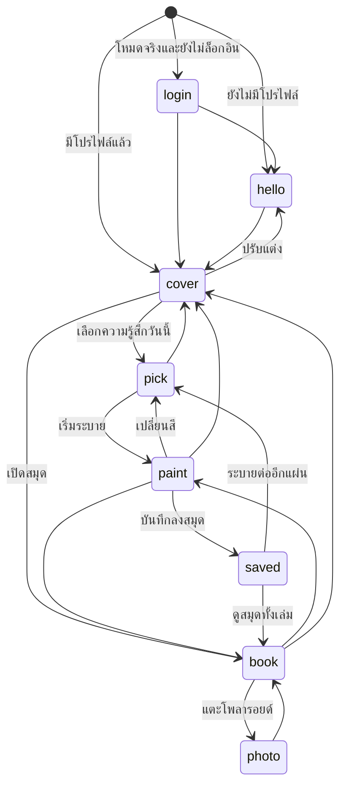
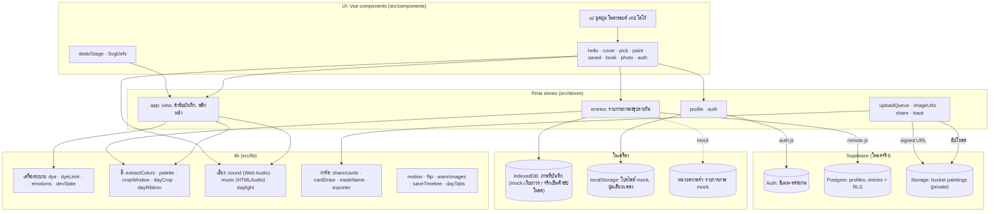
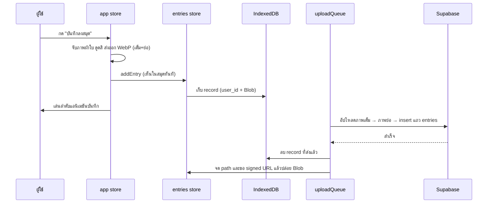

# ColorScrap — คู่มือโปรเจกต์ทั้งเล่ม

> เอกสารฉบับเดียวสำหรับคนที่ไม่เคยเห็นโค้ด: แอปคืออะไร ทำงานอย่างไร ไฟล์ไหนทำอะไร ปรับแต่งตรงไหน ใช้เทคโนโลยีอะไร
> ทุกข้อมูลตรวจกับโค้ดและ `package.json` จริง ส่วนที่ยืนยันจากโค้ดไม่ได้ติดป้าย **(ต้องยืนยัน)**
> เอกสารเชิงลึกอื่น: [SPEC.md](SPEC.md) (สเปกดีไซน์/พฤติกรรม) · [ROADMAP.md](ROADMAP.md) (ประวัติงานรายข้อ) · [DEPLOY.md](DEPLOY.md) (ขั้นตอน deploy) · [CHANGELOG.md](CHANGELOG.md) (สรุปสิ่งที่เปลี่ยน) · [CLAUDE.md](../CLAUDE.md) (กติกาและข้อควรระวังสำหรับคนที่แก้โค้ดด้วย Claude Code)

## สารบัญ

1. [ภาพรวม](#1-ภาพรวม)
2. [เส้นทางผู้ใช้ทีละหน้า](#2-เส้นทางผู้ใช้ทีละหน้า)
3. [แผนผังสถาปัตยกรรม](#3-แผนผังสถาปัตยกรรม)
4. [ระบบหลักเชิงลึก](#4-ระบบหลักเชิงลึก)
5. [แผนที่ไฟล์](#5-แผนที่ไฟล์)
6. [จุดปรับแต่งเอง](#6-จุดปรับแต่งเอง)
7. [เทคโนโลยีที่ใช้](#7-เทคโนโลยีที่ใช้)
8. [ความปลอดภัยและความเป็นส่วนตัว](#8-ความปลอดภัยและความเป็นส่วนตัว)
9. [การรัน ทดสอบ และ deploy](#9-การรัน-ทดสอบ-และ-deploy)
10. [ข้อจำกัดที่รู้อยู่และงานที่ยังไม่ได้ทำ](#10-ข้อจำกัดที่รู้อยู่และงานที่ยังไม่ได้ทำ)

---

## 1. ภาพรวม

ColorScrap คือ **สมุดระบายความรู้สึกด้วยสีน้ำ** ที่ทำงานในเบราว์เซอร์ (ออกแบบให้ใช้บน iPad แนวนอน และ Mac/PC ด้วยเมาส์) โปรเจกต์วิชา AI ของมหาวิทยาลัย

- ผู้ใช้เลือกอารมณ์ (8 แบบ) กับระดับความเข้ม แล้ว **ระบายสีน้ำที่ไหลได้จริง** บนผ้าใบ (หยดสี ปาดสี และสำหรับอารมณ์ลบมี "เติมสีสดใส")
- กด "บันทึกลงสมุด": ภาพถูกแปะเป็นโพลารอยด์ในสมุด แอปดูดสีจากภาพ แล้วผสมเป็น **สีของวัน** พร้อมชื่อสีภาษาไทย (เช่น "ฟ้าอมม่วง ยามค่ำ")
- เปิดสมุดย้อนดูได้ไม่จำกัดวัน (พลิกหน้า 3 มิติ แท็บวัน ปฏิทิน) ดูจานสีของแต่ละวัน และเก็บเป็นรูปการ์ด PNG ไปแชร์ได้ (สร้างในเครื่อง ไม่ส่งภาพไปที่ไหน)
- มีเสียงเอฟเฟกต์สังเคราะห์ เพลงคลอกลางวัน/กลางคืน และ UI ภาษาไทยทั้งหมด
- ข้อมูลเก็บได้ 2 โหมด: **mock** (ในเครื่อง ไม่ต้องล็อกอิน ใช้ตอนพัฒนา/สาธิต) และ **โหมดจริง** (ล็อกอินด้วยอีเมล + รหัสผ่านผ่าน Supabase ภาพเก็บเป็นส่วนตัวต่อบัญชี)

---

## 2. เส้นทางผู้ใช้ทีละหน้า

แอปเป็น **โต๊ะเดียว** ขนาดคงที่ 1280×800 ที่ย่อ/ขยายพอดีจอ ([Stage.vue](../src/components/desk/Stage.vue)) ไม่มี router: "หน้า" คือค่า `view` ใน store [stores/app.js](../src/stores/app.js) (`login | hello | cover | pick | paint | saved | book | photo`) และเปลี่ยนได้เฉพาะตามตารางที่อนุญาต (`ALLOWED`) สมุด กระดานวาด และกล่องสีเป็นวัตถุเดียวบนโต๊ะที่ย้าย/จางตาม view ไม่ถูกถอดทิ้ง ส่วน URL ผูกกับ `#hash` ([lib/useHashView.js](../src/lib/useHashView.js)) เพื่อให้ปุ่ม Back ของเบราว์เซอร์ใช้ได้ (`#saved` เปิดจาก URL ไม่ได้ตั้งใจ)

ลำดับบูตตอนเปิดแอป ([main.js](../src/main.js), `app.boot`): รอโหลดบัญชี (โหมดจริง) โปรไฟล์ และสมุดให้เสร็จก่อน mount → ยังไม่ล็อกอินไป `login` / ไม่มีโปรไฟล์ไป `hello` / อื่น ๆ ไป `cover` (ถ้า `#hash` ที่ใช้ได้ระบุหน้าอื่น จะเปิดหน้านั้น)

### 2.1 หน้า login — เข้าสู่ระบบ (เฉพาะโหมดจริง)

- **บนจอ:** กระดาษใบเดียวสไตล์เดียวกับหน้าตั้งชื่อ ช่องอีเมล + รหัสผ่าน ปุ่มเข้าสู่ระบบ และสมัครใหม่ ข้อความ error เป็นภาษาไทย ("อีเมลหรือรหัสผ่านไม่ถูกต้อง" ฯลฯ)
- **คอมโพเนนต์:** [LoginCard.vue](../src/components/auth/LoginCard.vue) · ถ้ามีภาพเก่าในเครื่องจากก่อนมีบัญชี [LegacyPrompt.vue](../src/components/auth/LegacyPrompt.vue) จะถามก่อนย้ายเข้าบัญชีนี้ (ไม่ย้ายเงียบ ๆ เพราะเครื่องเดียวอาจมีหลายคน)
- **store/lib:** [stores/auth.js](../src/stores/auth.js) (`signIn`, `signUp`, `signOut`, แปลง error), [lib/supabase.js](../src/lib/supabase.js)
- **ข้อมูล:** อ่าน/เขียน session ของ Supabase Auth · หลังเข้าได้ไป `cover` (มีโปรไฟล์) หรือ `hello` (ยังไม่มี) · ออกจากระบบหรือ session หมด → ตัวเฝ้าใน [App.vue](../src/App.vue) ล้างสถานะผู้ใช้คนก่อนทั้งหมด (`app.resetSession`, โปรไฟล์, รายการภาพ) แล้วกลับ `login`

### 2.2 หน้า hello — ตั้งชื่อและปรับแต่งสมุด

- **บนจอ:** ซ้าย กระดาษหน้าแรกของสมุด: ชื่อที่อยากให้เรียก (1–20 ตัวอักษร) · ตัวแทน 8 แบบ · สีปก 4 สี · "สิ่งที่ทำให้ใจฟู" เลือกได้สูงสุด 3 จาก 8 · ขวา ตัวอย่างปกที่เปลี่ยนตามที่เลือกทันที กับปุ่ม "เริ่มใช้สมุด" (หรือ "บันทึก" ถ้ามาจากปุ่มปรับแต่ง) ที่กดไม่ได้จนมีชื่อ · โหมดแก้ไข + โหมดจริงมีกลุ่มบัญชีท้ายคอลัมน์ขวา (อีเมล ออกจากระบบ ลบข้อมูลทั้งหมดซึ่งต้องกดซ้ำภายใน 3 วินาที)
- **คอมโพเนนต์:** [HelloSheet.vue](../src/components/hello/HelloSheet.vue), [CoverPreview.vue](../src/components/hello/CoverPreview.vue), [AccountActions.vue](../src/components/hello/AccountActions.vue), [BookCover.vue](../src/components/book/BookCover.vue) (ตัวปก)
- **store/lib:** [stores/profile.js](../src/stores/profile.js), [lib/likes.js](../src/lib/likes.js), [lib/doodles.js](../src/lib/doodles.js) (ตัวแทน), [lib/tokens.js](../src/lib/tokens.js) (`COVER_COLORS`), [lib/color.js](../src/lib/color.js) (คำนวณสันและสายรัดของปก)
- **ข้อมูล:** เขียนโปรไฟล์ — mock: `localStorage['colorscrap.profile']` · จริง: ตาราง `profiles` (`display_name 1–20`, `avatar`, `cover_color`, `likes`) · ลบข้อมูลทั้งหมด: ลบไฟล์ภาพทั้งโฟลเดอร์ผู้ใช้ → แถว `entries` → แถว `profiles` (บัญชี auth ยังอยู่)

### 2.3 หน้า cover — หน้าแรก

- **บนจอ:** สมุดปิดทางซ้าย คำทักทายตามเวลา (เช้า/บ่าย/เย็น/"ดึกแล้วนะ") ข้อความชวนระบาย ปุ่ม "เลือกความรู้สึกวันนี้", "เปิดสมุด", ปุ่ม "ปรับแต่ง" มุมขวาบน และแถบ 7 วันล่าสุด (ก้อนสีเด่นของวันที่มีบันทึก) แท็บคั่นหน้าบนปก 3 วันล่าสุดที่มีภาพ
- **คอมโพเนนต์:** [CoverIntro.vue](../src/components/cover/CoverIntro.vue), [WeekStrip.vue](../src/components/cover/WeekStrip.vue), [Scrapbook.vue](../src/components/book/Scrapbook.vue) (ตัวสมุด), [SoundToggle.vue](../src/components/ui/SoundToggle.vue) (ปุ่มเสียง/เพลง)
- **store/lib:** `entries.lastSevenDays`, `entries.recentTabs`, [lib/dates.js](../src/lib/dates.js) (`greetingFor`), [lib/daylight.js](../src/lib/daylight.js) (`greetingHour`)
- **ข้อมูล:** อ่านอย่างเดียว (สีเด่นของวันจากรายการภาพที่โหลดแล้ว)

### 2.4 หน้า pick — เลือกอารมณ์ (จุ่มพู่กัน)

- **บนจอ:** กล่องสีน้ำการ์ด 8 อารมณ์ พู่กันตัวใหญ่เลื่อนไปการ์ดที่แตะ ยกขึ้น จุ่มลงน้ำ ปลายขนเปลี่ยนเป็นสีอารมณ์ มีวงน้ำ เสียงน้ำกระฉอก · เลือกความเข้ม 3 ระดับ (นิดหน่อย/พอประมาณ/มากเลย) · ปุ่ม "เริ่มระบาย" · ถ้าผ้าใบยังมีภาพค้างจะถามว่า "ระบายต่อแผ่นเดิม" หรือ "เริ่มแผ่นใหม่"
- **คอมโพเนนต์:** [EmotionPalette.vue](../src/components/pick/EmotionPalette.vue), [PickBrush.vue](../src/components/pick/PickBrush.vue), [EmotionBlob.vue](../src/components/ui/EmotionBlob.vue)
- **store/lib:** `app.selection`, `app.beginPaint / continueSheet / newSheet`, [lib/emotions.js](../src/lib/emotions.js), [lib/sound.js](../src/lib/sound.js) (เสียงจุ่ม)
- **ข้อมูล:** เขียนแค่สถานะชั่วคราว (`app.selection` = อารมณ์ + ความเข้ม)

### 2.5 หน้า paint — ระบาย (หยดสี / เติมสีสดใส)

- **บนจอ:** กระดาษผ้าใบ 1112×612 เต็มโต๊ะ เข้าหน้ามาแล้วหยดสีของอารมณ์สาดลงภายใน 1 วินาทีตามรูปแบบของอารมณ์นั้น · การ์ดอารมณ์พับเก็บเป็นแถบเล็กที่ขอบขวาเมื่อเริ่มแตะผ้าใบ · ถาดเครื่องมือ: **ปาดสี** (ลากนิ้ว/เมาส์กวนสี) **หยดสี** (แตะ/กดค้างให้หยด) **เติมสีสดใส** (โผล่เฉพาะเมื่ออารมณ์ล่าสุดของแผ่นเป็นอารมณ์ลบ: เศร้า โกรธ กังวล เหนื่อย; หยดสีอุ่นบานออกอย่างนุ่มนวล ผู้ใช้เลือกเอง ไม่ทำอัตโนมัติ) **เริ่มใหม่** (กดซ้ำภายใน 3 วินาทีถึงล้างจริง) **บันทึกลงสมุด** · มีโน้ตชวนลอง "เติมสีสดใส" ครั้งเดียวต่อแผ่น (โผล่เมื่อแตะครั้งแรกมาครบ 10 วินาทีและพักมือ 1.5 วินาที) · สีแห้งเองหลังปล่อยมือราว 10 วินาที
- **คอมโพเนนต์:** [DrawingBoard.vue](../src/components/paint/DrawingBoard.vue), [FluidCanvas.vue](../src/components/paint/FluidCanvas.vue), [MoodCard.vue](../src/components/paint/MoodCard.vue), [ToolTray.vue](../src/components/paint/ToolTray.vue), [WarmNote.vue](../src/components/paint/WarmNote.vue), [WarmDrop.vue](../src/components/paint/WarmDrop.vue)
- **lib:** [lib/dye.js](../src/lib/dye.js), [lib/dyeLimit.js](../src/lib/dyeLimit.js), [lib/emotions.js](../src/lib/emotions.js) (ค่าน้ำไหลต่ออารมณ์), [lib/devState.js](../src/lib/devState.js) (ค่าเติมสีสดใส), [lib/cursors.js](../src/lib/cursors.js) (เคอร์เซอร์วาดมือเฉพาะเมาส์), [lib/sound.js](../src/lib/sound.js)
- **ข้อมูล:** เขียนสถานะบนผ้าใบ (ในหน่วยความจำ GPU) · `app.sheetEmotions` (อารมณ์ที่หยดลงแผ่นนี้ตามลำดับ) · `app.sheetShifted` (เคยเติมสีสดใสหรือยัง)

### 2.6 บันทึก — ลำดับแอนิเมชันและการเก็บภาพ

- **บนจอ (~1.6 วินาที):** ผ้าใบหดเป็นโพลารอยด์ → สมุดเลื่อนเข้าและซูมที่หน้าซ้าย → (ถ้าวันนั้นเต็ม 4 ภาพ แผ่นแทรกใหม่พลิกลงมาก่อน) → ภาพลอยลงช่องเส้นประ → เทปแปะ → การ์ดหลังบันทึกโผล่บนหน้าขวา · เพลงลดเสียงครึ่งหนึ่งระหว่างนี้ · ระหว่างลำดับ ปุ่มที่ทำให้สถานะพังกดไม่ได้
- **โค้ด:** `app.saveToBook` (จับภาพผ้าใบในเฟรมของ requestAnimationFrame) → [lib/extractColors.js](../src/lib/extractColors.js) (ดูดสี) → [lib/exportImage.js](../src/lib/exportImage.js) (ภาพเต็ม 1600 px + ภาพย่อ 480 px เป็น WebP ถ้าเข้ารหัสไม่ได้ใช้ JPEG) → `entries.addEntry` → `runSaveSequence` ขับเฟสตาม [lib/saveTimeline.js](../src/lib/saveTimeline.js) · [SavedFlight.vue](../src/components/saved/SavedFlight.vue) เล่นโพลารอยด์บิน
- **ข้อมูลเขียน:** ใส่รายการภาพลงสมุดทันที (id เป็น uuid, สี, ภาพเป็น Blob) → โหมดจริง: เก็บลง IndexedDB ก่อน (เห็นในสมุดทันทีไม่รอเครือข่าย) แล้วคิวอัปโหลดส่งภาพเต็ม → ภาพย่อ → แถว `entries` ขึ้น Supabase, mock: เก็บลง IndexedDB เป็นที่เก็บถาวร (ไม่อัปโหลด) และโหลดกลับมาตอนเปิดแอป ส่วนรายการตัวอย่าง ~45 วันสร้างในหน่วยความจำใหม่ทุกครั้ง

### 2.7 หน้า saved — การ์ดหลังบันทึก และการเก็บรูป (ดาวน์โหลด)

- **บนจอ:** สมุดเปิดซูม การ์ดอยู่ในหน้าขวา 4 ส่วน: "แปะลงสมุดแล้ว" · "สีในภาพนี้" (ชิปสีที่ดูดได้) · สีของวัน (แถบสีปาดช่วงสุดท้ายและก้อนสีค่อย ๆ เปลี่ยนที่ ~1.5 วินาที ชื่อเก่าเทาขีดฆ่า ถ้าชื่อสีไม่เปลี่ยนจะแสดง "สีของวันนี้ยังคงเดิม" แทน) · ปุ่ม "ดูสมุดทั้งเล่ม" / "ระบายต่ออีกแผ่น"
- **คอมโพเนนต์:** [SavedCard.vue](../src/components/saved/SavedCard.vue), [DayRibbon.vue](../src/components/book/DayRibbon.vue), [WatercolorBlob.vue](../src/components/ui/WatercolorBlob.vue)
- **การเก็บรูปเป็นไฟล์ (ไม่ได้อยู่ที่การ์ดนี้ แต่ที่หน้าดูภาพเดี่ยวและจานสี):** ปุ่ม "เก็บรูปไว้" ใน [PhotoView.vue](../src/components/photo/PhotoView.vue) (การ์ดภาพพร้อมชาร์ตสี หรือภาพเปล่า) และปุ่ม "เก็บรูป" ใน [DailyPalette.vue](../src/components/book/DailyPalette.vue) (การ์ดของวัน) → [stores/share.js](../src/stores/share.js) → [lib/share/](../src/lib/share) วาด PNG 1080×1350 ด้วย Canvas 2D ในเครื่อง → iPad เปิดหน้าแชร์ของระบบ เครื่องอื่นดาวน์โหลดเป็นไฟล์ ชื่อไฟล์ใช้วัน/เวลาของภาพ ชื่อผู้ใช้บนการ์ดถูกปิดบัง (`ส••จ`)
- **ข้อมูล:** อ่านรายการภาพกับภาพจาก Storage (signed URL) เท่านั้น ไม่อัปโหลดอะไรขึ้นไป

### 2.8 หน้า book — สมุด (พลิกหน้า แท็บวัน ปฏิทิน)

- **บนจอ:** สมุดเปิดเต็มเล่ม ซ้าย = หน้าภาพของวัน (แผ่นละ 4 โพลารอยด์ เอียงสุ่มคงที่ตาม id; วันที่มีเกิน 4 ภาพจะมีแผ่นแทรกเลื่อนด้วย "แผ่น n / N") ขวา = จานสีของวัน · **แท็บวัน 4 แท็บ** เหนือสมุด เลื่อนเป็นหน้าต่างรอบวันที่เปิด นับเฉพาะวันที่มีภาพ (เปิดวันนี้ = วันนี้อยู่ขวาสุด) · **แท็บ "ปฏิทิน"** ต่อท้าย: ปฏิทินเดือน (เลื่อนได้ตั้งแต่เดือนของภาพแรกถึงเดือนปัจจุบัน จุดสี = สีเด่นของวัน วันที่ไม่มีภาพกดไม่ได้ วันนี้มีวง) กดวันแล้วพลิกไปวันนั้นครั้งเดียว · ปุ่มวันก่อนหน้า/ถัดไป (แสดงเป็นวันที่) ท้ายหน้าขวา · แถบซ้าย 92 px ของกระดานวาด กดกลับไประบายได้ · แตะโพลารอยด์ → ดูภาพเดี่ยว
- **คอมโพเนนต์:** [OpenBook.vue](../src/components/book/OpenBook.vue), [PhotoPage.vue](../src/components/book/PhotoPage.vue), [PhotoSlot.vue](../src/components/book/PhotoSlot.vue), [LeafPager.vue](../src/components/book/LeafPager.vue), [DateTabs.vue](../src/components/book/DateTabs.vue), [CalendarPanel.vue](../src/components/book/CalendarPanel.vue), [DailyPalette.vue](../src/components/book/DailyPalette.vue), [CoverFlip.vue](../src/components/book/CoverFlip.vue)
- **store/lib:** `app.turnToDay`, `app.pageTurn`, `entries.dates / dayHex / ensureDay`, [lib/dayTabs.js](../src/lib/dayTabs.js), [lib/warmImages.js](../src/lib/warmImages.js), [lib/dayCrop.js](../src/lib/dayCrop.js)
- **ข้อมูล:** อ่านสรุปรายวันทั้งสมุด (เบา) + รายละเอียดเต็มของวันที่เปิดและวันข้างเคียง (โหลดตามที่ต้องใช้) · ไม่เขียนอะไร (เว้นแต่เปลี่ยนวัน/แผ่นที่เปิดอยู่ ซึ่งเป็นสถานะชั่วคราว)

### 2.9 จานสีของวัน (หน้าขวาของสมุด)

- **บนจอ:** หัวข้อ "จานสีของวันนี้/ของ {วัน}" · กรอบโพลารอยด์ "สีของวัน": ชิ้นที่ครอปจากภาพที่ระบายจริงของวันนั้น + ชื่อสี 2 บรรทัด (เช่น "ฟ้าอมม่วง / ยามค่ำ") · แถบสีไล่ตามเวลาเป็นรอยพู่กันเส้นเดียว ป้ายเวลา/อารมณ์ใต้แถบ · ประโยคสรุป และรายการอารมณ์ของวัน · ปุ่ม "เก็บรูป" (การ์ดของวัน)
- **คอมโพเนนต์:** [DailyPalette.vue](../src/components/book/DailyPalette.vue), [DayRibbon.vue](../src/components/book/DayRibbon.vue), [PolaroidFrame.vue](../src/components/ui/PolaroidFrame.vue), [RevealImg.vue](../src/components/ui/RevealImg.vue)
- **lib:** [lib/palette.js](../src/lib/palette.js) (ผสมสี ตั้งชื่อ), [lib/dayCrop.js](../src/lib/dayCrop.js) + [lib/cropWindow.js](../src/lib/cropWindow.js) (ครอปชิ้นสี), [lib/dayRibbon.js](../src/lib/dayRibbon.js) (เรขาคณิตแถบสี)
- **ข้อมูล:** อ่านสีของภาพทุกใบของวัน (`entries.colors`) ไม่เขียน

### 2.10 หน้า photo — ดูภาพเดี่ยว

- **บนจอ:** พื้นโต๊ะทึบ 85% ทับทั้งจอ โพลารอยด์บินขยายจากตำแหน่งในสมุดมากลางโต๊ะ พร้อมการ์ดชาร์ตสี (ภาพย่อขึ้นก่อน ภาพเต็มตามมา) ภาพพลิ้วเบา ๆ ราว 3 วินาทีเหมือนสียังเปียก ปุ่ม "ปิด" และ "เก็บรูปไว้"
- **คอมโพเนนต์:** [PhotoView.vue](../src/components/photo/PhotoView.vue) · **lib:** [lib/flip.js](../src/lib/flip.js) (ท่าบิน), [lib/wetPhoto.js](../src/lib/wetPhoto.js) + [lib/wetCurve.js](../src/lib/wetCurve.js)
- **ข้อมูล:** อ่านภาพเต็มจาก Storage (signed URL) หรือจาก Blob ในเครื่อง

---

## 3. แผนผังสถาปัตยกรรม

แอปแบ่ง 4 ชั้น: **คอมโพเนนต์ Vue** (หน้าตาและการแตะ) → **Pinia stores** (สถานะและกติกา) → **lib** (ตรรกะล้วน เครื่องวาดน้ำ สี เสียง การ์ด) → **ที่เก็บข้อมูล** (ในเครื่อง หรือ Supabase)

โหมด **mock** (`VITE_USE_MOCK=true`, ตั้งไว้ใน `.env` สำหรับ dev): ไม่มีเครือข่าย ไม่มีหน้า login โปรไฟล์อยู่ใน localStorage รายการภาพตัวอย่างสร้างในหน่วยความจำ (~45 วันย้อนหลัง มีวันว่างปน) ภาพที่ผู้ใช้บันทึกเองเก็บใน IndexedDB · โหมดจริง (`.env.production` ตั้ง `false`; ถ้าไม่ตั้งตัวแปรเลยถือเป็นโหมดจริง กันลืมตั้งตอน deploy) ใช้ Supabase ทั้งหมดและภาพที่ยังไม่อัปโหลดรออยู่ใน IndexedDB

ลำดับของการบันทึกภาพ (โหมดจริง) แสดงด้านล่าง การอัปโหลดทำซ้ำได้อย่างปลอดภัย (path คงที่ + upsert, แถวซ้ำถือว่าสำเร็จ) และพลาดแล้วลองใหม่เองเมื่อกลับมาออนไลน์:

---

## 4. ระบบหลักเชิงลึก

### 4.1 เครื่องระบายสีน้ำ

**ใช้อะไร:** ไลบรารี [webgl-fluid-enhanced](https://www.npmjs.com/package/webgl-fluid-enhanced) v0.8 (จำลองน้ำไหลบนการ์ดจอด้วย WebGL) ห่อโดย [FluidCanvas.vue](../src/components/paint/FluidCanvas.vue) ผ้าใบขนาดคงที่ 1112×612 บนโต๊ะ 1280×800 ไลบรารีเปิดให้ใช้แค่ `start / stop / setConfig / multipleSplats / splatAtLocation` โค้ดส่วนที่เหลือจึงเป็นของโปรเจกต์เอง

**หลักการที่ควรรู้**
- **สีเป็น "สีลบ":** ไลบรารีเก็บสีเป็นแสงบวก ผ้าใบจึงถูกกลับสีด้วย CSS (`invert(1)`) พื้นเป็นสีกระดาษที่กลับแล้ว ดังนั้นทุกครั้งที่อ่านภาพจากผ้าใบ (บันทึก ดูดสี) ต้องกลับสีกลับก่อน ([lib/dye.js](../src/lib/dye.js) แปลงสีเป้าหมายเป็นค่าที่ไลบรารีเข้าใจ) ความเข้มต่ออารมณ์ (`brightness`) จูนจนสีบนผ้าใบใกล้สีอารมณ์ที่กำหนด
- **ตัวน้ำไหลเก็บในตัวแปรธรรมดา (`let`) ห้ามห่อด้วย `ref()`/`reactive()`** เพราะ Proxy ของ Vue รบกวน WebGL
- **อินพุต:** ผ้าใบมีแผ่นโปร่งใสวางทับรับ Pointer Events เอง (ไม่ใช้การจัดการเมาส์/ทัชของไลบรารี เพราะพิกัดผิดเมื่อโต๊ะถูกย่อ) ปาดสีผลักน้ำอย่างเดียว หยดสีผลักน้ำและลงสี กดค้างเกิน 400 ms = หยดต่อเนื่อง
- **สีน้ำที่แห้งเอง:** หลังปล่อยมือ น้ำไหลตามค่าของอารมณ์ 2.5 วินาที จากนั้นหน่วงความเร็วน้ำเพิ่มและลดการหมุนวนจนสงบที่ 10 วินาที (นับด้วยเวลาที่จำลองจริง ไม่ใช่นาฬิกา เครื่องที่เฟรมตกจึงไม่แห้งก่อนน้ำไหลถึง) **ปริมาณสี (density) ไม่ถูกแตะเลย** (`DENSITY_DISSIPATION` ต้องเป็น 0 พอดี ค่าเล็ก ๆ ทำให้สีจางหายใน ~1 นาทีเพราะบัฟเฟอร์เป็น half float) เมื่อน้ำนิ่งพอ การจำลองหยุดเองเพื่อประหยัดแบตเตอรี่ (เกณฑ์ `STILL_SPEED`)
- **กันสีดำที่ GPU:** สีถูกเติมด้วย shader ของโปรเจกต์ที่อ่านสีเดิมของพิกเซลแล้วเติมเท่าที่ไม่ทะลุ 2 เงื่อนไข: ช่องสีสูงสุดไม่เกิน `cap` 0.85 และความสว่างที่เห็นไม่ต่ำกว่า `minLight` 0.3 (เข้าใกล้เพดานแบบนุ่มนวลเหนือ `knee` 0.8) ระบายซ้ำกี่ครั้งสีที่ตรงข้ามกันก็ไม่ผสมเป็นดำหรือเทาตาย ตรรกะเดียวกันมีต้นแบบ JS ที่ทดสอบได้ใน [lib/dyeLimit.js](../src/lib/dyeLimit.js) ถ้าสร้าง shader ตัวนี้ไม่ได้ผ้าใบจะ **ไม่ลงสีเลย** (ไม่มีทางถอย ดู [ข้อจำกัด](#10-ข้อจำกัดที่รู้อยู่และงานที่ยังไม่ได้ทำ))
- **สาดตอนเข้าหน้า:** จำนวน/ขนาด/การกระจายของหยดเริ่มต้น = `INITIAL_SPLATS` ของอารมณ์ × `SPLASH_LEVELS` ของความเข้ม × ตัวคูณ `splash` ต่ออารมณ์ ทยอยลงภายใน 1 วินาที (ลดการเคลื่อนไหว: ลงพร้อมกันแล้วค่อยจางเข้า)
- **เติมสีสดใส (เฉพาะอารมณ์ลบ):** ทุกหยดใช้สีอุ่นสีเดียวต่ออารมณ์ (`WARM_TONES`) เปลี่ยนเฉดอ่อน/ปกติ/เข้มวนทีละหยด **ทำเป็น "บาน" ไม่ใช่ประทับ:** ตอนแตะ น้ำดันสีเดิมออกเป็นวงขอบเข้ม ยกสีเดิมกลางวงให้จาง แล้วสีใหม่ค่อยเบ่งบานตรงกลางตามเส้นโค้งเดียวที่คำนวณจากเวลาจริง (3 วินาที ขึ้นสูงสุดที่ ~250 ms แล้วลดลง) กดค้างใช้เส้นโค้งสั้น 900 ms ซ้ำทุก ~700 ms ปุ่ม "ลองดู" ในโน้ตชวนหยดตัวอย่าง 4 จุดรอบขอบกระดาษ ค่าทั้งหมดอยู่ใน [lib/devState.js](../src/lib/devState.js) (ปรับสดได้ด้วย `?debug`) และค่าคงที่ใน FluidCanvas
- **ล้างผ้าใบ:** ไม่มี API ล้าง จึงตั้ง dissipation สูงมากชั่วคราว 8 เฟรม (การสร้างอินสแตนซ์ใหม่ทำให้ FBO รั่ว)
- **จับภาพ:** ต้องทำในเฟรมของ `requestAnimationFrame` (ไม่ได้เปิด `preserveDrawingBuffer`) แล้วกลับสีกลับ

ค่าของแต่ละอารมณ์ (`brightness`, `speed`, `curl`, `velDiss`, `radius`, `splash`, `pattern`) อยู่ที่ `FLUID_PARAMS` ใน [lib/emotions.js](../src/lib/emotions.js) รูปแบบการสาด: `burst` กระจายรอบทิศ · `drift` ไหลช้า · `fall` ไหลลง · `pulse` พุ่งเป็นจังหวะ · `scatter` จุดเล็กทั่วกระดาษ · `still` แทบนิ่ง ตัววัดสีบนผ้าใบสำหรับจูน: [src/dev/fluidMetrics.js](../src/dev/fluidMetrics.js) + [scripts/measure-fluid.mjs](../scripts/measure-fluid.mjs)

### 4.2 การคำนวณสีและชื่อสี

**ดูดสีจากภาพ** ([lib/extractColors.js](../src/lib/extractColors.js)): ย่อภาพให้ด้านยาว 200 px ทำให้พิกเซลที่ใกล้สีกระดาษ (ระยะ RGB < 28) โปร่งใส ให้ไลบรารี `colorthief` หาจาน 8 สี แล้วนับพิกเซลของภาพจริงเข้าหาสีที่ใกล้ที่สุด เก็บสูงสุด 5 สี เป็น `[{ hex, ratio }]` ที่รวมเป็น 1 (ถ้าไม่มีสีเลยใช้สีอารมณ์ ratio 1) ผลนี้บันทึกกับภาพแต่ละใบ

**สีของวัน** ([lib/palette.js](../src/lib/palette.js), SPEC §8)
1. น้ำหนักภาพ = `0.75 + 0.25 × ความเข้ม (0–2)` · น้ำหนักสี = `ratio × น้ำหนักภาพ`
2. **สีผสม:** ผสมใน HSL — hue เป็นค่าเฉลี่ยแบบวงกลมถ่วงน้ำหนัก (ไม่นับสีที่ซีด saturation ≤ 0.15) ส่วน saturation/lightness เป็นค่าเฉลี่ยถ่วงน้ำหนัก
3. **สีเด่น** (ใช้กับแท็บ ปฏิทิน แถบ 7 วัน): สีที่ใกล้กัน (RGB < 40) รวมกลุ่ม แล้วเลือกกลุ่มที่ "น้ำหนัก × ความอิ่มสี" สูงสุด (สีจางของน้ำซึมจึงไม่ชนะสีของหยดจริง) เท่ากันใช้ของภาพล่าสุด
4. **ชื่อสี** = กลุ่มสีจาก hue (แดง ส้ม เหลือง เขียว ฟ้า น้ำเงิน ม่วง ชมพู หรือ เทา) + ตัวขยาย + ช่วงเวลาของภาพล่าสุด: ตัวขยายใช้ข้อแรกที่ตรง — "อม…" ตามกลุ่มสีรองที่หนักสุด · "หม่น" · "ครึ้ม" · "อ่อน" · "สด" · ช่วงเวลา ยามเช้า (05–11) เที่ยงวัน (11–14) ยามบ่าย (14–17) ยามเย็น (17–19) ยามค่ำ (19–24) กลางดึก (00–05) ผลจาก SPEC §8.1/§8.2 มีตัวอย่างเป็นเทสต์ใน [palette.test.js](../src/lib/palette.test.js) **ห้ามแก้ตัวอย่างให้เทสต์ผ่าน** ถ้าสูตรไม่ตรงตัวอย่างต้องตัดสินใจเรื่องดีไซน์ก่อน

**ชิ้นสีของวัน (ครอป)** ([lib/dayCrop.js](../src/lib/dayCrop.js), [lib/cropWindow.js](../src/lib/cropWindow.js))
- ทางหลัก: ใช้สีผสมของวันเป็นเป้า (ในปริภูมิ OKLab ที่ใกล้ตาเห็น) เลื่อนหน้าต่างสี่เหลี่ยมจัตุรัส (50% ของด้านสั้น) ค้นภาพย่อ ~128 px ของ **ทุกภาพในวัน** ให้คะแนนต่อพิกเซลด้วย `exp(−ΔE²/σ²)` (σ = 0.09) ไม่นับพิกเซลที่ใกล้สีกระดาษ เลือกภาพ+ตำแหน่งที่ได้คะแนนเฉลี่ยสูงสุด แล้วครอปจากภาพเต็ม (ออกมา 480 px)
- ทางสำรอง: ถ้าคะแนนเฉลี่ยต่ำกว่า `MIN_MATCH` (0.065 = ไม่มีภาพที่มีสีนี้จริง) ใช้ภาพต้นทางที่ถูกใจก่อน ไม่งั้นภาพล่าสุด ครอปส่วนที่ห่างกระดาษที่สุด แล้ว **ตั้งชื่อสีใหม่จากชิ้นที่ครอป** (หน้าการ์ดหลังบันทึกจึงแสดง "ชื่อเปลี่ยน" ได้)
- ผลเก็บในหน่วยความจำต่อวัน (อ่านซ้ำแบบ sync ไม่กะพริบ) และใช้ผลเดียวกันทั้งหน้าจานสีกับการ์ดเก็บรูปของวัน

### 4.3 เสียงและเพลง

**เอฟเฟกต์** ([lib/sound.js](../src/lib/sound.js)): สังเคราะห์สดด้วย Web Audio ทั้งหมด (หยด ปาด สาด เติมสีสดใสเป็นเสียงระฆังแก้ว 2–4 โน้ต พู่กันจุ่มน้ำ ยกกระดาษ เทป พลิกแผ่น โน้ต แตะปุ่ม) ปรับโทนตามอารมณ์ (อารมณ์ช้าทุ้มกว่า) เล่นพร้อมกันไม่เกิน 6 เสียง ผ่านคอมเพรสเซอร์และ soft clip ให้ยอด ≤ −1 dBFS
- **ไฟล์เสียงจริง (ไม่บังคับ):** ถ้ามี `src/assets/sfx/<ชื่อ>.mp3` ที่ชื่ออยู่ใน `SFX_NAMES` (`drop smear splash glow dip stroke lift tape cover page note tap`) จะใช้ไฟล์แทนเสียงสังเคราะห์ของเสียงนั้น ต่อท้าย `-1`, `-2` ได้เพื่อสุ่มหลายไฟล์ (รายชื่อไฟล์รู้ตอน build ไม่มีไฟล์ = ไม่มีคำขอเครือข่าย) ตอนนี้มีไฟล์เดียวคือ `dip-1.mp3` (เสียงจุ่มพู่กัน เล่นด้วย playbackRate สุ่ม 0.94–1.06) ที่เหลือสังเคราะห์
- **เปิดเสียงหลังแตะครั้งแรก:** AudioContext ถูกสร้างหลัง pointerdown/touchend/keydown ครั้งแรกเท่านั้น (นโยบาย autoplay) ก่อนหน้านั้นทุกฟังก์ชันเงียบเฉย ๆ ปุ่มเปิด/ปิดเสียงและเพลงแยกกัน จำใน localStorage (`colorscrap.sound`, `colorscrap.music`) ค่าเริ่มต้นเปิดทั้งคู่
- **ปลุกเสียงหลังสลับแอป (iOS/iPadOS):** ซ่อนแท็บ/สลับแอป = suspend เสียง กลับมาแล้วรอแตะ → `resume()` ถ้าไม่ขึ้นภายใน 800 ms (หรือ context ถูกปิด) สร้าง AudioContext ใหม่ต่อกราฟใหม่และให้เพลงเล่นต่อ ([audioResume.test.js](../src/lib/audioResume.test.js) จำลองสถานการณ์นี้) **ยังไม่ได้ลองบนไอแพดจริง**

**เพลงคลอ** ([lib/music.js](../src/lib/music.js)): สตรีมจาก `src/assets/audio/music-day.mp3` และ `music-night.mp3` ด้วย `HTMLAudioElement` (preload ตั้งแต่เปิดหน้า วนซ้ำ) ต่อเข้า Web Audio ผ่าน `MediaElementAudioSourceNode` เพื่อใช้บัส/คอมเพรสเซอร์/ปุ่มปิดเสียงเดียวกับเอฟเฟกต์
- แตะครั้งแรก → `play()` ทันทีในเหตุการณ์นั้น แล้ว fade in 1.5 วินาที (ถ้าเบราว์เซอร์ปฏิเสธ จะเล่นเมื่อแตะครั้งถัดไป) · day = กลางวัน+เย็น (06–19 น.) night = กลางคืน สลับเมื่อช่วงเวลาเปลี่ยน (crossfade 4 วินาที ตรวจทุก 30 วินาที) **ไม่ผูกกับอารมณ์** · ลดเสียงครึ่งหนึ่งระหว่างลำดับบันทึกและตอนเติมสีสดใสบาน · ซ่อนแท็บ = หยุด
- ไฟล์ผ่าน [scripts/make-music.sh](../scripts/make-music.sh) จากต้นฉบับ: ตัดเงียบหัวท้าย crossfade ท้ายเข้าหัวให้วนเนียน เข้ารหัส stereo mp3 112 kbps ชื่อไฟล์มี hash ตอน build (cache ยาว) ถ้า `createMediaElementSource` ใช้ไม่ได้บนเครื่องไหน มีทางสำรองคุมเสียงที่ `element.volume` (ระดับ `DIRECT_VOLUME` **ยังไม่ได้วัดบนอุปกรณ์จริง**)
- `?time=day|dusk|night` บังคับช่วงเวลา มีผลแค่เพลงกับคำทักทายหน้าปก (ฉากโต๊ะเป็นแสงกลางวันคงที่ ไม่มีแสงตามเวลา)

### 4.4 สมุดและการพลิกหน้า

- **สมุดเล่มเดียว** ([Scrapbook.vue](../src/components/book/Scrapbook.vue)) อยู่บนโต๊ะตลอด เคลื่อน/ซูมตาม view: ปกปิด 420×540 (hello/cover) ↔ เปิดเต็มเล่ม 1012×640 (book) ↔ ซูมหน้าซ้าย (saved) การ์ดบันทึก ([SavedCard.vue](../src/components/saved/SavedCard.vue)) วางพิกัดตามการซูมนี้ (หน้าขวา x 622–1188, y 48–752) ถ้าเปลี่ยนค่าซูมต้องแก้พิกัดการ์ดตาม
- **พลิกปก** ([CoverFlip.vue](../src/components/book/CoverFlip.vue)): เฉพาะ หน้าแรก ↔ สมุด ปกหมุนรอบสันซ้ายของหน้าขวา (`rotateY` 0 → −180°, perspective 1800, 1.3 วินาที) ด้วย Web Animations API; ระบาย/บันทึก → สมุด ไม่พลิก สมุดเลื่อนเข้าเฉย ๆ
- **พลิกหน้าตอนเปลี่ยนวัน** ([OpenBook.vue](../src/components/book/OpenBook.vue), 0.8 วินาที) **ทิศทางตายตัว:** วันใหม่กว่า = หน้าขวายกขึ้นแล้วพลิกไปทางซ้าย (rotateY 0 → −180° รอบขอบซ้ายของหน้าขวา) ไปลงบนหน้าซ้าย · วันเก่ากว่า = หน้าซ้ายยกขึ้นแล้วพลิกกลับไปทางขวา (0 → +180°) ไปลงบนหน้าขวา กระโดดข้ามหลายวัน (จากปฏิทิน) ก็พลิกครั้งเดียว
  - **โครงของแผ่น:** ด้านหน้า = สำเนาหน้าเก่า (ตัด `data-entry-id` ออก) ด้านหลัง = สำเนาหน้าใหม่ที่แผ่นจะไปลง ใต้แผ่นฝั่งที่จะลงมีสำเนาหน้าเก่าคงอยู่จนแผ่นลง ข้อมูลจริงเปลี่ยนทันทีตอนกด (อยู่ใต้แผ่น)
  - **ลำดับชั้น:** ชั้นของหน้ามี z-index ในตัว (แผ่นแทรก 1, ปุ่ม 10) แผ่นพลิกจึงตั้ง z-index 31 และสำเนาหน้าเก่า 30 เพื่ออยู่บนสุดของสมุดเสมอทั้งสองทิศ
  - **ลงถึงหน้า (กันกะพริบ):** ห้ามมีเลเยอร์โปร่งใสบางส่วนพร้อมกัน (เคยทำให้เห็นปกสีแดงทะลุเป็นสีชมพูจาง ๆ) จึงสลับแบบทันทีที่ 88% ของเวลา ขณะแผ่นแทบแบนและทึบเต็มที่: หน้าจริงขึ้นเป็น 1 ใต้แผ่น และสำเนาหน้าเก่าหายไป ถ่ายสำเนาหลังแผ่นใหม่ที่ 84% (เก็บของที่มาถึงระหว่างพลิก) แล้วเอาแผ่นออกหลัง `requestAnimationFrame` 2 ครั้ง
  - **เตรียมหน้าปลายทางก่อนพลิก:** แผ่นหยุดคลุมหน้าเก่าก่อน รอสูงสุด 150 ms (`FLIP_WAIT_MS`) ให้ภาพย่อ ชิ้นสีของวัน และ `decode()` ของภาพพร้อม ไม่ทันก็เริ่มพลิกเลย · หลังหน้านิ่ง 300 ms แอปโหลดรายละเอียด+ภาพย่อ+ชิ้นสีของ **วันก่อนหน้า/ถัดไป** ล่วงหน้า ([lib/warmImages.js](../src/lib/warmImages.js) ใช้ URL เดียวกับ `` จริง จึงไม่เพิ่มคำขอ) · รูปที่ยังไม่พร้อมตอนแสดง ([RevealImg.vue](../src/components/ui/RevealImg.vue)): แสดงพื้นกระดาษก่อนแล้วเฟดเข้า 200 ms ส่วนรูปที่พร้อมแล้วไม่เฟด
  - **WebKit (Safari และ Chrome บนไอแพด):** เคยเห็นตัวหนังสือกลับด้านจากด้านหลังแผ่นทะลุตั้งแต่เริ่มพลิก จึงใส่ `-webkit-` ให้ทั้ง `transform-style` และ `backface-visibility` และซ่อนแต่ละด้านของแผ่นด้วย `visibility` ตามมุมโดยตรง (สลับเมื่อแผ่นตั้งฉาก) ไม่พึ่ง `backface-visibility` อย่างเดียว · ค่าคงที่ `FLIP_BACK_MODE` เลือกว่าหลังแผ่นเป็นกระดาษเปล่า (`blank`) สำเนาหน้าใหม่ (`copy`) หรือสำเนาที่ค่อยชัดช่วง 110°→170° (`fade` ค่าตั้งต้น; กระดาษข้างใต้ทึบเสมอ) · **ยังไม่ได้ตรวจบน WebKit จริง**
  - **ลดการเคลื่อนไหว (`prefers-reduced-motion`):** ไม่พลิก เปลี่ยนหน้าด้วยการจาง
- **แผ่นแทรก:** แต่ละวันแผ่นละ 4 ภาพ ภาพที่ 5 ขึ้นไปอยู่แผ่นแทรกซึ่งพลิกขึ้น-ลงรอบเทปด้านบน (rotateX) ไม่ใช่พลิกข้าง
- **แท็บวัน/ปฏิทิน** ([lib/dayTabs.js](../src/lib/dayTabs.js)): หน้าต่าง 4 แท็บเลื่อนรอบวันที่เปิด ไม่ขยับถ้าวันที่เปิดยังอยู่ในนั้น เลื่อนทีละขั้นเมื่อพลิกเกินขอบ และวางเป็นแท็บที่ 2 เมื่อกระโดดไกล ปฏิทินบนจอเล็ก (ย่อ < 0.8 เช่น มือถือ ไอแพดแนวตั้ง) ย้ายไปเป็นแผ่นกลางจอใน body เพราะเวทีถูกย่อและตัดขอบ
- **โหลดข้อมูลตามวัน:** ดู [4.6](#46-บัญชีและข้อมูล) (สรุปรายวันเบา ๆ ทั้งสมุด + รายละเอียดต่อวัน)

### 4.5 การ์ดดาวน์โหลด (เก็บรูป)

โค้ดอยู่ใน [src/lib/share/](../src/lib/share) สร้าง PNG ขนาด **1080×1350 ด้วย Canvas 2D ในเครื่องทั้งหมด** ไม่อัปโหลดอะไร (ไม่ใช้ html-to-image/foreignObject เพราะ Safari ใช้ไม่ได้)

- **สองแบบ:** การ์ดภาพ (ภาพ + ชาร์ตสี หรือภาพเปล่า) และการ์ดของวัน (หัวโลโก้ กรอบสีของวัน แถบสีของวัน โพลารอยด์ 3 ใบ + "+N ภาพ") [cards.js](../src/lib/share/cards.js) ตามแบบ [docs/design/screens/](design/screens) · [exporter.js](../src/lib/share/exporter.js) โหลดภาพของแต่ละรายการ (Blob ในเครื่อง หรือ signed URL → fetch → `createImageBitmap` ไม่ให้ canvas ปนเปื้อน)
- **ฟอนต์:** ใช้ฟอนต์ที่รวมในแอป (ไม่ดึงจาก Google Fonts) และต้องโหลดด้วยข้อความไทยตัวอย่างก่อนวาด (`loadCardFonts`) เพราะฟอนต์แบ่งไฟล์ตามช่วงอักขระ · วางข้อความด้วยการวัดความกว้างเองแล้วคำนวณตำแหน่ง (ไม่พึ่ง `textAlign` ซึ่ง Safari วางต่างกัน)
- **ย่อข้อความให้พอดี** (`fitLines`): ถ้ายาวเกินกรอบ ย่อก่อนถึง 70% ของขนาด ยังไม่พอจึงตัดบรรทัดตามคำ (`Intl.Segmenter`) แล้วตัดด้วย "…" ใช้กับวันที่ ท้ายการ์ด คำบรรยาย ชื่อสี
- **ปิดบังชื่อ** ([maskName.js](../src/lib/share/maskName.js)): ตัวแรก + `•` (จำนวน = ตัวอักษรที่เหลือตรงกลาง สูงสุด 3) + ตัวท้าย นับตาม grapheme ของภาษาไทย สระหน้า (เ แ โ ใ ไ) รวมกับพยัญชนะถัดไปเป็นก้อนแรก เช่น "ไข่หวาน" → "ไข่•••น", "เมย์" → "เม•ย์" จุด `•` วาดเป็นวงกลมเอง ไม่พึ่งฟอนต์
- **ส่งมอบ** ([shareOrDownload.js](../src/lib/share/shareOrDownload.js)): จอสัมผัสที่ `navigator.canShare` รับไฟล์ → Web Share (iPad เปิดหน้าแชร์) ที่เหลือดาวน์โหลด ผลคือ `shared | cancelled | downloaded | blocked` — ถ้าการแชร์หลุดจากจังหวะที่ผู้ใช้กด (ทำรูปนานเกิน) ระบบเก็บไฟล์ไว้และขึ้น toast ปุ่ม "แตะเพื่อบันทึก" ให้แชร์ใหม่ในการแตะใหม่ · ชื่อไฟล์/วันที่ภาษาไทย (พ.ศ.): [fileNames.js](../src/lib/share/fileNames.js), [formatThaiDate.js](../src/lib/share/formatThaiDate.js)
- ภาพตัวอย่างการ์ด: `node scripts/render-cards.mjs` (ต้องมี Playwright) เขียนลง `scripts/out/` (ไม่เข้า git)

### 4.6 บัญชีและข้อมูล

- **Supabase Auth:** อีเมล + รหัสผ่าน (ปิดการยืนยันอีเมลในโปรเจกต์ที่ใช้อยู่ — ถ้ายังเปิดอยู่ สมัครแล้วเข้าไม่ได้ และแอปบอกให้ไปแก้ค่าใน dashboard) แอปใช้ publishable key ฝั่งเว็บเท่านั้น
- **ตาราง (ดู [supabase/schema.sql](../supabase/schema.sql)):** `profiles` (ชื่อ 1–20 ตัว ตัวแทน สีปก ใจฟู) และ `entries` (วัน/เวลาท้องถิ่น อารมณ์ 8 ค่าที่บังคับด้วย check ความเข้ม 0–2 สี 1–5 สี shifted และ path ของภาพเต็ม/ภาพย่อ) เปิด **Row Level Security** ทั้งคู่ ผู้ใช้เห็น/เขียน/แก้/ลบเฉพาะแถวของตัวเอง (policy แยกสี่ตัวต่อตาราง `user_id = auth.uid()`) · ดัชนี `entries_user_date (user_id, local_date, local_time)` รองรับ query ตามช่วงวัน
- **Storage:** bucket `paintings` เป็น **private** (ขนาดไฟล์ ≤ 5 MB, รับ webp/jpeg/png) policy อนุญาตเฉพาะไฟล์ในโฟลเดอร์ `{auth.uid()}/…` path: `{user_id}/{id}.{ext}` และ `{user_id}/{id}_thumb.{ext}` นามสกุลตามชนิดไฟล์จริง
- **แสดงภาพด้วย signed URL:** [stores/imageUrls.js](../src/stores/imageUrls.js) ขอ URL แบบมีอายุ 1 ชั่วโมงทีละชุด เก็บใน cache ต่ออายุเองเมื่อเหลือน้อยกว่า 5 นาที (และตอนกลับมาออนไลน์)
- **โหลดสมุดแบบเบา:** ตอนเปิดแอป ดึง "สรุปรายวัน" ทั้งสมุดครั้งเดียว (เฉพาะวันที่ น้ำหนัก และสี ไม่ใช่ภาพ แบ่งหน้าละ 1,000 แถวเพราะ PostgREST ตัดที่ 1,000) ได้รายการวันที่มีภาพ + สีเด่น แล้วโหลดรายละเอียดเต็มเฉพาะ 7 วันปฏิทินล่าสุด + 3 วันล่าสุดที่มีภาพ ส่วนที่เหลือโหลดเมื่อเปิดวันนั้นหรือวันข้างเคียง ([stores/entries.js](../src/stores/entries.js) `ensureDay`)
- **ภาพที่ยังไม่อัปโหลด:** เก็บใน IndexedDB (ฐาน `colorscrap`, store `entries`, [lib/imageStore.js](../src/lib/imageStore.js)) พร้อม `user_id` ผู้ใช้คนอื่นบนเครื่องเดียวกันไม่เห็น [stores/uploadQueue.js](../src/stores/uploadQueue.js) ส่งตามลำดับ ภาพเต็ม → ภาพย่อ → แถว พลาดแล้ว toast ครั้งเดียวและลองใหม่ที่ 5 วิ/15 วิ/1 นาที/5 นาที กับเมื่อกลับมาออนไลน์ และรอจนลำดับบันทึกจบก่อน
- **ภาพเก่าก่อนมีบัญชี:** ถ้ามี record ใน IndexedDB ที่ไม่มี `user_id` [LegacyPrompt.vue](../src/components/auth/LegacyPrompt.vue) ถามก่อนทุกครั้งว่าจะย้ายเข้าบัญชีนี้ไหม (ไม่ย้ายเงียบ)
- **ลบข้อมูลทั้งหมด:** ลบไฟล์ทั้งโฟลเดอร์ผู้ใช้ใน bucket (รวมไฟล์กำพร้า) → แถว `entries` → แถว `profiles` → ของค้างในเครื่อง แล้วออกจากระบบ **บัญชีใน Supabase Auth ยังอยู่** (การลบต้องใช้ service role ซึ่งห้ามอยู่ในแอป)
- **หลายคนใช้เครื่องเดียว (นิทรรศการ):** ตอนออกจากระบบหรือ session หมด ทุกอย่างของผู้ใช้เดิมถูกล้าง (สถานะโต๊ะ โปรไฟล์ รายการภาพ cache URL ผลครอป) ให้คนถัดไปเริ่มจากโต๊ะว่าง

---

## 5. แผนที่ไฟล์

ตารางนี้ครอบคลุมทุกไฟล์ใน `src/` (ไฟล์ทดสอบรวมเป็นแถวเดียวต่อโฟลเดอร์ท้ายตาราง) พาธในตารางอิงจากโฟลเดอร์ `src/` ส่วนที่อยู่นอก `src/`:

| ที่ | คืออะไร |
|---|---|
| [index.html](../index.html) | หน้าเดียวของเว็บ (ชื่อแท็บ, favicon, จุดที่ Vue เกาะ) |
| [vite.config.js](../vite.config.js) | ตั้งค่า Vite: plugin Vue, alias `@` → `src/`, Vue DevTools (เปิดด้วย `VITE_DEVTOOLS=true`) |
| [tailwind.config.js](../tailwind.config.js), [postcss.config.js](../postcss.config.js) | Tailwind อ่านสี/ฟอนต์/ขนาด/เวลาจาก `src/lib/tokens.js` |
| [vercel.json](../vercel.json), [public/](../public) | cache ยาวของ `/assets/*` + rewrite สำรอง · ไอคอนเว็บ `manifest.webmanifest` และ `_headers`/`_redirects` ของ Netlify |
| [supabase/schema.sql](../supabase/schema.sql) | ตาราง `profiles`/`entries`, RLS, bucket `paintings` สำหรับรันใน SQL Editor (รันซ้ำได้) |
| [scripts/](../scripts) | เครื่องมือ dev: ถ่ายภาพ วัดผล สร้างไฟล์เสียง/โลโก้ (ดู [หัวข้อ 9](#9-การรัน-ทดสอบ-และ-deploy)) |
| [docs/](.) | เอกสาร ([SPEC.md](SPEC.md), [ROADMAP.md](ROADMAP.md), [DEPLOY.md](DEPLOY.md), …) และดีไซน์ต้นแบบ [design/](design) |
| [CLAUDE.md](../CLAUDE.md) | กติกาการทำงานและข้อควรระวังเชิงเทคนิคสำหรับ Claude Code |

| ไฟล์ | ทำอะไร | ใช้ในหน้าไหน |
|---|---|---|
| **root ของ src/** | | |
| [`main.js`](../src/main.js) | จุดเริ่มแอป: รอบัญชี โปรไฟล์ และสมุดโหลดเสร็จแล้วค่อย mount | ทุกหน้า (ตอนเปิดแอป) |
| [`App.vue`](../src/App.vue) | โครงรวมของโต๊ะ: วางทุกหน้า ปุ่มเสียง Toast ตัวเฝ้าออกจากระบบ; โหลดหน้าตรวจ UI kit (?kit) และแผง ?debug เฉพาะ dev | ทุกหน้า |
| [`fonts.js`](../src/fonts.js) | นำเข้าฟอนต์ Mali และ IBM Plex Sans Thai Looped (เฉพาะ thai+latin) จาก @fontsource ใช้ออฟไลน์ได้ | ทุกหน้า |
| [`KitGallery.vue`](../src/KitGallery.vue) | หน้าดูชุด UI kit ทุกชิ้น (เปิดด้วย ?kit เฉพาะ dev) | dev เท่านั้น |
| **src/assets/ และ src/styles/** | | |
| [`assets/app.css`](../src/assets/app.css) | สไตล์รวม: พื้นฐาน เคอร์เซอร์ ลดการเคลื่อนไหว (reduced-motion) เฟดรูป (.reveal-fade) | ทุกหน้า |
| [`styles/tokens.css`](../src/styles/tokens.css) | ตัวแปร CSS ที่เปลี่ยนตอนรัน: สีปก (--cover, --cover-spine, --cover-strap) และ --motion-scale | hello, cover, book |
| [`assets/audio/music-day.mp3`](../src/assets/audio/music-day.mp3) | เพลงคลอกลางวัน+เย็น (สร้างด้วย scripts/make-music.sh) | ทุกหน้า (เพลงพื้นหลัง) |
| [`assets/audio/music-night.mp3`](../src/assets/audio/music-night.mp3) | เพลงคลอกลางคืน | ทุกหน้า (เพลงพื้นหลัง) |
| [`assets/sfx/dip-1.mp3`](../src/assets/sfx/dip-1.mp3) | เสียงพู่กันจุ่มน้ำ (ไฟล์จริงไฟล์เดียว เสียงอื่นสังเคราะห์) | pick |
| **src/components/desk/ — โต๊ะและตัวกรอง** | | |
| [`components/desk/Stage.vue`](../src/components/desk/Stage.vue) | เวทีคงที่ 1280×800 ย่อ/ขยายพอดีจอ พื้นโต๊ะ | ทุกหน้า |
| [`components/desk/SvgDefs.vue`](../src/components/desk/SvgDefs.vue) | SVG filter ทั้งหมด (wob ขอบสั่น, wc/wcm/wct/wcs รอยสีน้ำ, grain, wet) วางครั้งเดียวที่ root | ทุกหน้า |
| **src/components/auth/ — บัญชี** | | |
| [`components/auth/LoginCard.vue`](../src/components/auth/LoginCard.vue) | การ์ดเข้าสู่ระบบ/สมัคร | login |
| [`components/auth/LegacyPrompt.vue`](../src/components/auth/LegacyPrompt.vue) | ถามก่อนย้ายภาพเก่าในเครื่อง (ก่อนมีบัญชี) เข้าบัญชีนี้ | หลัง login (โหมดจริง) |
| **src/components/hello/ — ตั้งชื่อ/ปรับแต่งสมุด** | | |
| [`components/hello/HelloSheet.vue`](../src/components/hello/HelloSheet.vue) | กระดาษตั้งชื่อ เลือกตัวแทน สีปก สิ่งที่ทำให้ใจฟู | hello |
| [`components/hello/CoverPreview.vue`](../src/components/hello/CoverPreview.vue) | คอลัมน์ขวา: ตัวอย่างปก ปุ่มเริ่มใช้สมุด/บันทึก ช่องกลุ่มบัญชี | hello |
| [`components/hello/AccountActions.vue`](../src/components/hello/AccountActions.vue) | อีเมล ออกจากระบบ ลบข้อมูลทั้งหมด (โหมดแก้ไข + โหมดจริงเท่านั้น) | hello (แก้ไข) |
| **src/components/cover/** | | |
| [`components/cover/CoverIntro.vue`](../src/components/cover/CoverIntro.vue) | ข้อความทักทาย ปุ่มเลือกความรู้สึก/เปิดสมุด/ปรับแต่ง | cover |
| [`components/cover/WeekStrip.vue`](../src/components/cover/WeekStrip.vue) | แถบ 7 วันล่าสุด | cover |
| **src/components/pick/** | | |
| [`components/pick/EmotionPalette.vue`](../src/components/pick/EmotionPalette.vue) | กล่องสีน้ำ 8 อารมณ์ + ความเข้ม + ถามระบายต่อ/แผ่นใหม่ | pick |
| [`components/pick/PickBrush.vue`](../src/components/pick/PickBrush.vue) | พู่กันตัวใหญ่ที่จุ่มลงการ์ดอารมณ์ (ท่า วงน้ำ เสียง) | pick |
| **src/components/paint/** | | |
| [`components/paint/DrawingBoard.vue`](../src/components/paint/DrawingBoard.vue) | กระดานวาด (อยู่บนโต๊ะตลอด): เต็มจอใน paint เหลือแถบซ้ายใน book | paint, book |
| [`components/paint/FluidCanvas.vue`](../src/components/paint/FluidCanvas.vue) | ผ้าใบน้ำไหล (WebGL) อินพุต หยด/ปาด/เติมสีสดใส การแห้ง กันดำ จับภาพ | paint |
| [`components/paint/MoodCard.vue`](../src/components/paint/MoodCard.vue) | การ์ดอารมณ์ที่เลือก พับเป็นแถบเมื่อเริ่มแตะ | paint |
| [`components/paint/ToolTray.vue`](../src/components/paint/ToolTray.vue) | ถาดเครื่องมือ: ปาดสี หยดสี เติมสีสดใส เริ่มใหม่ บันทึกลงสมุด | paint |
| [`components/paint/WarmNote.vue`](../src/components/paint/WarmNote.vue) | โน้ตชวนลองเติมสีสดใส (ครั้งเดียวต่อแผ่น) | paint |
| [`components/paint/WarmDrop.vue`](../src/components/paint/WarmDrop.vue) | ไอคอนหยดสีอุ่นของเครื่องมือ/โน้ต สีเดียวกับที่หยดจริง | paint |
| **src/components/saved/** | | |
| [`components/saved/SavedCard.vue`](../src/components/saved/SavedCard.vue) | การ์ดหลังบันทึก (4 ส่วน) อยู่ในหน้าขวาของสมุดที่ซูม | saved |
| [`components/saved/SavedFlight.vue`](../src/components/saved/SavedFlight.vue) | โพลารอยด์ที่บินตอนบันทึก | saved (ระหว่างลำดับบันทึก) |
| **src/components/book/ — สมุด** | | |
| [`components/book/Scrapbook.vue`](../src/components/book/Scrapbook.vue) | สมุดเล่มเดียวบนโต๊ะ ย้าย/ซูมตาม view (ปกปิด ↔ เปิด ↔ ซูม) | hello, cover, book, saved |
| [`components/book/BookCover.vue`](../src/components/book/BookCover.vue) | ตัวปกสมุดปิด 420×540 (ชื่อ ตัวแทน สติกเกอร์ แท็บ) | hello, cover |
| [`components/book/CoverFlip.vue`](../src/components/book/CoverFlip.vue) | ปกที่พลิกรอบสันตอนเปิด/ปิดสมุด | cover ↔ book |
| [`components/book/OpenBook.vue`](../src/components/book/OpenBook.vue) | สมุดเปิดเต็มเล่ม 1012×640 + พลิกหน้าตอนเปลี่ยนวัน + แท็บวัน/ปฏิทิน + อุ่นภาพวันข้างเคียง | book, saved |
| [`components/book/PhotoPage.vue`](../src/components/book/PhotoPage.vue) | หน้าซ้าย: ภาพของวัน แผ่นละ 4 ภาพ + แผ่นแทรก | book, saved |
| [`components/book/PhotoSlot.vue`](../src/components/book/PhotoSlot.vue) | โพลารอยด์หนึ่งใบในช่อง (มุมเอียงคงที่ตาม id) | book, saved |
| [`components/book/EmptySlot.vue`](../src/components/book/EmptySlot.vue) | ช่องเส้นประรอภาพใหม่ | saved |
| [`components/book/LeafPager.vue`](../src/components/book/LeafPager.vue) | ปุ่มเลื่อนแผ่นแทรก + "แผ่น n / N" | book |
| [`components/book/DateTabs.vue`](../src/components/book/DateTabs.vue) | แท็บวัน 4 แท็บ + แท็บปฏิทิน | book |
| [`components/book/CalendarPanel.vue`](../src/components/book/CalendarPanel.vue) | ปฏิทินเดือนเลือกวันที่มีภาพ | book |
| [`components/book/DailyPalette.vue`](../src/components/book/DailyPalette.vue) | หน้าขวา: จานสีของวัน (ชื่อสี กรอบสีของวัน แถบสี สรุป ปุ่มเก็บรูป) | book |
| [`components/book/DayRibbon.vue`](../src/components/book/DayRibbon.vue) | แถบสีรอยพู่กันของวัน (SVG) | book, saved |
| **src/components/photo/** | | |
| [`components/photo/PhotoView.vue`](../src/components/photo/PhotoView.vue) | ดูภาพเดี่ยว: โพลารอยด์บิน ชาร์ตสี ปุ่มเก็บรูปไว้ | photo |
| **src/components/ui/ — ชุดชิ้นส่วนใช้ซ้ำ** | | |
| [`components/ui/HandButton.vue`](../src/components/ui/HandButton.vue) | ปุ่มลายมือ 4 แบบ (primary/secondary/chip/icon) | ทุกหน้า |
| [`components/ui/SoundToggle.vue`](../src/components/ui/SoundToggle.vue) | ปุ่มเสียง/เพลงมุมขวาบน | ทุกหน้า |
| [`components/ui/Toast.vue`](../src/components/ui/Toast.vue) | ข้อความสั้น ๆ กลางล่างของโต๊ะ | ทุกหน้า |
| [`components/ui/BrandMark.vue`](../src/components/ui/BrandMark.vue) | โลโก้ ColorScrap (wordmark/icon/lockup) | login, hello, ปกสมุด (hello/cover) |
| [`components/ui/Doodle.vue`](../src/components/ui/Doodle.vue) | ตัวแทน 8 แบบและไอคอนเส้น | ทุกหน้า |
| [`components/ui/EmotionBlob.vue`](../src/components/ui/EmotionBlob.vue) | หยดสีอารมณ์พร้อมใบหน้า | pick, paint |
| [`components/ui/WatercolorBlob.vue`](../src/components/ui/WatercolorBlob.vue) | หยดสีน้ำภาพนิ่ง (large/small/timeline) | book, saved |
| [`components/ui/Polaroid.vue`](../src/components/ui/Polaroid.vue) | โพลารอยด์ในสมุด (ภาพ เทป แถบสี คำบรรยาย 14 px) | book, saved, photo |
| [`components/ui/PolaroidFrame.vue`](../src/components/ui/PolaroidFrame.vue) | กรอบโพลารอยด์ขาว (ใช้ร่วมกับกรอบสีของวัน) | book, saved |
| [`components/ui/RevealImg.vue`](../src/components/ui/RevealImg.vue) | รูปที่ไม่กะพริบ: พร้อมแล้วแสดงทันที ไม่ทันเฟด 200 ms | book, photo |
| [`components/ui/ColorStrip.vue`](../src/components/ui/ColorStrip.vue) | แถบสีแบ่งช่องตาม ratio ของสีที่ดูดได้ | book, saved, photo |
| [`components/ui/Tape.vue`](../src/components/ui/Tape.vue) | เทปกาวขอบหยัก | login, paint, saved, book |
| **src/stores/ — Pinia** | | |
| [`stores/app.js`](../src/stores/app.js) | state หลักของโต๊ะ: view และกติกาเปลี่ยนหน้า ลำดับบันทึก พลิกหน้า/แผ่น โน้ตและเครื่องมือบนผ้าใบ | ทุกหน้า |
| [`stores/entries.js`](../src/stores/entries.js) | รายการภาพ: สรุปรายวัน โหลดต่อวัน บันทึกใหม่ อัปโหลด ข้อมูลจำลอง mock | cover, paint, book, saved, photo |
| [`stores/profile.js`](../src/stores/profile.js) | โปรไฟล์ (ชื่อ ตัวแทน สีปก ใจฟู) mock=localStorage จริง=Supabase | hello, cover, book |
| [`stores/auth.js`](../src/stores/auth.js) | เข้าสู่ระบบ/สมัคร/ออกจากระบบ และข้อความ error ภาษาไทย | login, hello |
| [`stores/uploadQueue.js`](../src/stores/uploadQueue.js) | คิวอัปโหลดภาพที่ค้างใน IndexedDB ขึ้น Supabase (ลองใหม่เอง) | paint → saved (เบื้องหลัง) |
| [`stores/imageUrls.js`](../src/stores/imageUrls.js) | cache signed URL ของภาพใน Storage ต่ออายุเอง | book, saved, photo |
| [`stores/share.js`](../src/stores/share.js) | สร้างการ์ด PNG แล้วแชร์/ดาวน์โหลด + toast ลองใหม่ | book, photo |
| [`stores/toast.js`](../src/stores/toast.js) | ข้อความ toast | ทุกหน้า |
| **src/lib/ — เครื่องระบายและความรู้สึก** | | |
| [`lib/emotions.js`](../src/lib/emotions.js) | ข้อมูลอารมณ์ 8 แบบ ค่าน้ำไหลต่ออารมณ์ สีอุ่น ค่าสาดและการแห้ง | pick, paint |
| [`lib/dye.js`](../src/lib/dye.js) | แปลงสีเป้าหมายเป็นค่าที่ webgl-fluid-enhanced เข้าใจ (สีลบ) | paint |
| [`lib/dyeLimit.js`](../src/lib/dyeLimit.js) | ตัวกันสีดำ: ต้นแบบ JS + GLSL ของตัวลงสีที่ GPU | paint |
| [`lib/devState.js`](../src/lib/devState.js) | ค่าเติมสีสดใส (reactive) ให้แผง ?debug ปรับสด | paint |
| [`lib/cursors.js`](../src/lib/cursors.js) | เคอร์เซอร์วาดมือ (เฉพาะ pointer: fine) | ทุกหน้า |
| [`lib/exportImage.js`](../src/lib/exportImage.js) | ส่งออกภาพผ้าใบเป็นภาพเต็ม 1600 px + ภาพย่อ 480 px (WebP/JPEG) | paint (บันทึก) |
| **src/lib/ — สีและจานสี** | | |
| [`lib/color.js`](../src/lib/color.js) | ฟังก์ชันสีพื้นฐาน (hex/RGB/HSL/OKLab ผสมสีปก) | ทุกหน้า |
| [`lib/extractColors.js`](../src/lib/extractColors.js) | ดูดสีจากภาพที่ระบาย (สูงสุด 5 สี + ratio) | paint (บันทึก) |
| [`lib/palette.js`](../src/lib/palette.js) | สีผสม สีเด่น ชื่อสี ช่วงเวลา ตำแหน่งบนเส้นเวลา ปัดเปอร์เซ็นต์ | cover, saved, book |
| [`lib/cropWindow.js`](../src/lib/cropWindow.js) | หาหน้าต่างครอปที่มีสีเป้าหมายมากที่สุด (ฟังก์ชันล้วน) | book, saved |
| [`lib/dayCrop.js`](../src/lib/dayCrop.js) | ชิ้นสีของวันจากภาพจริง + ชื่อสีใหม่ถ้าใช้ทางสำรอง | book, saved |
| [`lib/useDayCrop.js`](../src/lib/useDayCrop.js) | composable เอาผลครอปไปใช้ในจานสี | book |
| [`lib/dayFrame.js`](../src/lib/dayFrame.js) | กรอบโพลารอยด์ของสีของวันเป็น SVG (ใช้ในการ์ด) | การ์ดดาวน์โหลด |
| [`lib/dayRibbon.js`](../src/lib/dayRibbon.js) | เรขาคณิตและ markup ของแถบสีของวัน | book, saved, การ์ดดาวน์โหลด |
| **src/lib/ — สมุด วันที่ และข้อมูล** | | |
| [`lib/dates.js`](../src/lib/dates.js) | วัน/เวลาท้องถิ่น ชื่อวัน-เดือนไทย คำทักทาย | cover, book, saved |
| [`lib/dayTabs.js`](../src/lib/dayTabs.js) | หน้าต่างแท็บ 4 วัน เดือนปฏิทิน สรุปรายวัน วันที่ต้องโหลดตอนบูต | book, cover |
| [`lib/daylight.js`](../src/lib/daylight.js) | ช่วงเวลาของวัน (?time=) สำหรับเลือกเพลงและคำทักทาย | cover, ทุกหน้า (เพลง) |
| [`lib/photos.js`](../src/lib/photos.js) | ตำแหน่งช่องโพลารอยด์ 4 ช่อง/แผ่น และมุมเอียงจาก id | book, saved |
| [`lib/saveTimeline.js`](../src/lib/saveTimeline.js) | ตารางเวลาและพิกัดของลำดับแอนิเมชันบันทึก | saved |
| [`lib/flip.js`](../src/lib/flip.js) | ท่าบินโพลารอยด์ไป/กลับดูภาพเดี่ยว (FLIP) | photo |
| [`lib/flipTiming.js`](../src/lib/flipTiming.js) | easing ของแผ่นพลิกหน้าและเวลาที่แผ่นหมุนถึงมุมที่ต้องการ (ใช้สลับด้านหน้า/หลังของแผ่นให้ตรง 90°) | book |
| [`lib/wetPhoto.js`](../src/lib/wetPhoto.js) | ภาพยังเปียก: พลิ้วเบา ๆ ราว 3 วินาที | saved, photo |
| [`lib/wetCurve.js`](../src/lib/wetCurve.js) | เส้นโค้งความแรงของภาพเปียก (ฟังก์ชันล้วน) | saved, photo |
| [`lib/warmImages.js`](../src/lib/warmImages.js) | อุ่น (โหลด+decode) ภาพย่อของวันก่อนพลิกหน้า | book |
| [`lib/motion.js`](../src/lib/motion.js) | reduced-motion แบบ reactive และตัวคูณเวลา (?motion=slow) | ทุกหน้า |
| [`lib/likes.js`](../src/lib/likes.js) | กติกา "สิ่งที่ทำให้ใจฟู" สูงสุด 3 อย่าง | hello, cover |
| [`lib/uuid.js`](../src/lib/uuid.js) | สร้าง UUID v4 (มีทางสำรองเมื่อไม่ใช่ secure context) | paint (บันทึก) |
| [`lib/useBlobUrl.js`](../src/lib/useBlobUrl.js) | แปลง Blob เป็น object URL ที่คืนหน่วยความจำเอง | book, photo |
| [`lib/useEntryImage.js`](../src/lib/useEntryImage.js) | เลือก URL ภาพของรายการ (Blob ในเครื่อง หรือ signed URL) | book, photo |
| [`lib/useHashView.js`](../src/lib/useHashView.js) | ผูก view กับ location.hash (ปุ่ม Back) ไม่ใช้ router | ทุกหน้า |
| [`lib/imageStore.js`](../src/lib/imageStore.js) | IndexedDB ของเครื่อง (ฐาน colorscrap) | paint (บันทึก), เปิดแอป |
| [`lib/remote.js`](../src/lib/remote.js) | ทุกการคุยกับ Supabase: โปรไฟล์ สรุปรายวัน รายละเอียดวัน อัปโหลด signed URL ลบข้อมูล | โหมดจริง |
| [`lib/supabase.js`](../src/lib/supabase.js) | ตัวสร้าง client + สวิตช์ USE_MOCK + ชื่อ bucket | ทุกหน้า |
| **src/lib/ — เสียง** | | |
| [`lib/sound.js`](../src/lib/sound.js) | เสียงสังเคราะห์ด้วย Web Audio, บัสเพลง, ปลุกเสียงหลังสลับแอป, ไฟล์ sfx ทางเลือก | ทุกหน้า |
| [`lib/music.js`](../src/lib/music.js) | เพลงคลอแบบสตรีมและการสลับกลางวัน/กลางคืน | ทุกหน้า |
| **src/lib/ — ดีไซน์และโลโก้** | | |
| [`lib/tokens.js`](../src/lib/tokens.js) | design tokens: สี อารมณ์ สีปก ขนาดตัวอักษร ระยะบรรทัด เวลาแอนิเมชัน | ทุกหน้า (และ tailwind.config.js) |
| [`lib/doodles.js`](../src/lib/doodles.js) | path ของตัวแทน ไอคอน และรูปหยดสี | ทุกหน้า |
| [`lib/brand.js`](../src/lib/brand.js) | โลโก้ทั้งหมด (wordmark/icon/lockup) ที่ไฟล์เดียว | hello, login, cover, การ์ดดาวน์โหลด, favicon |
| [`lib/brandGlyphs.js`](../src/lib/brandGlyphs.js) | เส้นขอบตัวอักษรของโลโก้ (สร้างอัตโนมัติ ห้ามแก้มือ) | โลโก้ |
| **src/lib/share/ — การ์ดเก็บรูป** | | |
| [`lib/share/cards.js`](../src/lib/share/cards.js) | วาดการ์ด PNG 1080×1350 ทั้งสองแบบ | book, photo (ปุ่มเก็บรูป) |
| [`lib/share/cardDraw.js`](../src/lib/share/cardDraw.js) | เครื่องมือวาด Canvas 2D: ฟอนต์ ข้อความย่อให้พอดี เส้นประ เทป | การ์ดดาวน์โหลด |
| [`lib/share/exporter.js`](../src/lib/share/exporter.js) | โหลดภาพของรายการแล้วเรียกตัววาดการ์ด | การ์ดดาวน์โหลด |
| [`lib/share/svgImage.js`](../src/lib/share/svgImage.js) | แปลง SVG เป็นภาพที่ drawImage ลง canvas ได้ | การ์ดดาวน์โหลด |
| [`lib/share/maskName.js`](../src/lib/share/maskName.js) | ปิดบังชื่อผู้ใช้บนการ์ด (ตามตัวอักษรไทย) | การ์ดดาวน์โหลด |
| [`lib/share/fileNames.js`](../src/lib/share/fileNames.js) | ตั้งชื่อไฟล์รูปที่เก็บ | การ์ดดาวน์โหลด |
| [`lib/share/formatThaiDate.js`](../src/lib/share/formatThaiDate.js) | จัดรูปวันที่ไทย (พ.ศ.) | การ์ดดาวน์โหลด |
| [`lib/share/shareOrDownload.js`](../src/lib/share/shareOrDownload.js) | แชร์ผ่านระบบ (iPad) หรือดาวน์โหลดไฟล์ | book, photo |
| **src/dev/ — เครื่องมือพัฒนา (ไม่ติดไปกับ production)** | | |
| [`dev/DebugPanel.vue`](../src/dev/DebugPanel.vue) | แผงปรับค่าน้ำไหลสด เปิดด้วย ?debug (lazy เฉพาะ dev) | paint (dev) |
| [`dev/fluidMetrics.js`](../src/dev/fluidMetrics.js) | วัดสี/พื้นที่บนผ้าใบเพื่อจูนน้ำไหล (ฟังก์ชันล้วน) | dev |
| **ไฟล์ทดสอบ (รวมเป็นแถวเดียวต่อโฟลเดอร์)** | | |
| `src/lib/*.test.js` | ทดสอบตรรกะล้วนของ lib: palette, extractColors, cropWindow, dayRibbon, dayTabs, daylight, flip, saveTimeline, dyeLimit, sound, audioResume (จำลองสลับแอป), music, warmImages, wetPhoto, color, likes, uuid, cursors | ไม่ใช่หน้าใด (รันด้วย npm test) |
| `src/lib/share/*.test.js` | ทดสอบการ์ดเก็บรูป: maskName, formatThaiDate/fileNames, shareOrDownload, fitLines ของ cardDraw | ไม่ใช่หน้าใด |
| `src/dev/fluidMetrics.test.js` | ทดสอบตัววัดสีบนผ้าใบ | ไม่ใช่หน้าใด |

---

## 6. จุดปรับแต่งเอง

> วิธีใช้: เปิดไฟล์ในคอลัมน์ "ไฟล์" ค้นชื่อค่า แก้ แล้วดูผลใน `npm run dev` (หลังแก้ `tokens.js`/`tailwind.config.js` ให้รีสตาร์ท dev server) ค่าที่ติดป้าย **ข้อเสนอ** คือช่วงที่ผู้เขียนคาดว่าปลอดภัยแต่ **ยังไม่ได้ทดสอบ** ส่วนค่าที่ไม่มีป้ายมาจากช่วงที่โค้ดหรือการวัดระบุไว้ ทุกครั้งที่แก้ค่าที่กระทบหน้าตา/เสียง ให้ตรวจบนไอแพดด้วย และรัน `npm test`

### 6.1 เสียงและเพลง

| ค่า | ไฟล์ | คุมอะไร | ค่าปัจจุบัน | ช่วงที่แนะนำ |
|---|---|---|---|---|
| `MASTER_GAIN` | `src/lib/sound.js` | ความดังรวมของเอฟเฟกต์ (0–1) | 0.6 | ข้อเสนอ 0.4–0.8 (ยอดรวมถูกจำกัด ≤ −1 dBFS เสมอ) |
| `MUSIC_BASE` | `src/lib/sound.js` | ความดังเพลงคลอ (0–1) ยอดเพลงต่ำกว่าเอฟเฟกต์ ~19 dB ที่ค่านี้ | 0.04 | ข้อเสนอ 0.02–0.08 |
| `MUSIC_DUCK` | `src/lib/sound.js` | เพลงลดเหลือกี่เท่าระหว่างบันทึก/เติมสีสดใสบาน | 0.5 | 0.3–0.7 (ข้อเสนอ) |
| `FADE_IN_MS` | `src/lib/music.js` | เวลา fade in ของเพลงหลังแตะครั้งแรก (ms) | 1500 | 500–3000 (ข้อเสนอ) |
| `CROSSFADE_MS` | `src/lib/music.js` | เวลา crossfade ตอนสลับเพลงกลางวัน/คืน (ms) | 4000 | 1000–8000 (ข้อเสนอ) |
| `MAX_VOICES`, `SOFT_CEILING` | `src/lib/sound.js` | เสียงพร้อมกันสูงสุด / เพดานยอดสัญญาณ | 6 / 0.89 (≈ −1 dBFS) | ไม่ควรแก้ (วัดแล้วว่าไม่แตก) |
| `DIP_GAP_MS`, `BELL_GAP_MS` | `src/lib/sound.js` | เสียงจุ่ม/เสียงระฆังไม่ซ้อนถ้ากดถี่กว่า (ms) | 150 / 150 | 100–300 (ข้อเสนอ) |
| `PITCH` (รายอารมณ์) | `src/lib/sound.js` | ความสูงของเสียงตามอารมณ์ | sad 0.7 · tired 0.62 · calm 0.8 · warm 0.92 · angry 0.88 · anxious 1.12 · happy 1.15 · excited 1.28 | 0.5–1.4 (ข้อเสนอ) |
| `BELL_SCALE` | `src/lib/sound.js` | โน้ตของเสียงเติมสีสดใส (Hz) | 587–1175 (6 โน้ต pentatonic) | ตามต้องการ |
| `DIRECT_VOLUME` | `src/lib/music.js` | ระดับเพลงถ้าต่อ Web Audio ไม่ได้ (ทางสำรอง) | 0.3 | ยังไม่ได้วัดบนอุปกรณ์จริง **(ต้องยืนยัน)** |
| `RESUME_TIMEOUT_MS` | `src/lib/sound.js` | รอปลุกเสียงกี่ ms ก่อนสร้าง AudioContext ใหม่ | 800 | 500–1500 (ข้อเสนอ) |

**เปลี่ยนไฟล์เสียงเอฟเฟกต์:** วางไฟล์ mp3 ชื่อตรงกับ `SFX_NAMES` ใน `src/assets/sfx/` (`drop smear splash glow dip stroke lift tape cover page note tap` ต่อท้าย `-1`, `-2` เพื่อสุ่มหลายไฟล์ได้) แล้วรีสตาร์ท/build ใหม่ ไม่ต้องแก้โค้ด ไฟล์ไหนไม่มีใช้เสียงสังเคราะห์ ปรับยอดไฟล์ราว −6 dBFS ถ้าเป็นเสียงวนของ `smear` ต้องตัดให้วนเนียน ตรวจว่าไฟล์ไหนโหลดสำเร็จ: เปิด `?debug` แล้วพิมพ์ `window.__sfxLoaded()` ใน Console (เสียงจุ่มเตรียมด้วย [scripts/make-dip-sfx.sh](../scripts/make-dip-sfx.sh) จาก [docs/design/audio-src/](design/audio-src))

**เปลี่ยนเพลง:** วางต้นฉบับเป็น `docs/design/audio-src/music-day-src.mp3` / `music-night-src.mp3` แล้วแก้ค่า `head`/`end`/`S` ท้ายไฟล์ [scripts/make-music.sh](../scripts/make-music.sh) (head/end = วินาทีที่เสียงเริ่ม/จบจริง วัดด้วย `ffmpeg -af silencedetect=n=-50dB` · S = จุดที่ไฟล์เริ่มและวนกลับ ต้องเป็นช่วงที่ได้ยินชัด และ ≥ 4) แล้วรัน `sh scripts/make-music.sh` (ต้องมี ffmpeg) ได้ไฟล์ใหม่ใน `src/assets/audio/` เพลงต้องมีเสียงภายใน 0.3 วินาทีแรก ไม่มีไฟล์ = เงียบ ไม่ error

### 6.2 สี ตัวอักษร และดีไซน์ token

| ค่า | ไฟล์ | คุมอะไร | ค่าปัจจุบัน | ช่วงที่แนะนำ |
|---|---|---|---|---|
| `PALETTE` | `src/lib/tokens.js` | สีพื้นฐาน: `desk #E6E3DC` โต๊ะ · `paper #FBFAF6` กระดาษ · `ink #2D2B33` หมึก · `ink-soft #5E5B66` · `card #FFFDF8` ฯลฯ ใช้เป็นคลาส `bg-desk` `text-ink` | ดูไฟล์ | **ห้ามใส่ hex ตรง ๆ ในคอมโพเนนต์** แก้ที่นี่ที่เดียว |
| `EMOTION_COLORS` | `src/lib/tokens.js` | สีของ 8 อารมณ์ | happy `#F1BE48` · calm `#5FA3C8` · excited `#E2688A` · warm `#CF8A4A` · sad `#4256A8` · angry `#D6453A` · anxious `#6E4FA0` · tired `#5B6773` | แก้สีแล้วต้องจูน `brightness` ของอารมณ์นั้นใน `FLUID_PARAMS` ใหม่ให้สีบนผ้าใบตรง (วัดด้วย `scripts/measure-fluid.mjs`) |
| ชื่ออารมณ์ภาษาไทย/ชื่อเม็ดสี | `src/lib/emotions.js` (`EMOTIONS`) | ข้อความที่ผู้ใช้เห็น | – | เปลี่ยนชื่อไทยได้ **ห้ามเปลี่ยนคีย์อารมณ์** (`happy calm …`) เพราะฐานข้อมูลบังคับ |
| `COVER_COLORS` | `src/lib/tokens.js` | สีปกที่ให้เลือก (ตัวแรกคือค่าเริ่มต้น) | แดงเข้ม `#9E2F2A` · เขียวเข้ม `#2F5D50` · ส้ม `#CC5A30` · เทาถ่าน `#34323A` | เพิ่ม/ลดได้ สันและสายรัดคำนวณจากสีปกด้วย RGB ผสม |
| `FONT_SIZES` | `src/lib/tokens.js` | ขนาดตัวอักษร (px) ใช้เป็นคลาส `text-13` ฯลฯ | 11 12 13 14 15 16 17 19 26 38 44 52 | เพิ่มได้ ขนาดอิงเวที 1280×800 |
| `LEADING` | `src/lib/tokens.js` | ระยะบรรทัดไทย: `thai` ข้อความทั่วไป · `head` หัวข้อบรรทัดเดียว · `stack` Mali หลายบรรทัด | 1.5 / 1.3 / 1.7 | **ไม่ต่ำกว่านี้** (สระบน/วรรณยุกต์ของ Mali สูงเกินกรอบ ตรวจด้วย `scripts/check-leading.mjs`) |
| ฟอนต์ | `src/fonts.js`, `tailwind.config.js` (`fontFamily`) | ฟอนต์ลายมือ `hand` (Mali) และเนื้อหา `body` (IBM Plex Sans Thai Looped) | Mali 400–700 · Plex 400–600 | เปลี่ยน: ติดตั้งแพ็กเกจ `@fontsource/…` ใหม่ → แก้ import ใน `fonts.js` → แก้ `fontFamily` → ตรวจทุกหน้าว่าข้อความไม่ล้นกล่อง และการ์ดเก็บรูป (`loadCardFonts` ใน `lib/share/cardDraw.js` ใช้ชุดฟอนต์เดียวกัน) |
| `STAGE` | `src/lib/tokens.js` | ขนาดเวที | 1280×800 | ไม่ควรแก้ (พิกัดเกือบทั้งแอปอิงค่านี้) |
| โลโก้ | `src/lib/brand.js` | โลโก้ทั้งหมด (wordmark / icon / lockup) | – | แก้ไฟล์เดียว · glyph สร้างด้วย `scripts/make-brand-glyphs.mjs` (อย่าแก้ `brandGlyphs.js` ด้วยมือ) · ไอคอนเว็บสร้างด้วย `scripts/make-favicons.mjs` |

### 6.3 การเคลื่อนไหว (หน่วย ms)

| ค่า | ไฟล์ | คุมอะไร | ค่าปัจจุบัน | ช่วงที่แนะนำ |
|---|---|---|---|---|
| `MOTION.swap` | `src/lib/tokens.js` | เปลี่ยนสถานะเล็ก ๆ | 450 | 200–600 (ข้อเสนอ) |
| `MOTION.settle` | `src/lib/tokens.js` | วัตถุบนโต๊ะเปลี่ยนตำแหน่ง | 600 | 300–900 (ข้อเสนอ) |
| `MOTION.fade` | `src/lib/tokens.js` | เพดานเวลาเมื่อเปิดลดการเคลื่อนไหว | 150 | – |
| `MOTION.reveal` | `src/lib/tokens.js` | จานสีของวันปรากฏทีละส่วน (`lead`/`step`/`seep`/`rise`/`fade`) | 170 / 150 / 600 / 350 / 400 | ข้อเสนอ ±50% |
| `MOTION.save` | `src/lib/tokens.js` | ลำดับบันทึก: ผ้าใบหด → สมุดเข้า → ภาพลง → เทป → การ์ด | shrink 400 · bookAt 150 · drop 400 · tape 200 · cardLead 100 · card 300 (รวม ~1.6 วินาที) | ปรับแล้วต้องตรวจ `saveTimeline.js` และ `SavedFlight.vue` ให้เฟสต่อกัน |
| `MOTION.flip` | `src/lib/tokens.js` | `full` พลิกปกสมุด · `turn` พลิกหน้าตอนเปลี่ยนวัน · `perspective` ความลึก 3 มิติ | 1300 / 800 / 1800 | `turn` 600–1200 (ข้อเสนอ) **ห้ามเปลี่ยนทิศการพลิก** |
| `FLIP_WAIT_MS` | `src/components/book/OpenBook.vue` | รอหน้าปลายทางพร้อมก่อนพลิกไม่เกินกี่ ms | 150 | 0–300 (ข้อเสนอ) |
| `FLIP_BACK_MODE`, `FADE_FROM_DEG`, `FADE_TO_DEG` | `src/components/book/OpenBook.vue` | หลังแผ่นที่พลิกแสดงอะไร: `'blank'` กระดาษเปล่า แล้วหน้าใหม่ขึ้นทันทีตอนลงถึง · `'copy'` สำเนาหน้าใหม่ทึบตั้งแต่พ้น 90° · `'fade'` สำเนาหน้าใหม่ค่อยชัด (กระดาษใต้ทึบตลอด) ระหว่างมุมที่ตั้ง | `'fade'` · 110° → 170° | ถ้าเห็นตัวหนังสือกลับด้านบนไอแพด ให้ลอง `'blank'` ก่อน |
| `FAST_MS` | `src/components/ui/RevealImg.vue` | รูปที่โหลดเสร็จเร็วกว่านี้ไม่เฟด | 50 | 0–100 (ข้อเสนอ) |
| `WET_MS`, `WET_PEAK` | `src/lib/wetCurve.js` | เวลาที่ภาพ "ยังเปียก" พลิ้ว (ms) และแรงบิดสูงสุด (px) | 3000 / 7 | 1500–4000 / 3–10 (ข้อเสนอ) |
| `?motion=slow` | `src/lib/motion.js` | (dev) ทำให้ทุกแอนิเมชันช้าลง 3 เท่าเพื่อดูทีละเฟส | – | – |

### 6.4 เครื่องระบายสีน้ำ

| ค่า | ไฟล์ | คุมอะไร | ค่าปัจจุบัน | ช่วงที่แนะนำ |
|---|---|---|---|---|
| `FLUID_PARAMS` (รายอารมณ์) | `src/lib/emotions.js` | `brightness` ความเข้มของสี · `speed` ความเร็วหยด · `curl` การหมุนวน · `velDiss` ความหนืด (ยิ่งมากไหลหยุดเร็ว) · `radius` ขนาดหยด · `splash` ตัวคูณการสาด 3 ระดับ · `pattern` รูปแบบสาด | เช่น happy 2.0/1.3/18/0.35/0.15 · tired 1.6/0.2/4/0.55/0.2 | ปรับสดด้วย `?debug` แล้วคัดลอกค่า (JSON) กลับมาใส่ไฟล์ · แก้ `brightness` ต้องวัดสีกลับ |
| `INITIAL_SPLATS` | `src/lib/emotions.js` | จำนวนหยดตอนเข้าหน้า paint ต่ออารมณ์ | happy 5 · calm 3 · excited 3 · warm 3 · sad 3 · angry 3 · anxious 6 · tired 2 | 1–8 (ข้อเสนอ) |
| `INTENSITY_FACTOR` | `src/lib/emotions.js` | ตัวคูณความเข้มสีต่อหยดของ นิดหน่อย/พอประมาณ/มากเลย | 0.6 / 1 / 1.5 | ข้อเสนอ ±30% |
| `SPLASH_LEVELS` | `src/lib/emotions.js` | จำนวน/ขนาด/การกระจายของการสาดต่อระดับความเข้ม | count 1.5/3.0/4.8 · size 1.2/1.5/2.2 · spread 1.15/1.25/1.35 | ข้อเสนอ ±30% |
| `FLUID_GLOBAL.splashMs` | `src/lib/emotions.js` | เวลาที่หยดสาดทยอยลง (ms) | 1000 | 500–2000 (ข้อเสนอ) |
| `FLUID_GLOBAL.flowTime` / `dryTime` / `dryDamp` | `src/lib/emotions.js` | น้ำไหลปกติกี่วินาทีหลังปล่อยมือ / สงบเต็มที่กี่วินาที / ความหน่วงสุดท้าย | 2.5 / 10 / 6 | `dryTime` 5–20 (ข้อเสนอ) |
| `DENSITY_DISSIPATION` | `src/lib/emotions.js` | สีจางหายเองไหม | **0 (ต้องเป็น 0 พอดี)** | ห้ามแก้ (ค่าเล็ก ๆ ทำให้สีหายใน ~1 นาที) |
| `DYE_LIMIT` (`cap` / `minLight` / `knee`) | `src/lib/dyeLimit.js` | ตัวกันดำ: เพดานช่องสี / ความสว่างต่ำสุดที่เห็น / จุดเริ่มเข้าเพดานแบบนุ่ม | 0.85 / 0.3 / 0.8 | ปรับด้วย `?debug` ได้ ค่าต่ำเกินไปสีจืด สูงเกินไปผสมแล้วเทาตาย |
| `STILL_SPEED` | `src/components/paint/FluidCanvas.vue` | ความเร็วน้ำที่ต่ำกว่านี้ถือว่านิ่ง (หยุดจำลอง) | 0.15 | ข้อเสนอ 0.05–0.4 |
| `HOLD_MS` | `src/components/paint/FluidCanvas.vue` | กดค้างเกินกี่ ms = หยดต่อเนื่อง | 400 | 250–700 (ข้อเสนอ) |
| `warmTune` | `src/lib/devState.js` | เติมสีสดใส: `size` 0.4 · `strength` 2 · `samples` 4 · `noteDelay` 10 วินาที · `noteIdle` 1.5 วินาที · `lift` 0.7 · `liftRadius` 0.75 · `rim` 1.5 · `push` 120 · `bloomMs` 3000 · `bloomPeak` 1 | ตามค่า | ปรับสดด้วย `?debug` (`?shiftSpeed=10` เร่งเวลาโน้ต) |
| `WARM_TONES`, `WARM_PUSH_GAIN`, `WARM_BLOOM` | `src/lib/emotions.js` | สีอุ่นของแต่ละอารมณ์ลบ / ตัวคูณแรงดันน้ำ / อารมณ์ไหนบานได้ | sad & tired `#F7DE99` · angry `#F3DEA3` · anxious `#F8D68E` | ปรับสีได้ ระวังให้เป็นโทนอุ่น |
| `BLOOM_*` | `src/components/paint/FluidCanvas.vue` | ค่าคงที่ของเส้นโค้งบาน เช่น `BLOOM_TIP_MS` 250 · `BLOOM_PUSH_MS` 500 · `BLOOM_HOLD_MS` 900 · `HOLD_BLOOM_MS` 700 | ตามค่า | **ละเอียดอ่อน**: เคยปรับแล้วเห็นการบานรอบที่สอง/หางดาวหาง ปรับแล้วต้องวัดซ้ำด้วย `scripts/measure-fluid.mjs` |

ค่า `?debug` ปรับได้สดและมีปุ่ม "คัดลอกค่า" ([DebugPanel.vue](../src/dev/DebugPanel.vue) เฉพาะ dev) ค่าที่ปรับค้างอยู่ในหน้านั้นเท่านั้น ต้องเอากลับไปแก้ไฟล์เองจึงถาวร

### 6.5 สี จานสี และการครอป

| ค่า | ไฟล์ | คุมอะไร | ค่าปัจจุบัน | ช่วงที่แนะนำ |
|---|---|---|---|---|
| `SAMPLE_SIZE`, `PALETTE_SIZE`, `MAX_COLORS` | `src/lib/extractColors.js` | ด้านยาวของภาพที่ดูดสี / จำนวนสีที่ colorthief หา / จำนวนสีที่เก็บต่อภาพ | 200 / 8 / 5 | `MAX_COLORS` ≤ 5 (ฐานข้อมูลบังคับ 1–5) |
| `PAPER_DISTANCE` | `src/lib/extractColors.js`, `src/lib/cropWindow.js` | ระยะ RGB ที่ถือว่าเป็นกระดาษ (ตัดทิ้ง) | 28 | ทั้งสองไฟล์ต้องเท่ากัน · 20–40 (ข้อเสนอ) |
| `HUE_MIN_SAT` | `src/lib/palette.js` | สีที่ซีดกว่านี้ไม่นับตอนหา hue และเรียกว่า "เทา" | 0.15 | 0.1–0.25 (ข้อเสนอ) |
| ขอบ hue ของชื่อสี, ตัวขยาย | `src/lib/palette.js` (`hueGroup`, `modifierOf`) | แดง <15°/≥345° · ส้ม <40 · เหลือง <65 · เขียว <170 · ฟ้า <215 · น้ำเงิน <250 · ม่วง <290 · ชมพู ที่เหลือ; หม่น s<0.33 · ครึ้ม l<0.5 · อ่อน l>0.72 · สด s>0.6 | ตามค่า | **ห้ามแก้ให้ตัวอย่างใน SPEC §8 ไม่ผ่าน** (เป็นเทสต์) |
| `TONE_DARK_L` / `TONE_LIGHT_L` / `TONE_PALE_C` | `src/lib/palette.js` | ชื่อสีจากชิ้นที่ครอป (ทางสำรอง): เข้ม L<0.45 · อ่อน L>0.80 · จาง chroma<0.06 | 0.45 / 0.8 / 0.06 | – |
| `MIN_MATCH` | `src/lib/cropWindow.js` | คะแนนเฉลี่ยต่ำสุดที่ถือว่ามีภาพที่มีสีของวันจริง ต่ำกว่านี้ใช้ทางสำรอง | 0.065 | ค่าจากการทดสอบกับภาพจริง · 0.04–0.1 (ข้อเสนอ) |
| `SIGMA` | `src/lib/cropWindow.js` | ความกว้างของ "ใกล้สีเป้าหมาย" ใน OKLab | 0.09 | 0.06–0.14 (ข้อเสนอ) |
| `WINDOW_FRAC` | `src/lib/cropWindow.js` | ด้านของหน้าต่างครอป = สัดส่วนของด้านสั้นของภาพ | 0.5 | 0.45–0.55 |
| `OUT_MAX` | `src/lib/dayCrop.js` | ด้านของชิ้นที่ครอปออกมา (px) | 480 | พอสำหรับการ์ด |
| น้ำหนักภาพ | `src/lib/palette.js` (`entryWeight`) | น้ำหนักต่อภาพ = 0.75 + 0.25 × ความเข้ม | 0.75–1.25 | ตามสูตร SPEC §8.1 |
| `BLEND_FRAC`, `LABEL_FULL_MIN`, `LABEL_NONE_MIN`, `RIBBON_H` | `src/lib/dayRibbon.js` | แถบสีของวัน: รอยต่อซึมกัน / ช่วงที่แคบกว่านี้ใช้ป้ายเวลาอย่างเดียว / ซ่อนป้าย / ความสูงแถบ | 0.07 / 72 px / 32 px / 42 px | ข้อเสนอ ±30% |

### 6.6 สมุด ข้อมูล และการ์ดดาวน์โหลด

| ค่า | ไฟล์ | คุมอะไร | ค่าปัจจุบัน | ช่วงที่แนะนำ |
|---|---|---|---|---|
| `PHOTOS_PER_LEAF` | `src/stores/app.js` | จำนวนภาพต่อแผ่น (เกินนี้งอกแผ่นแทรก) | 4 | ตำแหน่งช่องใน `lib/photos.js` ออกแบบไว้ 4 ช่อง **ห้ามแก้เฉย ๆ** |
| `TAB_COUNT` | `src/lib/dayTabs.js` | จำนวนแท็บวัน | 4 | ตำแหน่งแท็บใน `DateTabs.vue` พอดี 5 แท็บ (รวมปฏิทิน) กับความกว้างสมุด |
| `MAX_LIKES` | `src/lib/likes.js` | "สิ่งที่ทำให้ใจฟู" สูงสุดกี่อย่าง | 3 | บังคับฝั่งไคลเอนต์ ไม่มีใน schema |
| ความยาวชื่อ | `src/components/hello/HelloSheet.vue` (`maxlength`) + `supabase/schema.sql` (check) | ชื่อ 1–20 ตัวอักษร | 20 | แก้ทั้งสองที่ ถ้าแก้ schema ต้องรันใน Supabase เอง |
| `FULL_SIZE`, `THUMB_SIZE`, `QUALITY` | `src/lib/exportImage.js` | ด้านยาวภาพเต็ม/ภาพย่อ (px) และคุณภาพ WebP | 1600 / 480 / 0.85 | – (bucket จำกัดไฟล์ ≤ 5 MB) |
| `TTL`, `MARGIN` | `src/stores/imageUrls.js` | อายุ signed URL (วินาที) / ต่ออายุเมื่อเหลือน้อยกว่า | 3600 / 5 นาที | – |
| `RETRY_MS` | `src/stores/uploadQueue.js` | ช่วงรอก่อนลองอัปโหลดใหม่ (ms) | 5000 / 15000 / 60000 / 300000 | – |
| ขนาดการ์ด, `minScale` ของ `fitLines`, `MAX_DOTS` | `src/lib/share/cardDraw.js`, `src/lib/share/maskName.js` | การ์ด 1080×1350 · ย่อข้อความได้ถึง 70% ก่อนตัดบรรทัด · จุดปิดบังชื่อสูงสุด 3 | 1080×1350 / 0.7 / 3 | – |
| เกณฑ์ช่วงเวลา | `src/lib/daylight.js` (`periodOf`) | day 06–17 · dusk 17–19 · night 19–06 (เลือกเพลงและคำทักทาย) | – | – |
| คำทักทาย | `src/lib/dates.js` (`greetingFor`) | 05–11 เช้า · 11–16 บ่าย · 16–19 เย็น · นอกนั้น "ดึกแล้วนะ" | – | – |
| ข้อความ UI | ในไฟล์ของแต่ละหน้า (ไม่มีไฟล์รวมข้อความ) | ภาษาไทยทั้งหมด ฝังในคอมโพเนนต์ / `emotions.js` (`EMOTIONS`, `INTENSITY_LABELS`) / `palette.js` (ชื่อสี) / `dates.js` | – | ค้นข้อความที่เห็นบนจอด้วยการค้นหาทั้งโปรเจกต์ |

### 6.7 พารามิเตอร์ใน URL (เฉพาะ dev ยกเว้น `?time=`)

| พารามิเตอร์ | ทำอะไร |
|---|---|
| `?debug` | เปิดแผงปรับค่าน้ำไหลสด + ตัวแปรวัดบน `window` (`__music`, `__sfxLoaded`, `__soundPeak`) — โหลดเฉพาะตอน `npm run dev` ไม่ติดไปกับ production |
| `?kit` | หน้าดูชุด UI kit ทุกชิ้น (เฉพาะ dev) |
| `?motion=slow` | แอนิเมชันช้าลง 3 เท่า (เฉพาะ dev) |
| `?shiftSpeed=10` | เร่งเวลาโน้ตชวน "เติมสีสดใส" (เฉพาะ dev) |
| `?time=day\|dusk\|night` | บังคับช่วงเวลา มีผลแค่เพลงกับคำทักทายหน้าปก (ใช้ได้ทั้ง dev และ production สำหรับอัดวิดีโอ) |

### 6.8 ไฟล์/ส่วนที่ไม่ควรแก้เอง และเพราะอะไร

| ไฟล์/ส่วน | เพราะอะไร |
|---|---|
| `.env.local` และค่า `VITE_SUPABASE_*` | เป็นความลับของโปรเจกต์ ห้ามส่งต่อ/วางในแชต/commit ใส่ได้เฉพาะ publishable key ห้าม secret / service_role |
| `package-lock.json`, `node_modules/`, `dist/` | npm และตัว build สร้างเอง แก้มือแล้วพังง่าย |
| `src/lib/palette.js` + `palette.test.js` | ตัวอย่างใน SPEC §8 เป็นเทสต์ ถ้าสูตรไม่ตรงต้องตัดสินใจเรื่องดีไซน์ก่อน ไม่ใช่แก้ตัวอย่างให้ผ่าน |
| `src/lib/tokens.js` | ต้องเป็นข้อมูลล้วน (ห้าม import Vue) เพราะ `tailwind.config.js` อ่านตอน build · ห้ามใส่ hex สีตรง ๆ ในคอมโพเนนต์ |
| คีย์อารมณ์ 8 ตัว (`happy calm excited warm sad angry anxious tired`) | ฐานข้อมูลบังคับ (check ใน `schema.sql`) และโค้ดหลายที่อ้างถึง เปลี่ยนได้เฉพาะชื่อไทย |
| `supabase/schema.sql` | แก้ไฟล์ไม่ทำให้ฐานข้อมูลจริงเปลี่ยน ต้องไปรันใน SQL Editor เอง และการเปลี่ยนโครงสร้างอาจกระทบข้อมูลที่มี |
| `src/components/paint/FluidCanvas.vue` (โครง), `src/lib/dye.js` | ตัวน้ำไหลต้องเป็น `let` ห้าม `ref()`/`reactive()` · ต้องเปิด `colorful: true` เสมอ · ระบบสีเป็นแบบ "สีลบ" (ภาพถูกกลับสี) · `DENSITY_DISSIPATION` ต้องเป็น 0 · ห้าม `NaN`/`Infinity` เข้าสูตรแรงดันน้ำ |
| `src/components/desk/SvgDefs.vue` (ตัวกรอง `wob` ฯลฯ) | ใส่ `wob` กับพื้นที่ใหญ่/ของที่ขยับตลอด/ข้อความยาวทำให้ iPad กระตุก |
| `src/lib/saveTimeline.js` (`ZOOM`, `POLAROID`, `PARK`), `src/lib/flip.js`, `src/lib/photos.js`, `Scrapbook.vue` (`OPEN.saved`, `CLOSED.hello`) | ตัวเลขชุดนี้ต้องตรงกับตำแหน่งจริงในสมุดและช่องว่างของหน้า hello ถ้าแก้ที่หนึ่งต้องแก้ที่อื่นตาม ไม่งั้นภาพบิน/การ์ดเยื้อง |
| `src/components/book/OpenBook.vue` (ลำดับชั้นและจังหวะพลิกหน้า) | z-index ของแผ่น (31/30), การสลับที่ 88%, สำเนาหลังแผ่น: แก้ผิดทำให้ของลอยทับแผ่นหรือหน้ากะพริบ ห้ามเปลี่ยนทิศการพลิก |
| `src/stores/app.js` | ตัวคุมสถานะและลำดับแอนิเมชัน มีระบบล็อกกดซ้ำ/ยกเลิกกลางทาง (`onCancel`) แก้ผิดทำให้แอปค้าง |
| `src/stores/uploadQueue.js`, `src/lib/remote.js`, `src/lib/imageStore.js` | กระทบการเก็บภาพของผู้ใช้ ถ้าพลาดภาพอาจไม่ถูกอัปโหลด/สูญหาย |
| `src/lib/brandGlyphs.js` | สร้างอัตโนมัติจากฟอนต์ ห้ามแก้ด้วยมือ (รัน `scripts/make-brand-glyphs.mjs`) |
| ไฟล์ `.vue` ที่มี `<style scoped>` (`PhotoView`, `WarmNote`, `PickBrush`) | แก้คอมเมนต์ก็เปลี่ยน scope id ใน build (ดู [ข้อจำกัด](#10-ข้อจำกัดที่รู้อยู่และงานที่ยังไม่ได้ทำ)) |
| `docs/SPEC.md`, `CLAUDE.md` | เป็นเอกสารที่ใช้ทำงานต่อ ถ้าเปลี่ยนดีไซน์ให้แก้เอกสารให้ตรงโค้ดเสมอ |
| ประวัติ git บน GitHub (`push --force`, `reset --hard` หลัง push) | ทำลายประวัติ/งานของคนอื่น |

ก่อนจบทุกครั้งที่แก้: (1) `npm test` ผ่าน (2) `npm run build` ผ่าน (3) เปิดดูหน้าที่แก้ในเบราว์เซอร์จริง ถ้าแตะแอนิเมชัน ผ้าใบ หรือเสียง ให้ลองบนไอแพดด้วย

### 6.9 ข้อความที่ผู้ใช้เห็นอยู่ที่ไหน

UI เป็นภาษาไทยทั้งหมดและ **ฝังอยู่ในไฟล์ของหน้านั้น ๆ** (ไม่มีไฟล์รวมข้อความ) ใช้ตารางนี้นำทาง แล้วค้นข้อความที่เห็นบนจอด้วยการค้นหาทั้งโปรเจกต์

| ข้อความ | ไฟล์ |
|---|---|
| ชื่ออารมณ์ ชื่อเม็ดสี, ป้ายความเข้ม (นิดหน่อย/พอประมาณ/มากเลย) | `src/lib/emotions.js` (`EMOTIONS`, `INTENSITY_LABELS`) |
| ชื่อสีปก, ชื่อตัวแทน | `src/lib/tokens.js` (`COVER_COLORS`), `src/lib/doodles.js` (`AVATARS`) |
| ชื่อวัน/เดือนไทย, คำทักทาย | `src/lib/dates.js` |
| ชื่อสีของวัน (กลุ่มสี ตัวขยาย ช่วงเวลา) | `src/lib/palette.js` |
| หน้า login และข้อความ error ของการเข้าสู่ระบบ | `src/components/auth/LoginCard.vue`, `src/stores/auth.js` (`thaiError`) |
| หน้า hello (ชื่อ ตัวแทน สีปก สิ่งที่ทำให้ใจฟู รายการ `LIKES`) | `src/components/hello/HelloSheet.vue`, `CoverPreview.vue`, `AccountActions.vue` |
| หน้า cover, แถบ 7 วัน | `src/components/cover/CoverIntro.vue`, `WeekStrip.vue`, `src/stores/entries.js` |
| หน้า pick | `src/components/pick/EmotionPalette.vue` |
| หน้า paint: ถาดเครื่องมือ การ์ดอารมณ์ โน้ตชวน | `src/components/paint/ToolTray.vue`, `MoodCard.vue`, `WarmNote.vue`, `DrawingBoard.vue` |
| การ์ดหลังบันทึก | `src/components/saved/SavedCard.vue` |
| สมุด: หน้าภาพ, ช่องว่าง, แผ่นแทรก, จานสีของวัน, แท็บ, ปฏิทิน | `src/components/book/*.vue` |
| ดูภาพเดี่ยว, ปุ่มเก็บรูป | `src/components/photo/PhotoView.vue`, `src/stores/share.js` (toast) |
| toast ต่าง ๆ | `src/stores/app.js`, `uploadQueue.js`, `profile.js`, `share.js` |
| ชื่อแท็บเบราว์เซอร์ | `index.html` (`<title>`) |

---

## 7. เทคโนโลยีที่ใช้

เวอร์ชันในตารางคือ "ช่วงที่กำหนดใน `package.json` → ที่ติดตั้งจริงใน `node_modules` ตอนเขียน" ไลเซนส์อ่านจากไฟล์ `LICENSE` / ช่อง `license` ของแพ็กเกจ

### 7.1 Framework และ build

| ชื่อ | เวอร์ชัน | ใช้ทำอะไรในโปรเจกต์ | ไลเซนส์ |
|---|---|---|---|
| Vue 3 | ^3.5.42 → 3.5.43 | สร้างหน้าจอทั้งหมดเป็นคอมโพเนนต์ (`<script setup>`) | MIT |
| Vite | ^8.2.2 → 8.3.1 | เซิร์ฟเวอร์ตอนพัฒนาและตัว build | MIT |
| @vitejs/plugin-vue | ^6.0.8 → 6.0.9 | ให้ Vite เข้าใจไฟล์ `.vue` | MIT |
| Pinia | ^4.0.3 → 4.0.3 | สถานะกลางของแอป (stores) | MIT |
| Vue Router | **ไม่ได้ใช้** | เปลี่ยนหน้าด้วย `view` ใน store + `location.hash` แทน | – |
| Tailwind CSS 3 | ^3.4.19 → 3.4.19 | จัดสไตล์ด้วยคลาส (สี/ฟอนต์/เวลาอ่านจาก `tokens.js`) | MIT |
| PostCSS, Autoprefixer | ^8.5.28 / ^10.6.1 → 8.5.28 / 10.6.1 | ตัวประมวลผล CSS ที่ Tailwind ทำงานบนนั้น และเติม prefix | MIT |

### 7.2 ไลบรารีที่ติดไปกับแอป (`dependencies`)

| ชื่อ | เวอร์ชัน | ใช้ทำอะไรในโปรเจกต์ | ไลเซนส์ |
|---|---|---|---|
| webgl-fluid-enhanced | ^0.8.0 → 0.8.0 | จำลองน้ำไหลของผ้าใบสีน้ำ (WebGL) · README ของแพ็กเกจอ้างว่าพัฒนาต่อจาก [PavelDoGreat/WebGL-Fluid-Simulation](https://github.com/PavelDoGreat/WebGL-Fluid-Simulation) (ควรใส่เครดิตในหน้า credits; ปีและผู้ถือลิขสิทธิ์ของโค้ดต้นทาง **(ต้องยืนยัน)**) | MIT (© 2023–Present Michael Brusegard) |
| colorthief | ^3.5.0 → 3.5.0 | หาจานสีเด่นจากภาพที่ระบายตอนบันทึก (`getPaletteSync`) | MIT (© 2015 Lokesh Dhakar) |
| @supabase/supabase-js | ^2.117.2 → 2.117.2 | ตัวเชื่อมไป Supabase (Auth, Postgres, Storage) ใช้เฉพาะโหมดจริง | MIT (© 2020 Supabase) |
| @fontsource/mali | ^5.3.0 → 5.3.0 | ฟอนต์ลายมือ (หัวข้อ ปุ่ม คำบรรยาย ในแอปและการ์ด) น้ำหนัก 400–700 เฉพาะ thai+latin | OFL-1.1 (© 2018 The Mali Project Authors) |
| @fontsource/ibm-plex-sans-thai-looped | ^5.3.0 → 5.3.0 | ฟอนต์เนื้อหา น้ำหนัก 400–600 เฉพาะ thai+latin | OFL-1.1 (© 2019 IBM Corp.) |
| Vue, Pinia | (ดู 7.1) | – | MIT |

### 7.3 เครื่องมือพัฒนาและทดสอบ (`devDependencies` และที่ใช้นอกรีโป)

| ชื่อ | เวอร์ชัน | ใช้ทำอะไรในโปรเจกต์ | ไลเซนส์ |
|---|---|---|---|
| Node.js + npm | engines `^22.18.0 \|\| >=24.12.0` | รันเครื่องมือทั้งหมด | – |
| Vitest | ^4.1.11 → 4.1.11 | ชุดทดสอบ `npm test` (เฉพาะฟังก์ชันล้วน ไม่มีเทสต์คอมโพเนนต์) | MIT |
| vite-plugin-vue-devtools | ^8.2.1 → 8.2.1 | ปุ่มลอยตรวจสถานะ Vue ตอน dev (ปิดโดยปริยาย เปิดด้วย `VITE_DEVTOOLS=true`; build จริงไม่มี) | MIT |
| Playwright | **ไม่อยู่ใน package.json** (ติดตั้งนอกรีโป; สคริปต์ใน `scripts/` อ่านพาธจากตัวแปรแวดล้อม `PLAYWRIGHT`) | ถ่ายภาพหน้าจอ อัดเฟรม วัด FPS ทดสอบ flow อัตโนมัติ | Apache-2.0 **(ต้องยืนยัน:** ไม่ได้ตรวจจากแพ็กเกจในรีโป) |
| ffmpeg | ติดตั้งในเครื่อง ไม่ใช่แพ็กเกจ npm | ตัดต่อ/เข้ารหัสไฟล์เสียงในสคริปต์ (`make-music.sh`, `make-dip-sfx.sh`) และสคริปต์อัดวิดีโอ | LGPL/GPL ตามรุ่นที่ติดตั้ง **(ต้องยืนยัน)** |
| git + GitHub | repo `Tequilx/colorscrap` | เก็บประวัติและโค้ด (branch `main` + `feature/polish`) | – |

### 7.4 Web APIs ของเบราว์เซอร์ที่ใช้โดยตรง

| API | ใช้ที่ไหน / ทำอะไร |
|---|---|
| WebGL (1/2) | ผ้าใบน้ำไหล + shader ลงสีกันดำ (`FluidCanvas.vue`) |
| Web Audio API | เสียงสังเคราะห์ บัสเพลง คอมเพรสเซอร์ (`lib/sound.js`) · `HTMLAudioElement` + `MediaElementAudioSourceNode` สำหรับเพลง (`lib/music.js`) |
| Canvas 2D | จับภาพผ้าใบ ย่อภาพ ดูดสี ครอปชิ้นสี และวาดการ์ดดาวน์โหลด |
| IndexedDB | เก็บภาพที่ยังไม่อัปโหลด / ภาพในโหมด mock (`lib/imageStore.js`) |
| localStorage | โปรไฟล์ mock, ปุ่มเสียง/เพลง |
| Pointer Events | รับนิ้ว/เมาส์/ปากกาบนผ้าใบ |
| Web Animations API + CSS 3D transforms | พลิกปก/พลิกหน้า 3 มิติ (`perspective`, `rotateY/rotateX`, `backface-visibility`), ภาพบิน |
| SVG filters | รอยสีน้ำ ขอบสั่น ภาพเปียก (`SvgDefs.vue`) |
| `Intl.Segmenter` | ตัดคำ/นับตัวอักษรไทย (ย่อข้อความการ์ด, ปิดบังชื่อ) ถ้าไม่มีใช้ตัวสำรอง |
| Web Share API (`navigator.canShare`) | แชร์รูปการ์ดบนจอสัมผัส ถ้าไม่ได้ใช้ดาวน์โหลด |
| `createImageBitmap`, Blob/object URL | โหลดและแสดงภาพ |
| `matchMedia('(prefers-reduced-motion)')` | ลดการเคลื่อนไหว |
| `document.fonts`, `visibilitychange`/`pagehide` | รอฟอนต์โหลดก่อนวาดการ์ด / หยุดเสียงเมื่อซ่อนแท็บ |

### 7.5 บริการภายนอก

| บริการ | ใช้ทำอะไร |
|---|---|
| Supabase — Auth | ล็อกอิน/สมัครด้วยอีเมล + รหัสผ่าน |
| Supabase — Postgres | ตาราง `profiles`, `entries` + Row Level Security |
| Supabase — Storage | bucket `paintings` แบบ private เก็บภาพเต็ม/ภาพย่อ |
| Vercel | โฮสต์เว็บ build จาก branch `main` (ขั้นตอนใน [DEPLOY.md](DEPLOY.md); Netlify ก็ใช้ได้ มี `public/_headers` และ `_redirects`) |
| GitHub | ที่เก็บโค้ด (Vercel ผูกกับ repo นี้) |

ไม่พบการเรียก URL ภายนอกอื่นในโค้ด (ฟอนต์รวมในแอป ไม่ดึงจาก Google Fonts)

### 7.6 ทรัพยากรภายนอก (ฟอนต์ เสียง เพลง)

| ทรัพยากร | แหล่ง | ไลเซนส์ |
|---|---|---|
| ฟอนต์ Mali | แพ็กเกจ `@fontsource/mali` (ต้นทาง Google Fonts / github.com/cadsondemak/Mali) | SIL OFL 1.1 — ใช้เชิงพาณิชย์และฝังเว็บได้ ต้องเก็บข้อความลิขสิทธิ์ |
| ฟอนต์ IBM Plex Sans Thai Looped | แพ็กเกจ `@fontsource/ibm-plex-sans-thai-looped` | SIL OFL 1.1 (© 2019 IBM Corp.) |
| เสียงเอฟเฟกต์ที่เป็นไฟล์ (`src/assets/sfx/dip-1.mp3`, ต้นฉบับ `docs/design/audio-src/dip-*.mp3`) | **Pixabay** ตามที่ผู้พัฒนาแจ้ง **(ต้องยืนยัน:** ลิงก์ไฟล์ต้นฉบับและเงื่อนไข Pixabay Content License ของแต่ละไฟล์ ไม่ได้บันทึกไว้ในรีโป) | ต้องยืนยัน |
| เสียงเอฟเฟกต์อื่นทั้งหมด | สังเคราะห์ด้วย Web Audio ในโค้ด (`lib/sound.js`) ไม่มีไฟล์ | เป็นของโปรเจกต์ |
| เพลงประกอบ (`music-day`, `music-night`) | **(ต้องยืนยันจากผู้ใช้)** ไม่มีบันทึกแหล่งที่มา/ผู้สร้าง/ไลเซนส์ในรีโป ต้นฉบับเก็บที่ `docs/design/audio-src/music-*-src.mp3` | ต้องยืนยัน — **ควรยืนยันก่อนนำไปแสดงจริง/เผยแพร่** |
| โลโก้ ไอคอน ตัวแทน หยดสี | วาดเองเป็น SVG ในโค้ด (`lib/brand.js`, `lib/doodles.js`); glyph ของโลโก้สร้างจากฟอนต์ Mali 700 (OFL) | เป็นของโปรเจกต์ |

### 7.7 เครื่องมือ AI ที่ใช้ระหว่างพัฒนา

| เครื่องมือ | ใช้ทำอะไร |
|---|---|
| Claude Code | เขียน/แก้โค้ด เทสต์ สคริปต์ และเอกสารตามคำสั่งภาษาไทย (กติกาการทำงานอยู่ใน [CLAUDE.md](../CLAUDE.md)) |
| Claude | ออกแบบ UX/ดีไซน์ และเขียนคำสั่ง (prompt) ให้ Claude Code (ดีไซน์ต้นแบบอยู่ที่ [docs/design/](design)) |

แอปที่ผู้ใช้เปิด **ไม่ได้เรียกบริการ AI ใด ๆ** ตอนทำงาน (ส่วน "AI" ของวิชาอยู่ที่การคำนวณสี/อัลกอริทึมจานสีและกระบวนการพัฒนา)

---

## 8. ความปลอดภัยและความเป็นส่วนตัว

- **คีย์ฝั่งเว็บ:** ใช้เฉพาะ `VITE_SUPABASE_URL` และ `VITE_SUPABASE_ANON_KEY` ซึ่งใส่ **publishable key** (`sb_publishable_…`) ค่า `VITE_*` ถูกฝังในไฟล์ JS ตอน build จึงเป็นของสาธารณะเสมอ ความปลอดภัยของข้อมูลมาจาก RLS ไม่ใช่การซ่อนคีย์ · `.env.local` (ใส่ค่าจริง) ถูก git ละเว้น (`*.local`) · `.env` (mock=true) และ `.env.production` (mock=false) เข้า git แต่ **ไม่มีค่าคีย์** · ตรวจแล้วไม่พบ key จริงหรือ `service_role` ในประวัติ git ของโค้ด (พบแต่ข้อความเตือนในเอกสาร)
- **ห้ามเด็ดขาด:** ใส่ secret key / `service_role` ในแอปหรือรีโป (service role ข้าม RLS ทั้งหมด) · ห้ามเอาค่าใน `.env*` ไปวางในแชตหรือ commit
- **RLS:** ตาราง `profiles` และ `entries` เปิด RLS ผู้ใช้ที่ล็อกอินเข้าถึงได้เฉพาะแถวของตัวเอง (`user_id = auth.uid()`; policy แยก select/insert/update/delete) `entries.user_id` มีค่าเริ่มต้น `auth.uid()` ฝั่งฐานข้อมูล (แอปไม่ต้องส่งเอง)
- **ภาพเป็นส่วนตัว:** bucket `paintings` เป็น private ไฟล์เข้าถึงได้เฉพาะโฟลเดอร์ `{user_id}/` ของตัวเอง และแอปแสดงภาพผ่าน signed URL อายุ 1 ชั่วโมงเท่านั้น (ไม่มี URL สาธารณะ)
- **การ์ดดาวน์โหลดไม่อัปโหลดอะไร:** สร้าง PNG ในเครื่อง ชื่อผู้ใช้บนการ์ดถูกปิดบัง
- **หลายคนใช้เครื่องเดียว:** ภาพที่ค้างใน IndexedDB ผูก `user_id` ผู้ใช้คนอื่นไม่เห็น ภาพเก่าไม่มีเจ้าของจะถามก่อนย้าย ออกจากระบบแล้วล้างทุกอย่างของคนเดิม
- **ลบข้อมูล:** ปุ่ม "ลบข้อมูลทั้งหมด" ลบไฟล์ แถว `entries` `profiles` และของค้างในเครื่อง แต่ **บัญชี Auth ยังอยู่** (ต้องใช้ service role ลบจากฝั่งเซิร์ฟเวอร์/dashboard)
- **ข้อมูลส่วนบุคคลที่เก็บ:** อีเมล (Supabase Auth), ชื่อที่ให้เรียก/ตัวแทน/สีปก/สิ่งที่ชอบ, ภาพที่ระบาย + อารมณ์/ความเข้ม/วันเวลา ไม่พบโค้ด analytics หรือการส่งข้อมูลไปบริการอื่น
- **ข้อควรทำก่อนเผยแพร่:** ตรวจ Supabase → Authentication → URL Configuration (Site URL / Redirect URLs) ให้ตรงกับโดเมน production และพิจารณาเปิด/ปิดการยืนยันอีเมลให้สอดคล้องกับการใช้งานจริง (ตอนนี้แอปคาดหวังว่าปิดไว้)

---

## 9. การรัน ทดสอบ และ deploy

ต้องมี Node.js `^22.18.0` หรือ `>=24.12.0`

| ต้องการ | คำสั่ง | หมายเหตุ |
|---|---|---|
| ติดตั้งไลบรารี | `npm install` | ครั้งแรก/หลังดึงโค้ดใหม่ |
| รันตอนพัฒนา | `npm run dev` | เปิดตาม URL ที่ Terminal แสดง (ปกติพอร์ต 5173) หน้าอัปเดตเองเมื่อแก้ไฟล์ · `.env` ตั้ง `VITE_USE_MOCK=true` ไว้แล้ว = โหมด mock |
| รันโหมด mock แน่ ๆ | `VITE_USE_MOCK=true npm run dev` | ไม่ต้องสนใจ `.env.local` (หลังแก้ `tokens.js`/`tailwind.config.js` ให้รีสตาร์ทด้วยคำสั่งนี้) |
| ทดสอบโหมดจริงในเครื่อง | ใส่ `VITE_USE_MOCK=false` + `VITE_SUPABASE_URL` + `VITE_SUPABASE_ANON_KEY` ใน `.env.local` | ใช้ [supabase/schema.sql](../supabase/schema.sql) ที่รันใน SQL Editor ของ Supabase แล้ว |
| เปิดบน iPad/มือถือ | `VITE_USE_MOCK=true npm run dev -- --host` แล้วเปิด URL "Network" ใน Safari (Wi-Fi เดียวกัน) | เปิดผ่าน `http://<IP>` ไม่ใช่ secure context: `crypto.randomUUID` ไม่มี (แอปมีตัวสำรอง) ปุ่มคัดลอกในแผง debug อาจต้องคัดลอกเอง |
| ชุดทดสอบ | `npm test` | Vitest รันเฉพาะฟังก์ชันล้วน (ไม่มีเทสต์คอมโพเนนต์) ต้องผ่านก่อน commit ทุกครั้ง |
| build จริง | `npm run build` → โฟลเดอร์ `dist/` | ต้องผ่านก่อน commit ทุกครั้ง |
| ดู build | `npm run preview` | ใช้ตรวจว่าไม่มี asset 404 และ devtools ไม่ติด |
| ปรับน้ำไหลสด | เปิด `/?debug` ตอน `npm run dev` | ดู [6.7](#67-พารามิเตอร์ใน-url-เฉพาะ-dev-ยกเว้น-time) |
| บังคับช่วงเวลา | `/?time=night` (หรือ `dusk`, `day`) | เปลี่ยนเพลงและคำทักทายเท่านั้น |
| เปิดปุ่มลอย Vue DevTools | `VITE_DEVTOOLS=true npm run dev` | ปิดโดยปริยาย และไม่มีใน build จริง |

**สคริปต์ใน [scripts/](../scripts)** (ใช้ Playwright ที่ติดตั้งนอกรีโป แล้วส่งพาธผ่านตัวแปร `PLAYWRIGHT=/path/to/playwright/index.mjs`) ภาพ/ผลลัพธ์ลง `scripts/out/` (git ละเว้น): `screens.mjs` ถ่ายทุกหน้า · `qa-flow.mjs` เดินทั้ง flow แล้วรายงาน console error/focus/ข้อความล้น · `measure-fluid.mjs` / `measure-fps.mjs` / `measure-music.mjs` วัดน้ำไหล/FPS/เวลาเริ่มเพลง · `check-fonts.mjs` ตรวจฟอนต์ออฟไลน์ · `check-leading.mjs` ตรวจระยะบรรทัดไทย · `render-cards.mjs` / `render-card-export.mjs` สร้างการ์ดตัวอย่าง · `record-*.mjs` อัดเฟรม/วิดีโอสำหรับตรวจแอนิเมชัน · `make-*.mjs|sh` สร้างไฟล์ที่ได้จากสคริปต์ (โลโก้ glyph, favicon, เพลง, เสียงจุ่ม)

**Deploy (Vercel) — สรุป:** เชื่อม repo GitHub → Framework Preset **Vite** → Build `npm run build` → Output `dist` → ใส่ Environment Variables 3 ตัว (`VITE_USE_MOCK=false`, `VITE_SUPABASE_URL`, `VITE_SUPABASE_ANON_KEY`) ทั้ง Production และ Preview → Production Branch = `main` → ตั้ง Site URL/Redirect URLs ใน Supabase ให้ตรงโดเมน → ทดสอบ ล็อกอิน → ระบาย → บันทึก → รีเฟรช → ออกจากระบบ → เข้าใหม่ · `vercel.json` ตั้ง cache ยาวให้ `/assets/*` และ rewrite สำรองไป `index.html` · ย้อนกลับ: Vercel → Deployments → Promote deployment ก่อนหน้า หรือ `git revert -m 1 <merge commit>` บน `main` — **ขั้นตอนละเอียดและ checklist อยู่ที่ [DEPLOY.md](DEPLOY.md)**

**กติกาของ git ในโปรเจกต์นี้** (รายละเอียดใน [CLAUDE.md](../CLAUDE.md)): ทำงานบน `feature/polish` → `npm test` + `npm run build` ผ่าน → push → merge `--no-ff` เข้า `main` → test + build บน `main` ผ่านจึง push · ห้าม force push/reset/rebase `main` · ห้าม `git add -A`/`git add .` ให้ add ทีละไฟล์

---

## 10. ข้อจำกัดที่รู้อยู่และงานที่ยังไม่ได้ทำ

**ยังไม่ได้ทดสอบบนอุปกรณ์จริง (สำคัญที่สุด)**
- ยังไม่ได้ตรวจชุดใหญ่บน Safari/iPad จริง: การเล่นเสียงและเพลงหลังสลับแอป ช่องว่างตอนเพลงวน ท่าพลิกหน้า 3 มิติ (การ re-raster ของ Safari) การ์ดดาวน์โหลดที่ย่อข้อความให้พอดีบนฟอนต์ของ Safari และเลย์เอาต์หน้าตั้งชื่อสมุดบนไอแพด การตรวจอัตโนมัติด้วย Playwright WebKit (ข้อ 58 ใน ROADMAP) **ไม่ได้ทำ** เพราะ WebKit ที่ติดตั้งเปิดไม่ขึ้นในสภาพแวดล้อมที่ใช้ — รวมถึงยังไม่ได้ลองบนมือถือจริง
- ทางสำรองคุมเสียงเพลงด้วย `element.volume` (`DIRECT_VOLUME`) ยังไม่ได้วัดบนอุปกรณ์จริง
- การดึงสรุปรายวันแบบแบ่งหน้า (เกิน 1,000 แถว) เขียนไว้แล้วแต่ยังไม่ได้ทดสอบกับข้อมูลจำนวนมากจริง

**ข้อจำกัดของระบบ**
- ถ้าเครื่องสร้าง shader ตัวกันดำไม่ได้ ผ้าใบจะไม่ลงสีเลย (ไม่มีทางถอยแบบ CPU หลังเอาของเก่าออก)
- เติมสีสดใสแบบบาน: บนผ้าใบที่ระบายไว้แล้ว ผลแกว่ง ±15% ระหว่างรอบ และอารมณ์ angry/anxious มีช่วงนิ่งที่ราบเล็กน้อย เพราะแรงหมุนวนของน้ำ
- ห้ามให้ `Infinity`/`NaN` เข้าสูตรแรงดันน้ำ (ผ้าใบจะขาวทั้งผืน)
- เวทีคงที่ 1280×800 ที่ย่อทั้งก้อน: ไม่มีเลย์เอาต์แยกสำหรับมือถือ บนจอเล็ก (เช่น 375 px) ปุ่มในเวทีเล็กมาก (ปฏิทินแก้โดยย้ายออกมาเป็นแผ่นกลางจอแล้ว ส่วนอื่นยังไม่) ใช้งานจริงตั้งใจสำหรับ iPad แนวนอนและจอคอมพิวเตอร์
- "ลบข้อมูลทั้งหมด" ไม่ลบบัญชี Auth
- กรอบ "สีของวัน" ใช้ภาพที่ `entry.liked` ก่อน แต่ **ยังไม่มีปุ่มกดถูกใจภาพ** จึงใช้ภาพล่าสุดของวันเสมอ
- `#saved` เปิดจาก URL โดยตรงไม่ได้ (ตั้งใจ)
- `app.leafFlipping` ถูกรีเซ็ตกลางการพลิกหน้า (โดย `PhotoPage`) จึงใช้เป็นสัญญาณ "พลิกเสร็จ" ไม่ได้ (สคริปต์วัดใช้การหายไปของสำเนาหน้าเก่าแทน) ไม่กระทบผู้ใช้ แต่ควรระวังเวลาแก้
- ไฟล์ `.vue` ที่มี `<style scoped>` (`PhotoView`, `WarmNote`, `PickBrush`): แก้คอมเมนต์ก็ทำให้ scope id ใน build เปลี่ยน (ไม่มีผลต่อการทำงาน)

**ที่ต้องยืนยันก่อนเผยแพร่:** ที่มาและไลเซนส์ของเพลงประกอบ และไฟล์เสียงจุ่ม (Pixabay) · เงื่อนไขการยืนยันอีเมลใน Supabase ให้ตรงกับที่แอปคาดหวัง

**นอกขอบเขตตาม SPEC §13 (ยังไม่ทำ):** ตกแต่งสมุดด้วยสติกเกอร์/กราฟิกอิสระ · สรุปรายเดือน/รายสัปดาห์ · เส้นขยับเบา ๆ (boiling line) บนปุ่มอารมณ์ · โหมดมืด · แชร์เป็นลิงก์หรือโพสต์ขึ้นเครือข่ายสังคม (การเก็บรูปเป็นไฟล์ PNG ทำแล้ว) · ความสามารถอื่นที่จดไว้ใน [ROADMAP.md](ROADMAP.md)

**ประวัติและเหตุผลเชิงลึก:** ดู [ROADMAP.md](ROADMAP.md) (รายข้อ พร้อมผลวัด) และ [CHANGELOG.md](CHANGELOG.md) (สรุปให้คนทั่วไป) · สเปกดีไซน์เต็ม: [SPEC.md](SPEC.md) · รายงานประสิทธิภาพ: [PERF.md](PERF.md) · ผลรันเต็มรอบ: [RUN-REPORT.md](RUN-REPORT.md)
