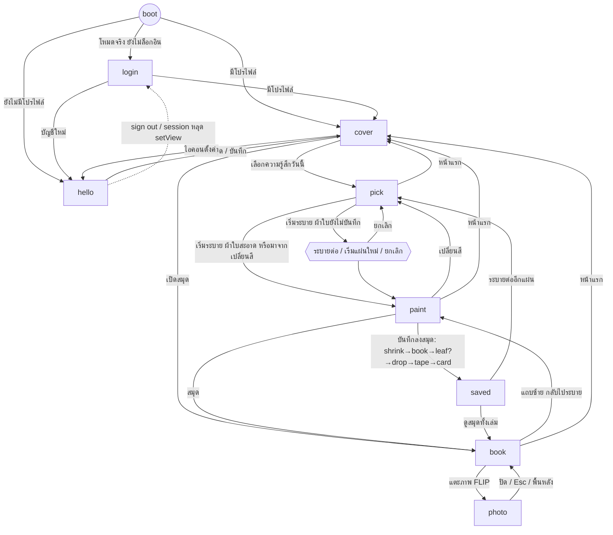

# ColorScrap — ภาพรวมโปรเจกต์ (อ่านจากโค้ดจริง)

> สถานะที่สรุป: branch `feature/download` ที่ commit `b199cc3` (2026-10-22), working tree สะอาด, push แล้ว
> เอกสารนี้ **อ่านและสรุปอย่างเดียว** ไม่ได้แก้ `src/` ไม่ได้ commit (ไฟล์นี้ยังเป็น untracked)
> อ้างอิงเป็น `ไฟล์:บรรทัด` บรรทัดหลักตรวจซ้ำกับโค้ดแล้ว (app.js, useHashView.js, motion.js, tokens.js, Stage.vue, `FluidCanvas.vue`, emotions.js, DebugPanel.vue) ส่วนที่มาจากการอ่านไฟล์อื่นอาจเลื่อนไม่กี่บรรทัด ข้อที่ไม่แน่ใจเขียนว่า **"ไม่แน่ใจ"**
> ไม่ได้อ่านค่าใน `.env*` ใด ๆ

---

## 1. Flow ผู้ใช้

### 1.1 กลไกเปลี่ยนหน้า
- **ไม่มี router** ใช้ view-store: `view` ใน Pinia `src/stores/app.js` (`VIEWS` บรรทัด 15: `login | hello | cover | pick | paint | saved | book | photo`)
- ตารางย้ายหน้าที่อนุญาต `ALLOWED` ที่ `app.js:30-39` บังคับโดย `go()` (`app.js:195`) ซึ่ง **ปฏิเสธขณะกำลังบันทึก** (`savePhase !== 'idle'`) ผลข้างเคียงตอนเข้าหน้าอยู่ที่ `enter()` (`app.js:147`): เข้า `book` เรียก `openBook()` (ยกเว้นมาจาก `saved`/`photo`) และเพิ่ม `bookTick` (ยกเว้นมาจาก `photo`), เข้า `paint` ผ้าใบสะอาดจะสาดสี (`dropOnSheet`)
- ปุ่ม back ของเบราว์เซอร์และการ sign-out ใช้ `setView()` (`app.js:205`) ซึ่งข้ามตาราง `ALLOWED` แต่เรียก `cancelSequences()` ก่อน ลำดับบันทึกเรียก `enter(VIEWS.saved)` ตรง ๆ (`app.js:327`, `:348`) จึงไม่ผ่าน `go()`
- ซิงก์กับ `location.hash` ที่ `src/lib/useHashView.js`: หน้าที่เปิดจาก hash ได้ `HASH_VIEWS` (บรรทัด 5) ไม่รวม `saved`; `accepts()` (บรรทัด 12) ปฏิเสธ `login` เมื่อล็อกอินแล้ว, ปฏิเสธหน้าอื่นเมื่อยังไม่มีโปรไฟล์ (ยกเว้น `hello`), `photo` ต้องมี `photoEntryId`; hash ที่ไม่รับถูกดึงกลับด้วย `replaceState` (บรรทัด 40) เปลี่ยนหน้าแต่ละครั้งสร้าง history entry ใหม่ (ตั้ง `location.hash` ตรง ๆ) จึงกด Back ได้
- boot (`app.js:211`): ยังไม่ล็อกอิน (โหมดจริง) → `login`, ไม่มีโปรไฟล์ → `hello`, อื่น ๆ → `cover` `main.js` รอ `auth.init()` + โหลดโปรไฟล์/รูปก่อน mount

### 1.2 เข้าครั้งแรก / ทำความรู้จัก
- ไม่มี onboarding แยก: ผู้ใช้ใหม่ลงที่ `hello` (`app.js:212`) กรอกชื่อ (1–20 ตัว), เลือกอวตาร, สีปกสมุด, "ชอบอะไร" (`HelloSheet.vue`) ปุ่ม "เริ่มใช้สมุด" (`CoverPreview.vue:7`) ปิดใช้งานจนมีชื่อ แล้ว `profile.save()` + `app.finishHello()` → `cover`
- โหมดแก้ไข: ไอคอนตั้งค่าที่ `cover` (`CoverIntro.vue:5` → `openSettings()` `app.js:215`) เปิดหน้าเดียวกัน ปุ่มเปลี่ยนเป็น "บันทึก" **ไม่มีปุ่มยกเลิก** ทางออกคือบันทึกหรือกด Back `AccountActions.vue` (ออกจากระบบ / ลบข้อมูลทั้งหมด กดสองครั้งใน 3 วิ) แสดงเฉพาะโหมดแก้ไขและเฉพาะโหมดจริง (`App.vue:22`)
- โหมด mock (ค่าเริ่มต้น `VITE_USE_MOCK !== 'false'`, `src/lib/supabase.js:4`) ไม่มีหน้า `login` โหมดจริงมี `LoginCard.vue` (เข้า/สมัครในการ์ดเดียว) และ watcher ใน `App.vue:82-92` เคลียร์ทุกอย่างเมื่อ sign-out หรือ session หลุด

### 1.3 แผ่นแทรก / ส่วนที่ไม่ใช่ view
- **Interstitial ที่หน้า pick** (`EmotionPalette.vue:66-74`): ถ้ามีผ้าใบที่ยังไม่บันทึกและมาจากหน้าแรก (ไม่ใช่ "เปลี่ยนสี") กด "เริ่มระบาย" แล้ว `beginPaint()` (`app.js:184`) คืน `'choose'` → ตัวเลือก "ระบายต่อแผ่นเดิม" / "เริ่มแผ่นใหม่" / "ยกเลิก"
- **แผ่นแทรกในสมุด:** 1 แผ่น (leaf) มี 4 ภาพ (`PHOTOS_PER_LEAF`, `app.js:27`) ภาพที่ 5 ของวันเปิดแผ่นใหม่ พลิกด้วย `LeafPager.vue` ลูกศร ป้าย "แผ่นใหม่" บนเทปจนกว่าผู้ใช้พลิก (`PhotoPage.vue:44`)
- **Overlay:** `LegacyPrompt.vue` (หน้า `cover`, เมื่อมีรูปเก่าที่ไม่มีเจ้าของใน IndexedDB, ปุ่ม "ย้ายขึ้น"/"ไม่ย้าย"), `Toast.vue`, `WarmNote.vue` (โน้ตชวนสีอุ่นบนหน้า `paint`)
- หน้า `saved` คือสมุดซูม (ขยาย 1.15 หน้าซ้าย) บวกการ์ด `SavedCard` เปิดจาก URL ไม่ได้ตั้งใจ

### 1.4 แผนภาพ

### 1.5 ปุ่มของแต่ละหน้า

| หน้า | ปุ่ม (ไฟล์:บรรทัด) | ผล |
|---|---|---|
| login | เข้าสมุด/สร้างสมุดใหม่ `LoginCard.vue:43`, ลิงก์สลับโหมด `:47` | → `cover` หรือ `hello` |
| hello | เริ่มใช้สมุด/บันทึก `CoverPreview.vue:7`; อวตาร/สีปก/ชิป `HelloSheet.vue:33,52,65`; ออกจากระบบ/ลบทั้งหมด `AccountActions.vue:6-7` | → `cover`; แก้โปรไฟล์; → `login` |
| cover | เลือกความรู้สึกวันนี้ `CoverIntro.vue:15`; เปิดสมุด `:16`; ตั้งค่า `:5` | → `pick`; → `book`; → `hello` |
| pick | หน้าแรก `EmotionPalette.vue:10`; 8 อารมณ์ `:32`; ระดับ 3 ชิป `:49`; เริ่มระบาย `:63` | → `cover`; เลือก; เลือก; → `paint` หรือ interstitial |
| paint | หน้าแรก `DrawingBoard.vue:26`; สมุด·วันนี้ N ภาพ `:29`; เปลี่ยนสี `MoodCard.vue:16`; ถาดเครื่องมือ `ToolTray.vue:15` (ปาดสี/เติมหยด/สีอุ่น*/เริ่มใหม่ กดสองครั้งใน 3 วิ); บันทึกลงสมุด `:27`; โน้ต "ลองดู"/"ไว้ก่อน" `WarmNote.vue:16-17` | → `cover`; → `book`; → `pick`; เปลี่ยนโหมด/ล้างผ้าใบ; → `saved`; |
| saved | ดูสมุดทั้งเล่ม `SavedCard.vue:61`; ระบายต่ออีกแผ่น `:62` | → `book`; → `pick` |
| book | หน้าแรก `App.vue:38`; แถบซ้าย "กลับไประบาย" `DrawingBoard.vue:52-60`; ช่องภาพ `PhotoSlot.vue:5`; แท็บวัน `DateTabs.vue:12`; ลูกศรแผ่น `LeafPager.vue`; วันก่อน/ถัดไป `DailyPalette.vue:52,56`; เก็บรูป `:21` | → `cover`; → `paint`; → `photo`; สลับวัน/แผ่น; ดาวน์โหลดการ์ดวัน |
| photo | ปิด `PhotoView.vue:25`, Esc `:134`, คลิกพื้นหลัง `:7`; เก็บรูปไว้ (การ์ดพร้อมชาร์ตสี / เฉพาะภาพ) `:52,56` | → `book`; ดาวน์โหลด/แชร์ PNG |

\* ปุ่ม "สีอุ่น" โผล่เฉพาะเมื่ออารมณ์ล่าสุดของแผ่นเป็นอารมณ์ลบ (`app.js:102`)

### 1.6 ข้อสังเกต
- โค้ดอนุญาต `paint → cover` และมีปุ่ม "หน้าแรก" แต่ตาราง SPEC §4.1 (`docs/SPEC.md:176-198`) ไม่มีเส้นนี้
- `paint → saved` ผ่าน `go()` ได้ตาม `ALLOWED` แต่ไม่มีที่เรียกใช้ (ลำดับบันทึกเข้า `saved` เอง) — โค้ดสำรองที่ไม่ได้ใช้
- ภาพ: `scripts/out/overview/` (ดูหัวข้อ 11)

---

## 2. แอนิเมชันและการเคลื่อนไหว

**โครง reduced-motion:** `reducedMotion` (ref ตาม `prefers-reduced-motion`, `src/lib/motion.js:8`), `ms(n)` = `min(n,150)` เมื่อลดการเคลื่อนไหว หรือ `n × TIME_SCALE` (บรรทัด 18), `?motion=slow` (dev) ตั้ง `TIME_SCALE=3` (บรรทัด 14) CSS ทั่วระบบ `src/assets/app.css:32-44` บังคับให้เหลือแค่ opacity/สี ระยะเวลา 150ms และเอาลูปออก บรรทัด 47-51 ตัด translate ของ `.card-enter-from` ค่าเวลาอยู่ที่ `MOTION` (`src/lib/tokens.js:54-63`): swap 450, settle 600, fade 150, ease `cubic-bezier(.2,.8,.2,1)`, reveal {170,150,600,350,400}, save {400,150,400,200,100,300}

| ชื่อ | เกิดตอนไหน | ไฟล์:บรรทัด | ระยะเวลา / easing | ทางเลือก reduced-motion |
|---|---|---|---|---|
| fade ของหน้า | login/hello/cover/ปุ่มหน้าแรกในสมุด, Toast, LegacyPrompt | `App.vue:15-27,36`, CSS `:116-124` | 450ms, ease ของ MOTION, opacity | มี (CSS ทั่วระบบ → 150ms) แต่ 450 ฮาร์ดโค้ด ไม่คูณ `--motion-scale` |
| card | `SavedCard` ปรากฏ (savePhase `card`/`idle` ที่ `saved`) | `App.vue:29-30`, CSS `:125-137` | 300ms × motion-scale, opacity + translateY 14px | มี (`app.css:47-51` ตัด translate) |
| เปิด/ปิดปกสมุด (Scrapbook) | ทุกครั้งที่ `view` เปลี่ยน ชั้นปกปิดกับชั้นสมุดเปิด | `Scrapbook.vue:5,19`, ตำแหน่ง `:45-61`, ซ่อน `:63-67` | 600ms `ease-desk` transform+opacity | มี: สถานะซ่อนอยู่กับที่แล้วจาง (`:64-65`) |
| DrawingBoard เต็มจอ ↔ แถบ 92px | เข้า paint / book,photo / หน้าอื่น | `DrawingBoard.vue:5,12,41,89-101` | 600ms `ease-desk` transform+clip-path+opacity | มี: ไม่เลื่อนออกนอกจอ แค่จาง (`:97`) |
| EmotionPalette เข้า/ออก | เข้า/ออก `pick` | `EmotionPalette.vue:4-5` | 600ms `ease-desk` opacity+translate-y-6 | มี (`motion-reduce:translate-y-0`) |
| การ์ดอารมณ์ hover/เลือก | hover, เลือก | `EmotionPalette.vue:29-31` | 450ms; hover หมุน −6° ขยาย 1.05; เลือกยก 5px | มี (`motion-reduce:hover:*`); hover เฉพาะอุปกรณ์ที่มี hover (`tailwind.config.js:6`) |
| HandButton tilt | hover เมื่อส่ง prop `tilt` | `HandButton.vue:9-10,28` | 450ms | ผ่าน CSS ทั่วระบบ; **ไม่มีที่ไหนส่ง `tilt` ในแอป** (พบเฉพาะนิยาม prop) |
| เลือกอวตาร | เลือกในหน้า hello | `HelloSheet.vue:33-34` | 450ms transform | ผ่าน CSS ทั่วระบบ |
| DateTabs | สลับวัน | `DateTabs.vue:9-10` | 450ms **`height`** (ขัดกฎ CLAUDE.md ว่าอนิเมตเฉพาะ transform/opacity/clip-path) | CSS ทั่วระบบทำให้ height กระโดด |
| พลิกแผ่น (leaf flip) | พลิกแผ่นในวันเดียวกัน | `PhotoPage.vue:8,85-96,119-152` | rotateX 70°/80° 450ms + opacity 300ms, perspective 1200 | มี (CSS + `ms()` → 150) เปลี่ยนวันข้ามอนิเมชัน; `leafFlipping` ล็อก `setLeaf` |
| จานสีของวัน (stagger) | เข้า `book` (key `app.bookTick`) ไม่เล่นซ้ำเมื่อกลับจาก photo/พลิกแผ่น/เปลี่ยนวัน | `DailyPalette.vue:97-100,150-184` | หน่วง 770/920/1070/1220ms; seep 600, rise 350, fade 400 | มี (สลับเป็น `pal-fade`, `:179-184`) |
| ลำดับบันทึก (store) | หลัง `saveToBook` | `app.js:292-375`, `src/lib/saveTimeline.js` | ไม่มีแผ่นใหม่ ~1550ms (shrink 0-400, book 150-750, drop 750-1150, tape 1150-1350, card 1250-1550); มีแผ่นใหม่ ~2000ms (คำนวณจาก MOTION.save เอง ไม่ใช่ค่าที่วัด) | มี: ไม่บินรูป เข้า `saved` ทันที ปล่อยหลัง 150ms (`app.js:323-334`) |
| SavedFlight (WAAPI) | `app.saveFlight` ถูกตั้ง | `SavedFlight.vue:49-72` | ตามตาราง saveSchedule, ease ของ MOTION, `fill:'both'` | ไม่ถูก mount เมื่อ reduced |
| Photo FLIP เปิด/ปิด | เข้า/ออก `photo` | `PhotoView.vue:4,162-202`, `src/lib/flip.js` | polaroid บิน 600ms; พื้นหลัง 450; การ์ดเลื่อน 24px หน่วง 150 / ปิด 400 | มี: จางด้วย `ms(swap)`=150 ไม่บิน (`:168,175,181`) |
| WarmNote | `warmNoteOpen` | `WarmNote.vue:3,31-50` | opacity 300 / transform 450 (ฮาร์ดโค้ด ไม่คูณ motion-scale) | มี media query ของตัวเอง |
| Toast | `toast.message` | `Toast.vue:3`, `stores/toast.js:19-20` | fade 450; ซ่อนเองหลัง 4 วิ | CSS ทั่วระบบ |
| สาดสีตอนเข้า paint | เข้า `paint` ผ้าใบสะอาด | `FluidCanvas.vue:384-431`, `splashMs` 1000 (`emotions.js:95`) | หยดทยอยลงใน 1 วิ ตามรูปแบบอารมณ์ | มี: ลงพร้อมกัน + จาง 150ms (`:431` ฮาร์ดโค้ด 150) |
| สีอุ่นบาน | แตะ/กดค้าง/"ลองดู" ด้วยเครื่องมือสีอุ่น | `FluidCanvas.vue:605-720` | เส้นโค้ง 3000ms (กดค้าง 900ms) ดูหัวข้อ 3 | มี: ยกสี 1 ครั้ง + ลงสีครั้งเดียว ไม่ดันน้ำ (`:705-714`) |
| น้ำแห้ง/นิ่ง | หลัง input ล่าสุด | `FluidCanvas.vue:198-259` | ไหลปกติ 2.5 วิ → ชะลอถึง 10 วิ | ไม่มีทางเลือกแยก (กลไกเดียวกัน) |
| ภาพการ์ด "หยดตกลงบ่อสี" | `SavedCard` | `SavedCard.vue:27-43` | **ไม่เคลื่อนไหว** เป็น SVG นิ่ง (คอมเมนต์พูดถึงน้ำกระเพื่อม แต่ไม่พบอนิเมชัน) | — |

ไม่มีการเปิดปกแบบ 3D/พลิกหน้า "เปิดปก" คือการ cross-fade + เลื่อนระหว่างสองชั้น

**ความไม่สม่ำเสมอ:** `.fade` กับ `WarmNote` ไม่ถูก `--motion-scale` คูณ (ทดสอบ `?motion=slow` จะไม่ช้าลง), `FluidCanvas` ใช้ `matchMedia` เอง (`:77`) ไม่ใช่ `lib/motion.js`, `DateTabs` อนิเมต height

---

## 3. การระบายสี

### 3.1 เครื่องมือ (`app.tool`, `stores/app.js:45`; ปุ่มที่ `ToolTray.vue:71-76`)
- **ปาดสี (ค่าเริ่มต้น):** ผลักน้ำอย่างเดียว ไม่ใส่สี (`queueSmear`→`pushWater` รัศมี `SMEAR_RADIUS` 0.25 `FluidCanvas.vue:54`; แรง `SMEAR_FORCE`/1112 ต่อพิกเซล `:62`) รวม pointermove ในเฟรมเดียวเป็นหนึ่งการผลัก `pushWater` (`:263`) เขียนลง velocity ของไลบรารีตรง ๆ
- **เติมหยด:** แตะ = `dropAt` ทิศสุ่ม ความเร็ว `60 × speed × strength` รัศมี `radius × 3` (`DROP_RADIUS_SCALE`, `:61`); เฉดสุ่มจาก `[base,base,base,deep,light]` (`emotionShades`, `emotions.js:116-122`) กดค้าง 400ms (`HOLD_MS`, `:50`) = หยดซ้ำทุก 120ms (`:51`) แรง 0.1 (`:52`) ขยับเกิน 8px ถือว่าลาก (`:53`) ใช้ได้กับทุกเครื่องมือ
- **สีอุ่น:** มีเมื่ออารมณ์ล่าสุดของแผ่นเป็น `NEGATIVE_EMOTIONS` (sad, angry, anxious, tired; `emotions.js:111`) เปลี่ยนเป็นอารมณ์บวกขณะเลือกอยู่ → กลับเป็นปาดสี (`app.js:104`) แตะ = `bloomAt` ถ้าเปิดบานให้อารมณ์นั้น (ดู 3.6) ไม่งั้นหยดเรียบ กดค้าง = บานนุ่มทุก ≥700ms (`HOLD_BLOOM_MS` `:58`) สีอุ่นสีเดียวต่ออารมณ์ (`WARM_TONES`, `emotions.js:128`) เฉดเปลี่ยนตามลำดับครั้ง (`warmShade`)
- **เริ่มใหม่:** ไม่ใช่โหมด กดสองครั้งใน 3 วิ (`ToolTray.vue:44`) → `clearCanvas()`
- **โน้ตชวน (WarmNote):** ครั้งเดียวต่อแผ่น เมื่อผ่านไป ≥ 10 วิ (`noteDelay`) นับจากแตะครั้งแรก และพักมือ ≥ 1.5 วิ (`noteIdle`) ("ลองดู" → `tryWarm()` `app.js:118` → หยดตัวอย่าง `tune.samples`=4 จุด ห่าง 280ms ที่ `FluidCanvas.vue:761`, จุดเลือกด้วย `pickSamplePoints` `:726`)

### 3.2 ค่าต่ออารมณ์ (`emotions.js:60-69`, `INITIAL_SPLATS` `:50`, `INTENSITY_FACTOR` `[0.6,1,1.5]` `:51`)
splash = [นิดหน่อย, พอประมาณ, มากเลย]

| อารมณ์ | brightness | speed | curl | velDiss | radius | splash | pattern | หยดเริ่มต้น | สีอุ่น | แรงดันบาน |
|---|---|---|---|---|---|---|---|---|---|---|
| happy | 2.0 | 1.3 | 18 | 0.35 | 0.15 | 1.06 / 0.65 / 0.43 | burst | 5 | — | — |
| calm | 1.8 | 0.5 | 6 | 0.5 | 0.20 | 1.01 / 0.92 / 0.76 | drift | 3 | — | — |
| excited | 2.0 | 1.4 | 30 | 0.3 | 0.12 | 0.62 / 0.42 / 0.33 | burst | 3 | — | — |
| warm | 2.0 | 1.0 | 12 | 0.4 | 0.22 | 0.93 / 0.71 / 0.67 | burst | 3 | — | — |
| sad | 1.7 | 0.5 | 8 | 0.5 | 0.18 | 0.92 / 0.80 / 0.78 | fall | 3 | `#F7DE99` | 1 |
| angry | 2.0 | 1.3 | 26 | 0.3 | 0.13 | 1.04 / 0.73 / 0.64 | pulse | 3 | `#F3DEA3` | 1 |
| anxious | 1.9 | 1.0 | 22 | 0.35 | 0.09 | 0.77 / 0.75 / 0.54 | scatter | 6 | `#F8D68E` | 0.78 |
| tired | 1.6 | 0.2 | 4 | 0.55 | 0.20 | 0.55 / 0.52 / 0.30 | still | 2 | `#F7DE99` | 0.92 |

`WARM_BLOOM` (`emotions.js:144`) เปิดครบ 4 อารมณ์ลบ, `WARM_PUSH_GAIN` ที่ `:146`

### 3.3 การสาดตอนเข้า paint (`FluidCanvas.vue:384-431`)
- จำนวน `want = INITIAL_SPLATS × level.count × splash[ระดับ]` (`:390`), `count = max(1, floor(want+0.2))` เศษไปอยู่ที่ขนาด (`fit`) รัศมี `radius × 3 × level.size × fit`; `SPLASH_LEVELS` (`emotions.js:85`) = นิดหน่อย {1.5, 1.2, 1.15}, พอประมาณ {3.0, 1.5, 1.25}, มากเลย {4.8, 2.2, 1.35} (count, size, spread)
- ทยอยลงใน `splashMs` = 1000ms; reduced → ลงพร้อมกัน; sad มีแรงถ่วงดันน้ำลง 4 วิ (`startGravity` `:450`, ไม่นับเป็น input ของการแห้ง); `emit('splash')` → `app.splashing` บล็อกการบันทึก
- **หมายเหตุ:** โค้ดของ pattern `pulse` ไม่ทำอะไรพิเศษ (หยดเว้นระยะเท่ากัน ทิศสุ่ม) แต่ `docs/FILE-GUIDE.md` พรรณนาว่า "เหลื่อมกัน 260ms" — ไม่ตรงกัน และตาราง splash ใน FILE-GUIDE (บรรทัด ~446-453) ใช้ค่าต่างจากโค้ด

### 3.4 น้ำสงบลงเอง
- เวลาในโลกจำลอง `simNow` (สะสม `min(dt,1/60)` ตอนวิ่ง) `dryProgress` (`FluidCanvas.vue:211`) = ease-in-out ของ `(simNow − lastInputAt − flowTime)/(dryTime − flowTime)` ด้วย `flowTime` 2.5, `dryTime` 10, `dryDamp` 6 (`emotions.js:95`); `applyDry` (`:216`) ตั้ง `velocityDissipation = velDiss + (dryDamp − velDiss)·e` และ `curl = curl·(1−e)` **ไม่แตะ density (=0 พอดี)** ไม่งั้นสีจางใน ~1 นาที (คอมเมนต์ `emotions.js:71-75`)
- พักการจำลอง: อ่านความเร็วน้ำสูงสุดแบบ async (PBO+fence) ทุก 0.5 วิ ถ้า < `STILL_SPEED` 0.15 → `goToSleep()` (`:251`) ยังเรนเดอร์ต่อเพื่อให้ `capture()` ได้ ไม่มี fence (WebGL1) ใช้ 20 วิ
- วัดแล้ว (session นี้ ไม่ได้เก็บในรีโป): หลังระบายปกติ 30 วิ แล้วปล่อย motion < 1 ที่ ~6.2 วิ และเข้าสถานะพักที่ ~8.2 วิ (ทั้งก่อนและหลังแก้สีอุ่น)

### 3.5 ตัวกันดำ
- shader GPU: `lib/dyeLimit.js` (`DYE_SPLAT_FRAG`) ลงสีเพิ่มเท่าที่ (ก) ช่องสูงสุด ≤ `gpuCap` 0.85 และ (ข) ความสว่างที่เห็น ≥ `minLight` 0.3 อย่างนุ่ม เหนือ `knee` 0.8 (`emotions.js:95`) ฝั่ง JS: `splatGpu` (`FluidCanvas.vue:311`) ลดหยดเดี่ยวให้ยอด ≤ cap, `buildProgram` (`:518`)
- **ตัวกัน CPU แบบเก่าถูกลบแล้ว** (commit b199cc3): ไม่พบ `takeInk/useShade/dyeSetting/blackGuard/warmCap` ใน `src`/`scripts` ถ้าสร้าง shader ไม่ได้ `splatGpu` คืน false = **ไม่ลงสีเลย** ไม่มีทางถอย
- แผนที่ ink (`FluidCanvas.vue:110`) ยังอยู่ แต่ใช้อ่านค่าเฉพาะใน `pickSamplePoints` (`:733`) เลือกจุด "ลองดู" (ไม่บล็อกหยดอีกแล้ว)

### 3.6 สีอุ่น และสถานะบัค "ฟุ้งซ้ำ"
- กลไกปัจจุบัน (`bloomAt` `:681`, `bloomFrame` `:634`, ค่าคงที่ `:605-616`): ที่ t=0 ดันวงนอก 6 จุด + ยกสีเดิมกลางวงครั้งเดียว แล้ว **เส้นโค้งเดียวต่อเนื่องจากเวลาจริง** อัตราลงสีขึ้นแบบ sin ถึงยอดที่ 250ms แล้วลดเป็นเส้นตรงถึง 0 ที่ `bloomMs` 3000ms (กดค้าง 900ms, ไม่มีดันวง/ยกก้อนแรก) รัศมี 0.55 → 1.05 โตอย่างเดียว ยกสีต่อเนื่อง (ระดับ 1.2× → 0.6× ของ `lift` ใน 1 วิ แล้วลดเหลือ 0) ดันน้ำเฉพาะ 500ms แรกทิศหมุน ~4 รอบต่อเส้นโค้ง ส่งทุก ≥ 30ms (ซ้อนกันเกิน 3 เส้นห่างขึ้น) ปริมาณรวมแตะ 1.85, กดค้าง 1.6 หน่วย
- **สถานะบัค:** แก้แล้วใน `7fbe909` (เดิมแบ่ง 4 หยดก้อน + ประคอง 5 ครั้ง หยดที่ 4 หนักสุดเห็นเป็นจังหวะที่สอง) วัดเทียบ `3d31f84` (motion ยอดเดียวที่ ~0.3–0.7 วิ; ของเดิมเด้งกลับ 5 ครั้ง +50–100%) ผู้ใช้ยอมรับผลรอบนั้น ความเหลือ: กระเพื่อมเล็ก (+0.005–0.01) ที่ปลายเส้นโค้ง, angry/anxious มีที่ราบ (curl สูง), ผลบนผ้าใบที่ระบายไว้แกว่ง ±15% แม้ของเดิม **ไม่แน่ใจ** ว่าตาเห็นจังหวะที่สองอีกหรือไม่บนเครื่องจริง (รอบนี้ไม่ได้ดูด้วยตา)

### 3.7 `?debug` / พารามิเตอร์ URL (dev เท่านั้น, ผ่าน `import.meta.env.DEV`)
- `?debug` (`App.vue:112`, `FluidCanvas.vue:74`): โหลด `DebugPanel.vue` (ล่างซ้าย 262px พับได้) และเปิด global `window.__fluid/__flowSpeed/__fluidSleeping/__dyeProgramOk`
- `?kit` (`App.vue:111`): แกลเลอรี UI kit · `?motion=slow` (`motion.js:14`): เวลา ×3 · `?shiftSpeed=N` (`FluidCanvas.vue:75`): เร่งเวลาโน้ตชวน ×N
- สลับ/แถบใน DebugPanel (ค่าแก้ในหน่วยความจำ ต้อง "คัดลอกค่า" ไปแก้ `emotions.js` เอง):
  - ต่ออารมณ์ (`FIELDS` `:85`): จำนวนหยด 1–12, ความเร็วหยด 0–3, curl 0–60, velDiss 0–2, ขนาดหยด 0.02–0.6, ความเข้ม 0.5–4, สาด× นิดหน่อย/พอประมาณ/มากเลย 0.1–3; ปุ่ม หยดสีเริ่มต้นใหม่ / คัดลอกค่า / รีเซ็ตเป็นค่าเริ่มต้น
  - ค่ากลาง (`GLOBAL_FIELDS` `:97`): เพดานขอบเข้มยกสี `inkCap` 0.2–1.5, CAP (GPU) 0.4–1, MIN_LIGHT 0–0.5, knee 0.2–0.95, density 0–0.01, เวลาจนแห้ง 4–30, ไหลปกติก่อนแห้ง 0.5–8, ความหน่วงตอนแห้ง 1–20, เวลาสาด 200–3000ms; ปุ่ม รีเซ็ตค่ากลาง
  - ระดับการสาด (`SPLASH_FIELDS` `:108`): จำนวนหยด× 0.3–6, ขนาดหยด× 0.5–3, ระยะกระจาย× 0.5–2 (3 ระดับ)
  - สีอุ่น (`WARM_FIELDS` `:126`): ขนาดหยด 0.1–3, ความเข้ม 0.5–5, จำนวนลองดู 1–10, เวลาก่อนโน้ตขึ้น 3–30, เวลาพักมือ 0.5–5, ความแรงยกสี 0–1, รัศมียกสี× 0.5–2, ขอบเข้ม 0–2, แรงดันวงขอบ 0–400, **เวลาบาน 500–5000ms, ความแรงสูงสุด× 0.2–3**; สวิตช์ "สีอุ่นแบบบาน"; ปุ่ม รีเซ็ตโน้ต
  - แถวข้อมูลเครื่อง (`INFO_ROWS` `:113`): WebGL, ชนิด texture, ความละเอียด, สถานะพัก, ความเร็วน้ำสูงสุด
  - ไม่มีแถบ: `WARM_BLOOM`, `WARM_PUSH_GAIN`, `WARM_TONES`, ค่า `BLOOM_*` ใน `FluidCanvas.vue:605-616`; ค่าสีอุ่นไม่ถูกรวมใน "คัดลอกค่า"

---

## 4. ข้อมูล

### 4.1 Supabase (`supabase/schema.sql`, รันมือใน SQL Editor, idempotent)
| ตาราง/ที่เก็บ | คอลัมน์สำคัญ | หมายเหตุ |
|---|---|---|
| `profiles` (`:8-16`) | `id` (→ auth.users), `display_name` 1-20, `avatar` (8 ค่า), `cover_color`, `likes text[]`, `created_at`, `updated_at` | trigger `set_updated_at` (`:38-52`) |
| `entries` (`:18-35`) | `id`, `user_id` (default `auth.uid()`), `local_date`, `local_time`, `emotion`, `emotions text[]` (ตัวท้าย = `emotion`), `intensity` 0-2, `colors jsonb` (1-5 ค่า `{hex, ratio}`), `shifted`, `image_path`, `thumb_path` | ดัชนี `entries_user_date` (`:37`) |
| bucket `paintings` (`:88-122`) | private, 5 MB, webp/jpeg/png | policy ตามโฟลเดอร์ `uid` |
- RLS เปิดทั้งสองตาราง แยก policy select/insert/update/delete ต่อบทบาท `authenticated` (`:56-86`) **SPEC §7 (`docs/SPEC.md:691-742`) ยังเป็นเวอร์ชันเก่า (`for all`)** ไม่ตรงกับ schema.sql

### 4.2 โหมดและการบันทึก
- `USE_MOCK = VITE_USE_MOCK !== 'false'` (`lib/supabase.js:4`): mock = ไม่ใช้เครือข่าย โปรไฟล์ใน `localStorage['colorscrap.profile']`, รูปใน IndexedDB (`lib/imageStore.js`) และมีรายการจำลอง 13 รายการ (`stores/entries.js:37-76`, วันหนึ่งมี 6 รายการทดสอบแผ่นแทรก)
- ต่อรายการบันทึก: `id` (uuid ฝั่งไคลเอนต์), `user_id`, วัน/เวลาท้องถิ่น, `emotion` (ล่าสุด) + `emotions[]` (ตามลำดับหยด), `intensity`, `colors`, `shifted` (ผู้ใช้หยดสีอุ่นเองในแผ่นนี้), `image_path`/`thumb_path` (ภาพเต็ม 1600px และ thumb 480px, WebP คุณภาพ 0.85 `lib/exportImage.js`)
- อัปโหลด (`stores/uploadQueue.js`, `lib/remote.js:62-82`): `addEntry` เพิ่มรายการทันที เก็บ record+Blob ใน IndexedDB ก่อน แล้ว `flush()` อัปภาพเต็ม → thumb → insert (ซ้ำได้ ถือ duplicate 23505 ว่าสำเร็จ) ล้มเหลว toast ครั้งเดียว retry 5/15/60/300 วิ และเมื่อ `online`; รอขณะแอนิเมชันบันทึก (`sequenceActive`)
- signed URL: cache TTL 3600s ต่ออายุเมื่อเหลือ < 5 นาที (`stores/imageUrls.js`); รูปเก่าก่อน step 7 ที่ไม่มี `user_id` ถามก่อนย้าย (`LegacyPrompt`, flag `colorscrap.legacyAsked.{uid}`)
- ลบทั้งหมด (`remote.js:93-107`) ลบไฟล์+แถว+โปรไฟล์ แต่ **user ใน auth ยังอยู่** (ต้องใช้ service role)

### 4.3 ดึงสีจากภาพ (`lib/extractColors.js`)
ย่อผ้าใบเหลือ 200px, `colorthief` v3 `getPaletteSync` 8 สี, ตัดพิกเซลใกล้สีกระดาษ (ระยะ RGB < 28), กำหนดแต่ละพิกเซลให้สีที่ใกล้สุดแล้วเก็บ ≤ 5 สี ratio ปัดเป็น 3 ตำแหน่งและปรับให้รวม 1 พอดี; ไม่มีพิกเซลที่ไม่ใช่กระดาษ → สีอารมณ์ ratio 1; error → สีอารมณ์ (`pickColors` ทดสอบหน่วยแล้ว)

### 4.4 จานสีของวัน (`lib/palette.js`, SPEC §8)
น้ำหนักต่อภาพ `0.75 + 0.25·intensity`; รวมสีใกล้กัน (RGB < 40) เฉพาะ `colorWeightsOfDay`/`dominantColorOfDay` (คะแนน = น้ำหนัก × ความอิ่มตัว) ส่วน `mixColors` ใช้สีดิบผสมใน HSL (hue เฉลี่ยวงกลม); ชื่อสีของวัน `nameOfDay(mixHex, lastLocalTime, entries)` = ช่วงเวลา + กลุ่มสี (9 กลุ่ม) + ตัวขยาย "อม…" (ต้องส่ง `entries`); ตัวอย่างใน SPEC §8.1/§8.2 เป็นเทสต์ `palette.test.js` บ่อผสม `lib/mixingWell.js` (6 ตำแหน่ง) ใช้ร่วมกับการ์ดวัน

### 4.5 เก็บรูป/แชร์ (`src/lib/share/`, SPEC §5.9) — สร้างฝั่งไคลเอนต์ทั้งหมด ไม่อัปโหลด
- Canvas 2D (`cards.js`, `cardDraw.js`) การ์ด 1080×1350 สองแบบ: การ์ดภาพ+ชาร์ตสี / เฉพาะภาพ (PhotoView) และการ์ดจานสีของวัน (DailyPalette); ไม่ใช้ html-to-image/foreignObject เพราะ Safari; เลียนลายมือด้วย value-noise (SVG filter ใช้ใน canvas ไม่ได้); โหลดฟอนต์ด้วยตัวอย่างภาษาไทย (`loadCardFonts`)
- `shareOrDownload`: จอสัมผัสใช้ Web Share, คอมพิวเตอร์ดาวน์โหลดเสมอ (`isTouchDevice`), คืน `shared|cancelled|downloaded|blocked`; `NotAllowedError` เก็บไฟล์ไว้แล้ว toast "แตะเพื่อบันทึก" (`stores/share.js:17-35`); ชื่อผู้ใช้บนการ์ดผ่าน `maskName` (ตัวแรก + ไม่เกิน 3 `•` + ตัวท้าย นับ grapheme)

---

## 5. หน้าตา (design token) และจุดที่ไม่สม่ำเสมอ

### 5.1 Token ที่ใช้จริง (`src/lib/tokens.js`, `tailwind.config.js`, `src/styles/tokens.css`)
- **สี** (`tokens.js:4-16`): desk `#E6E3DC`, board `#D3CEC4`, paper `#FBFAF6`, paper-deep `#EFEDE8`, ink `#2D2B33`, ink-2 `#3E3C45`, ink-soft `#5E5B66`, line `#CFCBC3`, tape `rgba(230,215,176,.9)`, note `#FFFBEF`, warm-tint `#FFF4DE`; ปก 4 สี (`:19-24`) `#9E2F2A #2F5D50 #E0704A #34323A`; อารมณ์ (`:27-36`) happy `#F1BE48` calm `#5FA3C8` excited `#E2688A` warm `#CF8A4A` sad `#4256A8` angry `#D6453A` anxious `#6E4FA0` tired `#5B6773`
- **ฟอนต์** (`tailwind.config.js`): `hand` = Mali, Itim · `body` = IBM Plex Sans Thai Looped, Noto Sans Thai · `mono` ระบบ **โหลดจริงเฉพาะ Mali (400-700) และ IBM Plex Sans Thai Looped (400-600)** (`index.html:9`) Itim/Noto เป็น fallback ที่ไม่ถูกโหลด; ต้องมีเน็ตเพื่อฟอนต์
- **ขนาดตัวอักษร** (`tokens.js:38-49`): 13, 14, 15, 16, 17, 19, 26, 38, 44, 52 · เวที 1280×800 (`:51`)
- **มุมโค้ง:** `rounded-hand` 18/22/16/24, `hand-sm` 16/20/14/18, `hand-lg` 26/30/24/28, `chip` 999px · **เงา:** `photo` `0 3 10 .18`, `card` `0 10 28 .16`, `book` `0 22 44 .30` · ฟิลเตอร์ `wob/wc/wcm/wct/wcs` (`tailwind.config.js:52-60`)
- **CSS variable:** `--cover`, `--cover-spine`, `--cover-strap` (ตั้งตอนรันจากสีปก `App.vue:104-109`), `--motion-scale` (`tokens.css:1-7`)

### 5.2 จุดที่ไม่สม่ำเสมอ (จากการ grep/อ่านจริง)
- **สีฮาร์ดโค้ดนอก token:** เทา `#8E8A93` ใน `HelloSheet.vue:19`, `LoginCard.vue:24,36`, `EmptySlot.vue:3`, `BookCover.vue:29`, `PhotoPage.vue:21,22,42`, `DayTimeline.vue:9,12`, `SavedCard.vue:32`, `DailyPalette.vue:107`, `cards.js:253`; `#C4C0B7` ใน `EmptySlot.vue:3`, `WeekStrip.vue:2`, `PhotoPage.vue`; ชุด `#DCD6CC/#F1EEE8/#E4DFD6/#FFFFFF` ซ้ำใน `MixingWell.vue:7-9,16`, `SavedCard.vue:33-35`, `PhotoPage.vue:5,26`, `cards.js`; อื่น ๆ `#C8C2B7` (`ToolTray.vue:3`), `#FDFCF9`, `#6B5A33` (`PhotoPage.vue`), `#F0EEE9`, `rgba(241,190,72,.28)` (`HelloSheet.vue:34`)
- **ค่า token ที่ถูกเขียนซ้ำเป็นตัวอักษร:** `#2D2B33` ใน `EmotionBlob.vue`, `SavedCard.vue`, `DayTimeline.vue`, `HelloSheet.vue:53`; `#3e3c45` (`PhotoView.vue:293`); `#5fa3c8` (`app.css:24`); `#FBFAF6` (`lib/share/exporter.js:41`); การ์ด canvas ประกาศชุดสีเองที่ `cardDraw.js:10-15`; สีอุ่น/สีเฉด (`#1a1a22`, `#D9A33F`, `WARM_TONES`) อยู่ใน `emotions.js` ไม่ใช่ `tokens.js` (นโยบาย "token ที่เดียว" ใน CLAUDE.md จึงไม่ครอบคลุม)
- **ไม่พบตัวแปร `--e-*`** ที่ SPEC §10 กล่าวถึง
- **เงา:** ใช้ token แค่ ~6 จุด ที่เหลือเป็น `shadow-[...]` เขียนเองหลายแบบ (rgba ต่างกัน `BookCover.vue:26,35,44` ใช้ `rgba(0,0,0,..)`) และ `EmotionPalette.vue:22` มีเงากับกล่องเดียวทั้งที่ SPEC บอกให้ใช้กับวัตถุที่ซ้อนเท่านั้น (`docs/SPEC.md:127`)
- **ขนาดนอกสเกล:** `text-[12px]` (`PhotoView.vue:61`, `DayTimeline.vue:13`), `[18px]` (`SavedCard.vue:61`, `EmotionPalette.vue:17`), `[20px]` (`MoodCard.vue:9`), `[42px]` (`BookCover.vue:28`), `[13px]` ซ้ำ token `text-13` (`DayTimeline.vue:20,26`); ขนาดและฟอนต์ของการ์ด canvas ฮาร์ดโค้ดใน `cards.js:164,167,258,282,412,442` และ `cardDraw.js:241,256`
- **ปุ่มคนละแบบ:** `HandButton` (primary/secondary/chip/icon, `HandButton.vue:35-43`) กับปุ่มที่เขียนเอง: "ลองดู" `WarmNote.vue:16` (รัศมี 14/16/12/18), ปุ่มใน Toast `Toast.vue:12` (14/18/12/16), ปุ่มบันทึกถาด `ToolTray.vue:26` (16/20/14/22, ไม่มี `wob`, ไม่ใช่ HandButton), ปุ่มเครื่องมือ `rounded-[14px]`, "เก็บรูป" `DailyPalette.vue:16-25`, `.save-btn` ใน `PhotoView.vue:265-295` (scoped CSS), ไทล์อารมณ์/อวตารมีรัศมีเฉพาะ; ปุ่มข้อความ (เปลี่ยนสี `MoodCard.vue:16` สูงแค่ 32px ต่ำกว่า 44px ที่ปุ่มอื่นใช้, ไว้ก่อน, ยกเลิก, สลับ login) มีขนาดและสีไม่เท่ากัน; รัศมีมุมโค้งแบบ arbitrary มีราว 15 สตริงต่างกัน ขณะที่ token ถูกใช้แค่ `hand` 1 จุด, `hand-sm/lg/chip` จุดละครั้ง
- **focus ring** ฮาร์ดโค้ด `#5fa3c8` ขอบประ 3px (`app.css:23-26`)
- **คุณลักษณะที่ไม่ใช้:** prop `tilt` ของ HandButton ไม่มีที่ใช้นอกชุดสาธิต

---

## 6. เสียง
**ไม่มีเลย** ค้นหา `Audio`, `.mp3/.wav/.ogg`, `howler`, `AudioContext`, `Tone`, `vibrate`/`haptic` ใน `src`, `index.html`, `package.json` ไม่พบ; `public/` มีแค่ `favicon.ico`, `src/assets/` มีแค่ `app.css` ไม่พบข้อกำหนดเสียงใน SPEC/FILE-GUIDE/specs (ค้น "เสียง"; ไม่ได้ตรวจ `docs/design/*.html`)

---

## 7. รองรับอุปกรณ์
- **เป้าหมาย** (`docs/SPEC.md:27`): PC/Mac และ iPad แนวนอน ทั้งเมาส์และนิ้ว
- **เวที:** `Stage.vue` กล่อง 1280×800 อยู่กลางจอ `translate(-50%,-50%) scale(s)` (`:12`), `s = min(innerWidth/1280, innerHeight/800)` (`:31`) คำนวณตอน mount และ `resize` เท่านั้น (`:36`) — **ไม่ฟัง `orientationchange`/`visualViewport` ไม่จำกัดสูงสุด** (จอใหญ่จะขยายเกิน 1) `body` เป็น `overflow-hidden` (`app.css:14`) ภาพ 1180×820 (iPad) ในหัวข้อ 11 แสดงว่าเวทีย่อลงมีขอบเว้นบนล่าง
- **สัมผัส/pointer:** ผ้าใบใช้ Pointer Events + `touch-none` (`FluidCanvas.vue:7-16`) หลาย pointer ผ่าน Map (`:95`), `setPointerCapture`, แปลงพิกัดผ่าน `getBoundingClientRect` ชดเชยสเกลของเวที, เมาส์ที่ `buttons===0` ถือว่าปล่อยแล้ว, `canvas{touch-action:none}` (`app.css:18-20`); ความละเอียดสี 512 บนจอสัมผัส (`maxTouchPoints > 1`) 768 บนอื่น (`FluidCanvas.vue:840`); hover จำกัดเฉพาะอุปกรณ์ที่มี hover
- **ไม่พบ:** การล็อกซูม, `touch-action: manipulation` นอกผ้าใบ, `user-select`, safe-area, `viewport-fit`, จัดการแนวตั้ง, และการจำกัด `devicePixelRatio` ที่ SPEC `:206` ระบุให้ ≤ 2 (เป็นข้อสังเกตจาก grep ไม่ได้ทดสอบบนเครื่องจริง; เรื่อง dpr **ไม่แน่ใจ** ว่าไลบรารีจำกัดเอง)
- **ปัญหาที่รู้แล้ว/ข้อควรระวัง:** SVG filter `wob` บนพื้นที่ใหญ่/ของที่เคลื่อนไหวตลอด/ข้อความยาวหนักบน iPad Safari (CLAUDE.md:29); อนิเมตเฉพาะ transform/opacity/clip-path; เก็บรูปบนจอสัมผัสเปิดหน้าแชร์ ถ้า gesture หาย (`NotAllowedError`) ใช้ toast "แตะเพื่อบันทึก"; เปิดผ่าน `http://IP:5173` ไม่ใช่ secure context บาง API (เช่น clipboard ของแผง debug) ใช้ไม่ได้ (`FILE-GUIDE.md:889-895`)
- **ทดสอบบน iPad จริง:** SPEC (บรรทัด ~885, 960) ระบุว่ายังเป็นงานทดสอบมือ ไม่พบบันทึกผลว่าทำแล้ว — **ไม่แน่ใจ**

---

## 8. คุณภาพ

### 8.1 เทสต์ (รัน `npm test` ล่าสุด: **10 ไฟล์ 94 เทสต์ ผ่านทั้งหมด**; `npm run build` ผ่าน)
| ไฟล์ | เทสต์ | ครอบคลุม |
|---|---|---|
| `src/lib/palette.test.js` | 38 | `mixColors` (ค่า hex ตรงตัวอย่าง SPEC), `nameOfDay`, `hueGroup`/`periodOf`, `timelineX`/`spreadXs`, `percentsOf`, `dominantColorOfDay`, `chunk`, `sameColorName` |
| `src/lib/saveTimeline.test.js` | 9 | `saveSchedule`, `slotCenter`, `flightPoses` |
| `src/lib/dyeLimit.test.js` | 8 | ต้นแบบ JS ของตัวกันดำ GPU `limitScale` |
| `src/lib/share/shareOrDownload.test.js` | 9 | แชร์/ยกเลิก/บล็อก/ดาวน์โหลด, ตรวจจอสัมผัส |
| `src/lib/share/maskName.test.js` | 9 | ปิดชื่อ ไทย/อีโมจิ/ค่าสำรอง |
| `src/lib/share/formatThaiDate.test.js` | 6 | วันที่ไทย + ชื่อไฟล์ |
| `src/lib/extractColors.test.js` | 5 | `pickColors` เท่านั้น |
| `src/dev/fluidMetrics.test.js` | 5 | `measureInk`, `meanAbsDiff`, `colorCentroids` |
| `src/lib/uuid.test.js` | 3 | `uuid()` |
| `src/lib/flip.test.js` | 2 | `flightTransforms` |

(บน `main` มีเทสต์แค่ 5 ไฟล์: extractColors, flip, palette, saveTimeline, uuid)

### 8.2 ที่ยังไม่มีเทสต์
Store ทั้ง 8 ตัว (`app`, `auth`, `entries`, `imageUrls`, `profile`, `share`, `toast`, `uploadQueue`), `lib/remote.js`/`supabase.js`/`imageStore.js`, คอมโพเนนต์ `.vue` ทั้งหมด (~40 ไฟล์ รวม `FluidCanvas.vue` ที่ใหญ่สุด), `extractColors()` ตัวจริง (ทดสอบแค่ `pickColors`), `exportImage.js`, `mixingWell.js`, `emotions.js`, `useHashView.js`, `share/cards.js`/`cardDraw.js`/`exporter.js` — ตรงกับ CLAUDE.md ("pure-function tests only, no component tests") ตัวกันดำ GPU ฝั่ง shader จริงทดสอบเฉพาะต้นแบบ JS

### 8.3 สคริปต์ใน `scripts/` (Playwright ติดตั้งนอกรีโป ไม่อยู่ใน `package.json`)
- `measure-fluid.mjs` (227 บรรทัด): หยดสี/แตะ/กดค้าง/สาดเริ่มต้น แล้ววัด ink พื้นที่ ตำแหน่ง ค่าต่างระหว่างเฟรม ตัวเลือก `--emotions --seeds --times --replace MODULE=`
- `measure-fps.mjs` (158 บรรทัด): fps เฉลี่ยและ 1% low สามกรณี (ว่าง/แตะทุก 150ms/ลาก) 5 วิต่อกรณี
- `render-cards.mjs` (95 บรรทัด): เรนเดอร์การ์ดตัวอย่างลง `scripts/out/` (git-ignored)

### 8.4 ผลวัด FPS ล่าสุด
**ไม่พบในรีโป** (ไม่มีไฟล์ผลลัพธ์/ตัวเลขใน docs; `docs/specs/watercolor-drying.md:70` ระบุเกณฑ์ "ไม่ต่ำกว่าผลรอบก่อน" เท่านั้น) ตัวเลขเดียวที่มีคือจากรอบแก้สีอุ่น (ไม่ได้เก็บในรีโป): แตะสีอุ่นรัว 120 วิ (480 ครั้ง) ได้ **60 fps ทั้งก่อนและหลัง** เฟรมช้าสุด 20ms → 26ms (วัดด้วยสคริปต์ชั่วคราวใน headless Chrome บน Mac ไม่ใช่ iPad)

---

## 9. ปัญหาที่รู้แล้ว / TODO / โค้ดที่ไม่ได้ใช้

**ไม่มี TODO/FIXME/XXX/HACK ใน `src`** รายการด้านล่างมาจากการอ่านโค้ดและเอกสาร

### 9.1 ปัญหา/ข้อจำกัด
- ถ้าสร้าง shader ตัวกันดำไม่ได้ ผ้าใบ **ไม่ลงสีเลย** (ไม่มีทางถอย หลังลบ CPU) — ความเสี่ยงบนเครื่องแปลก ๆ
- สีอุ่นบาน: กระเพื่อมเล็กที่ปลายเส้นโค้ง, angry/anxious มีที่ราบ, ผลบนผ้าใบที่ระบายไว้แกว่ง ±15% (3.6)
- ห้าม `Infinity`/`NaN` เข้าสูตรแรงดันน้ำ (ผ้าใบขาวทั้งผืน) — ข้อจำกัดเชิงออกแบบ (CLAUDE.md:42)
- ลายมือ SVG (`src/assets/hand/`, `vite-svg-loader`) ยังเป็น placeholder (`docs/SPEC.md:855,865`); `lib/fluid/` ไม่มี ใช้ไลบรารี `webgl-fluid-enhanced` (`SPEC.md:240`)
- นอกขอบเขต (SPEC §13): ตกแต่งอิสระ, สรุปรายสัปดาห์/เดือน, เส้นเดือดของสี, dark mode, แชร์ลิงก์ (`SPEC.md:964-969`)
- ลบข้อมูลทั้งหมดไม่ลบบัญชี auth (ต้อง service role)
- SPEC step 10 (ขัดเกลา: reduced-motion, ทดสอบ iPad, accessibility, ออฟไลน์) มีหลักฐานเพียงบางส่วน — **ไม่แน่ใจ** ว่าเสร็จ; `docs/specs/watercolor-drying.md` ไม่มีบันทึกผลเกณฑ์ผ่านครบ — **ไม่แน่ใจ**
- `#saved` เปิดจาก URL ไม่ได้ (ตั้งใจ, `FILE-GUIDE.md:117`)

### 9.2 โค้ด/ของที่ไม่ได้ใช้ (ตรวจด้วย grep)
- **ตัวกันดำ CPU แบบเก่า: ลบแล้ว** (b199cc3) เหลือแค่ข้อความอธิบายเหตุผลใน SPEC (`:587`), FILE-GUIDE (`:484`), CLAUDE.md (`:36`)
- คอมเมนต์ค้างที่ `FluidCanvas.vue` ราว `:551` ("null/false → ถอยไปแบบ CPU เก่า" ซึ่งไม่มีแล้ว) และคอมเมนต์ราว `:55-57` ที่ผสมประวัติกับพฤติกรรมปัจจุบัน (**ไม่ได้แก้ — รอบนี้อ่านอย่างเดียว**)
- `inkCells` คืน `centreIndex` (`:134`) ที่ไม่มีใครใช้
- export ที่ไม่มีผู้เรียก: `defaultsOf` (`emotions.js:100`); ใช้ภายในไฟล์เดียว: `EMOTION_KEYS`, `WARM_DEFAULTS`, `LUMA`; ใช้เฉพาะเทสต์: `visibleLight`, `limitScale`; `INK_CAP` ใช้ใน `emotions.js` และ `scripts/measure-fluid.mjs`
- `go('saved')` จาก paint อยู่ใน `ALLOWED` แต่ไม่มีที่เรียก; prop `tilt` ของ `HandButton` ไม่มีที่ใช้
- ไม่พบไฟล์ใน `src/lib` หรือ `src/components` ที่ไม่มีผู้ import (ไฟล์เทสต์/สคริปต์ตั้งใจแยก)
- **เอกสารไม่ตรงโค้ด:** RLS ใน SPEC §7 (`for all`) vs `schema.sql` (แยกสี่ policy); pattern `pulse` และตาราง splash ใน FILE-GUIDE (ข้อ 3.3); ตาราง §4.1 ไม่มี `paint → cover`

---

## 10. สถานะ git (ณ ตอนเขียน)
- **branch:** `feature/download` = `origin/feature/download` (b199cc3, 2026-10-22) tree สะอาด ไม่มี commit ค้าง push
- **main:** `0426f37` (2026-10-02, commit เอกสาร Tech stack) `origin/main` ตรงกัน
- **tag:** `tuning-v1` (ec262b7), `tuning-v2` (71e94f1), `pre-gpu-cap` (8b49648), `backup/animations-before-rebase`, `backup/main-before-animations`
- **commit ล่าสุด:** `b199cc3` ลบตัวกันดำ CPU+สวิตช์, `7fbe909` สีอุ่นบานเป็นเส้นโค้งเดียว, `3d31f84` เอกสารตัวกันดำ GPU, `6998ba9` สีอุ่นสีเดียวต่ออารมณ์, `9db50bd` ย้ายตัวกันดำไป GPU, `8b49648` สีอุ่นบาน (ชั้น 2), `4dc5bd5` แก้สีอุ่นไม่ออก, `169e500` เก็บรูปใช้หน้าแชร์เฉพาะจอสัมผัส, `822ff11`/`b6d20da`/`0c7a1e2`/`5cb80f0` การ์ดเก็บรูปและปุ่ม
- **อยู่ใน main:** งานแอนิเมชัน (`feature/animations` เป็นบรรพบุรุษของ main) เทสต์ 5 ไฟล์
- **ยังไม่อยู่ใน main (23 commit):** `feature/fluid-tuning` ทั้งหมด (จูนน้ำไหล: density 0, น้ำแห้ง, แผง `?debug`, สคริปต์วัด), ฟีเจอร์เก็บรูป/แชร์ (`src/lib/share/*`, `stores/share.js`, ปุ่มใน PhotoView/DailyPalette), ตัวกันดำ GPU, สีอุ่นสีเดียวต่ออารมณ์ + บาน, เอกสาร `docs/specs/`, เทสต์เพิ่ม 5 ไฟล์ รวม **46 ไฟล์ +3816/−248** (ใหญ่สุด `FluidCanvas.vue`) ไม่มีอะไรใน `main` ที่ `feature/download` ไม่มี (merge ได้โดยไม่ conflict ในเชิงประวัติ — ไม่ได้ลองรัน merge)

---

## 11. ภาพหน้าจอ
เก็บใน `scripts/out/overview/` (git-ignored) ถ่ายด้วย Playwright (Chrome) โหมด mock **รอ `document.fonts.ready` ก่อนทุกภาพ** และไม่บล็อกฟอนต์ (เห็น Mali จริง; สคริปต์ตรวจ `document.fonts.check` ผ่านทุกภาพ)

| ไฟล์ | สถานะ |
|---|---|
| `01-hello-ผู้ใช้ใหม่` | ผู้ใช้ใหม่กรอกชื่อ/อวตาร/สีปก |
| `02-cover` | หน้าแรกของสมุด |
| `03-hello-แก้ไขโปรไฟล์` | โหมดแก้ไขโปรไฟล์ (ปุ่ม "บันทึก") |
| `04-pick`, `05-pick-เลือกเศร้า` | เลือกอารมณ์/ระดับ |
| `06-paint-ผ้าใบเปล่า` | ผ้าใบเปล่า |
| `07-paint-ระหว่างสาดสี`, `08-paint-หลังสาดสี` | ระหว่างและหลังสาดสี (sad) |
| `09-paint-โน้ตชวนสีอุ่น` | โน้ตชวน (เปิดด้วย `warmNote='open'` ไม่รอ 10 วิ) |
| `10-paint-สีอุ่นบาน` | หลังแตะสีอุ่นหนึ่งครั้ง |
| `11-pick-ถามระบายต่อหรือแผ่นใหม่` | interstitial |
| `12-save-ระหว่างบันทึก`, `13-saved-การ์ดหลังบันทึก` | ลำดับบันทึก (ถ่ายที่ ~0.65 วิ) และการ์ดผลลัพธ์ |
| `14-book-วันนี้`, `15-book-วันที่มีแผ่นแทรก`, `16-book-แผ่นแรกของวันนั้น` | สมุด/แผ่นแทรก |
| `17-photo-ดูภาพเดี่ยว` | ดูภาพเดี่ยว |
| `ipad-01-paint-หลังสาดสี`, `ipad-02-book` | **1180×820 (iPad)** |
| `contact-sheet.png` | แถว 1: ทุกหน้า 1280×800 · แถว 2: iPad 1180×820 (ระบายหลังสาดสี + สมุด) |

**ไม่ได้ถ่าย:** หน้า `login` (ต้องใช้โหมดจริง `VITE_USE_MOCK=false` + Supabase) และ `LegacyPrompt` (เกิดเฉพาะโหมดจริงเมื่อมีรูปเก่าไม่มีเจ้าของ) ภาพ `09` เปิดโน้ตด้วยการตั้งสถานะตรง ๆ ไม่ได้รอตัวจับเวลาจริง ภาพ iPad เป็นการจำลองขนาดหน้าต่างด้วย Chrome ไม่ใช่ iPad Safari จริง

---

## ถ้ามีเวลาอีก 3 วัน — จุดที่คุ้มที่สุดในมุมมองของผม
(ชั่วโมง = ประมาณการของผม · ความเสี่ยง = ต่อของที่ทำงานอยู่แล้ว · เห็นไหม = ผู้ใช้เห็นความต่าง)

| # | งาน | ชม. | ความเสี่ยง | ผู้ใช้เห็น |
|---|---|---|---|---|
| 1 | ทดสอบบน iPad Safari จริงทั้งสมุด: วัด FPS (ผ้าใบ + บันทึก + เก็บรูป), จดผลลง repo, แก้ที่พบ | 6–8 | ต่ำ (เป็นการวัด) | เห็น (ถ้าพบปัญหา) |
| 2 | ให้ผ้าใบมีทางถอยเมื่อ shader ตัวกันดำสร้างไม่ได้ (ลงสีแบบไม่มีตัวกัน หรือข้อความแจ้ง) + เทสต์ shader บนเครื่องที่มี | 2–3 | ต่ำ | เห็น (เฉพาะเครื่องที่ล้มเหลว) |
| 3 | เทสต์ store/คิว: `app.js` (ตารางย้ายหน้า, ลำดับบันทึก, `cancelSequences`), `uploadQueue` (retry/online), `entries` (merge/legacy) ด้วย Vitest + mock | 8–10 | ต่ำ (เพิ่มเทสต์ ไม่แตะโค้ด) | ไม่เห็น |
| 4 | รีวิวแล้ว merge `feature/download` เข้า `main` (23 commit, 46 ไฟล์) + ทดสอบ regression ผ่านหน้าทั้งหมดและเก็บรูป | 3–4 | กลาง (diff ใหญ่ที่ `FluidCanvas.vue`) | ไม่เห็น |
| 5 | รวมสี/ปุ่ม/มุมโค้ง/เงา/ขนาดตัวอักษรที่หลุด token เข้า `tokens.js` + ใช้ `HandButton` ให้ปุ่มที่เขียนเอง | 8–10 | กลาง (เปลี่ยนหน้าตาเล็ก ๆ ทั่วแอป ต้องดูภาพเทียบ) | เห็น (เล็กน้อย) |
| 6 | เสริมการทนทานบนจอสัมผัส: ล็อกซูม/double-tap, `touch-action`, safe-area, ฟัง `orientationchange`/`visualViewport`, จำกัด dpr ≤ 2 | 3–4 | กลาง (ผูกกับการวางเวทีและพิกัดผ้าใบ) | เห็น (บน iPad) |
| 7 | ฟอนต์ใช้ได้ออฟไลน์ (self-host Mali/IBM Plex) เหมาะกับงานแสดงที่เน็ตไม่เสถียร | 2–3 | ต่ำ | เห็น (เมื่อเน็ตหลุด) |
| 8 | ลายมือ SVG จริงแทน placeholder (`src/assets/hand/` + loader) ตามดีไซน์ใน `docs/design/` | 10–14 | กลาง | เห็น (มาก) |
| 9 | เก็บกวาดเอกสารและโค้ดค้าง: คอมเมนต์ CPU เก่า, export ที่ไม่ใช้ (`defaultsOf` ฯลฯ), SPEC §7 RLS / pulse / ตาราง splash / เส้น `paint→cover` | 3–4 | ต่ำ | ไม่เห็น |
| 10 | เสียงเบา ๆ (หยดน้ำ/กระดาษ) ที่ปิดได้ — ทำเมื่อเหลือเวลา | 4–6 | ต่ำ (แยกเป็นโมดูลเดียว) | เห็น (ได้ยิน) |
